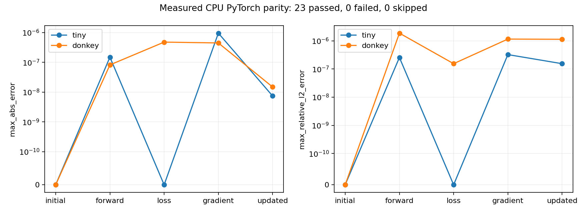

# A100 空闲窗口实验（进行中）

分支：`experiment/a100-gpu-complete`，基于 `f5cf9c8ffc7c039c2e99d473ba17b6e6e4696012`。

用户追加授权从 2026-10-28 16:41:09 UTC 监控八小时，截止 2026-10-29 00:41:09 UTC（北京时间 08:41）。每 30 秒检查八张卡，只选择显存为零、利用率为零、无计算进程并经十秒再次确认的设备；UUID 映射为逻辑 GPU 0。空闲检查不构成调度预约，实际启动前再次检查。没有强占或终止其他用户进程。

## 当前证据与状态

| 实验 | 状态 | 证据 |
|---|---|---|
| PyTorch 安装、导入及依赖兼容性 | PASS | environment/install-pytorch-01.log、pip-check-01.log、torch-import-01.log |
| 三组主机回归 | PASS：23 passed / 0 failed / 0 skipped | pytorch-parity/pytest-01.log、tests-01.xml |
| TinyNet / DonkeyNet PyTorch 数值对齐 | PASS：两个参数化测试实际执行 | pytorch-parity/numeric-comparisons-01.jsonl、summary.csv |
| PyTorch CUDA tensor 验证 | NOT_RUN，等待空闲 GPU | CPU 导入检查隐藏了 GPU，不能代替 CUDA 验证 |
| GEMM 正式实验 | NOT_RUN，预检发现 CuPy API 兼容错误，修复待 GPU 验证 | 原始失败目录 runs/gpu_window_gemm_pilot_monitor_02 |
| Conv/Pooling、GPU 训练、Nsight、预训练网络 | NOT_RUN | 等待空闲 GPU |
| 真实 DonkeyCar / 分类迁移训练 | BLOCKED：未取得数据路径 | environment/tool-data-inventory.json；只检查了用户常用目录 |

## 环境与主机对齐

Ubuntu 20.04.6，A100-PCIE-40GB，驱动 535.247.01，系统 Toolkit 12.2.2；项目 `.venv` Python 3.8.10、NumPy 1.24.4、CuPy 12.3.0、PyTorch 2.4.1+cu121、torchvision 0.19.1+cu121。PyTorch 自带 CUDA 12.1 运行库，与系统 Toolkit 版本分开记录。`pip check` 无依赖冲突。未安装系统级软件。

官方安装组合来源：[PyTorch previous versions](https://docs.pytorch.org/get-started/previous-versions/)。精确安装命令、起止时间、完整输出见 environment 目录的日志及配套 command.json。主机运行隐藏所有 GPU：

```bash
source docs/experiments/a100-stage2a-gemm/environment/activate.sh
python -m pip install --cache-dir .venv/pip-cache --only-binary=:all: torch==2.4.1 torchvision==0.19.1 --index-url https://download.pytorch.org/whl/cu121
PYTHONPATH="$PWD/docs/experiments/a100-gpu-window/scripts:$PWD" PYTEST_ADDOPTS='-p parity_audit' HYTORCH_NUMERIC_AUDIT=/新的唯一输出路径/numeric.jsonl python -m pytest tests/test_cuda_host.py tests/test_conv2d_gemm_cpu.py tests/test_gemm_blocked_packed.py -v -rs
```

全部初始参数逐元素完全相同。最大绝对误差（对应原始数值，完整逐参数相对 L2 误差与容差见 CSV/JSONL）：

| 模型 | Forward | Loss | 梯度 | SGD 更新后 |
|---|---:|---:|---:|---:|
| TinyNet | 1.4901161e-7 | 0 | 9.5367432e-7 | 7.4505806e-9 |
| DonkeyNet | 8.1956387e-8 | 4.7683716e-7 | 4.4703484e-7 | 1.4901161e-8 |

前向/Loss/更新容差 atol=1e-6、rtol=1e-5；梯度 atol=1e-5、rtol=1e-4。没有放宽已有容差。`tests/test_cuda_host.py` 新增初始化和 Loss 显式断言，并给已有断言标注名称。审计插件记录后仍调用原始 NumPy 断言。



## 已发现问题

GEMM 预检在设备 5 真正空闲时启动，但 `ndarray.get(out=target, blocking=True)` 在 CuPy 12.3.0 不接受 blocking 参数。原始异常完整保存在服务器 `runs/gpu_window_gemm_pilot_monitor_02/benchmark.log`。按已安装版本接口删除该参数，不传 stream 的 get 默认同步；保持原本同步 D2H 计时口径。修改 benchmarks/bench_cuda_gemm.py，尚待下一次 GPU 预检确认，不宣称已通过。

原始日志保存在 `/home/xymo/projects/hytorch/runs/`，本目录同步适合 Git 管理的记录。完整索引见 [files.md](files.md)。后续每阶段单独记录，不把主机数值对齐解释为 GPU 性能证据。
