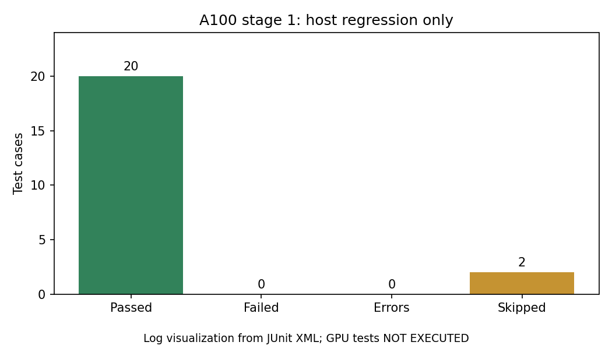

# A100 阶段 1 实验记录（部分完成，等待空闲 GPU）

记录日期：2026-10-28 UTC。项目工作目录 `/home/xymo/projects/hytorch`，实际路径 `/srv/lab-disks/disk2/users/xymo/projects/hytorch`。
源代码基线提交：`edb6fbe3bfaa9eed461addd29e6943b22e28216e`。本次分支：`experiment/a100-stage1`。

## 目标及状态

本阶段只验证 CUDA 环境、主机回归、CUDA 编译、GPU 正确性及 TinyNet 合成数据训练链路。不执行正式性能 benchmark、真实 DonkeyCar 训练、Nsight、ImageNet 或 Unity 适配。

| 关卡 | 实测状态 |
| --- | --- |
| 独立环境与依赖 | 完成；CuPy 可导入，`pip check` 无依赖冲突 |
| 主机回归 | 20 passed / 0 failed / 0 errors / 2 skipped；2.18 秒 |
| GPU 选择 | 尚未选择：两次检查均显示 8 张卡有其他计算进程 |
| CUDA 编译及库加载 | NOT_EXECUTED，等待空闲设备 |
| GPU 正确性验收 | NOT_EXECUTED；没有 PASSED/EXECUTED 结论 |
| TinyNet GPU 烟测 | NOT_EXECUTED；Loss、dispatch_counts、训练时间均无实测值 |
| GitHub 上传 | 本地分支已创建；推送预检因缺少凭据失败，尚未上传 |

用户确认先完成环境及主机测试，待 GPU 空闲后再使用。没有用 skipped 冒充 GPU 通过，没有使用任何 GPU 做计算，没有自动进入第二阶段。

## 环境

| 项目 | 实测值 |
| --- | --- |
| 操作系统 | Ubuntu 20.04.6 LTS，Linux 5.15.0-139-generic |
| CPU | 2 × AMD EPYC 7763；128 物理核 / 256 逻辑 CPU |
| GPU | 8 × NVIDIA A100-PCIE-40GB；每张 40960 MiB；物理编号 0–7 |
| NVIDIA 驱动 | 535.247.01；驱动显示支持 CUDA 12.2 |
| CUDA Toolkit | `/usr/local/cuda-12.2`；Toolkit 12.2.2，nvcc 12.2.140 |
| CUDA Runtime | 12.2，`cudaRuntimeGetVersion=12020`；系统组件版本见原始记录 |
| Python / GCC | 3.8.10 / 9.4.0 |
| NumPy / CuPy | 1.24.4 / cupy-cuda12x 12.3.0 |
| pytest | 8.3.5 |
| 虚拟环境 | 项目内 `.venv`，独立于其他项目 |
| 线程限制 | OMP_NUM_THREADS=4，OPENBLAS_NUM_THREADS=4 |
| 当前设备映射 | 主机任务 `CUDA_VISIBLE_DEVICES=''`，没有逻辑或物理 GPU 被选中 |

CuPy 12.3.0 的选择基于 Python 3.8 和 CUDA 12.2 的兼容范围，参见 [CuPy 12.3 安装说明](https://docs.cupy.dev/en/v12.3.0/install.html)。导入及配置检查不等于 GPU 数值验收。

两次占用快照分别见 `environment/system-info.txt` 和 `environment/gpu-availability-02.txt`、`environment/gpu-processes-02.txt`。第二次观察的 GPU 利用率为 79%–100%，每张卡均有计算进程；不把显存较少的物理 GPU 7 当作空闲卡。具体采集时间在同名 `.command.json` 中。未来选卡应记录物理编号及 UUID，仅暴露选定 UUID；该卡在进程中映射为逻辑 `--device 0`。

## 安装过程及问题处理

未使用 sudo，未修改共享系统配置。由于系统 Python 没有可用的 ensurepip，使用 `python3 -m venv --without-pip .venv` 创建环境，再用已有的 Python 3.8 get-pip 脚本为新环境安装 pip。该脚本从 Udacity 项目只读使用，没有修改该项目。未执行 SHA256、MD5 或其他哈希验证。

首次 requirements 安装失败：fastrlock 0.8.4 从源码构建时找不到 `Python.h`。原始错误保留在 `environment/install-requirements.log`（退出码 1）。改用 `--only-binary=:all:` 后解析到兼容的 fastrlock 0.8.3 wheel，第二次安装成功（退出码 0），见 `environment/install-requirements-02-wheels.log`。没有安装系统开发包，也没有修改 HyTorch 源码。

随后 `pip check` 输出 `No broken requirements found.`。完整包版本在 `environment/python-packages.txt`，CuPy/Runtime 配置在 `environment/python-info.txt`。无 CUDA Bug 修复记录：CUDA 编译和 GPU 测试尚未执行，不能声称不存在 CUDA Bug。

## 主机测试

在隐藏所有 GPU 的环境中执行：

```bash
cd /home/xymo/projects/hytorch
source docs/experiments/a100-stage1/environment/activate-host.sh
python -m pytest tests/test_cuda_host.py tests/test_conv2d_gemm_cpu.py tests/test_gemm_blocked_packed.py -q -ra --junitxml=docs/experiments/a100-stage1/host-tests/tests.xml
```

结果：22 项，20 passed、0 failed、0 errors、2 skipped，pytest 报告 2.18 秒，JUnit 记录 2.183 秒。没有失败后修改测试或数值容差。

两项跳过均位于 `tests/test_cuda_host.py:114`：

- `test_torch_parity_forward_backward_update[tiny-shape0]`
- `test_torch_parity_forward_backward_update[donkey-shape1]`

原因均为 `could not import 'torch': No module named 'torch'`。本环境未安装可选 PyTorch，对照测试尚未验证，不能算作通过。完整 stdout/stderr 在 `host-tests/pytest.log`，逐项结果在 `host-tests/tests.xml`，计数在 `host-tests/summary.json`。



图像由 JUnit 原始结果生成，生成器为 `make_host_figure.py`。没有训练 Loss 或 GPU 监控曲线，因为尚无相应实验数据。

## 后续关卡及尚未解决的问题

1. 等待真正空闲且允许使用的 A100，记录物理编号、UUID、逻辑映射及新占用快照。不能抢占已有计算进程。
2. 选定单卡后运行 `python scripts/build_cuda.py --device 0`，核对 A100 架构 sm_80、实际编译命令和动态库加载；每次构建立即归档 build.log/build.json，失败记录不得被后续重试覆盖。本轮未生成 libhytorch_cuda.so。
3. 运行 `python scripts/validate_cuda.py --device 0 --output runs/gpu_acceptance_01`；输出目录如存在则选新的唯一目录。必须实际通过 GEMM、Conv2d 前向/梯度、Pooling、tile 16/32、非连续输入、非默认 stream 等测试，并检查 PASSED 和 EXECUTED。
4. 只有正确性通过后才运行用户指定 TinyNet 烟测。静态检查发现 `benchmarks/bench_cuda_training.py` 默认计算数据及权重 SHA256；运行前需提供显式关闭摘要的选项以遵守本次“禁止哈希验证”的要求。目前没有执行该脚本，也没有改动其默认逻辑。数值误差和有限 Loss 检查必须保留。
5. 烟测后保存 config.json、summary.json、steps.jsonl、hardware.jsonl 和完整运行日志；核对实际 dispatch_counts、有限 Loss、训练时间和监控样本。该脚本目前逐步日志不含 Loss，需在运行前补充真实逐步 Loss 记录才能绘制逐步曲线；不凭空插值。合成数据结果不能解释为自动驾驶训练成效。
6. Git 推送凭据尚未配置，预检原始错误在 `environment/git-push-preflight.log`。服务器未安装 gh；尚未创建 PR。应用 GitHub 插件连接与本机 Git 认证要分别验证。

阶段 1 未完成前不提出 CUDA 加速收益结论。下一阶段先共同分析完整阶段 1 数据；本次不执行正式 benchmark。

## 原始文件索引与复现

所有以下文件均位于 `/home/xymo/projects/hytorch/docs/experiments/a100-stage1/`（实际路径见本文开头）。完整原始日志留在服务器，适合 Git 管理的本目录文件已准备提交；`.venv`、CPU 构建文件和缓存不进入提交。

| 路径 | 内容 |
| --- | --- |
| `environment/system-info.txt` | OS、CPU、驱动、Toolkit、初始 GPU 占用完整记录 |
| `environment/gpu-availability-02.txt` / `gpu-processes-02.txt` | 第二次逐卡占用及计算进程原始记录 |
| `environment/install-pip.log` | venv pip 安装日志 |
| `environment/install-requirements.log` | 原始安装失败日志 |
| `environment/install-requirements-02-wheels.log` | wheel 安装修复成功日志 |
| `environment/python-packages.txt` / `pip-check.log` | 完整依赖版本和兼容性检查 |
| `environment/python-info.py` / `python-info.txt` | Python/CuPy/Runtime 采集器及输出 |
| `environment/activate-host.sh` | 本项目主机测试环境变量配置 |
| `environment/git-push-preflight.log` | 缺少 GitHub 凭据的推送预检错误 |
| `host-tests/pytest.log` / `tests.xml` / `summary.json` | 全部主机测试 stdout/stderr、逐项状态、计数 |
| `figures/host-results.png` / `generation.log` | 主机测试结果图（日志可视化）及生成日志 |
| `commands.md` | 已记录命令与退出码、耗时索引 |
| `*.command.json`（各子目录） | 对应日志的完整 argv、cwd、环境变量、UTC 时间和退出码 |
| `run_logged.py` | 拒绝覆盖原日志的命令记录工具 |
| `make_host_figure.py` | 从实际 JUnit XML 生成汇总与图像 |

`build/`、`validation/`、`smoke/` 暂无结果文件；没有用占位数据冒充脚本产物。后续实验应使用新的日志和输出路径，保留现有所有文件。
