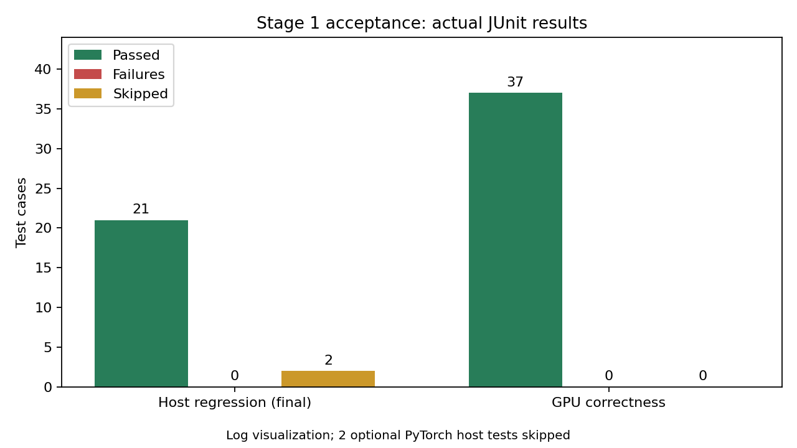
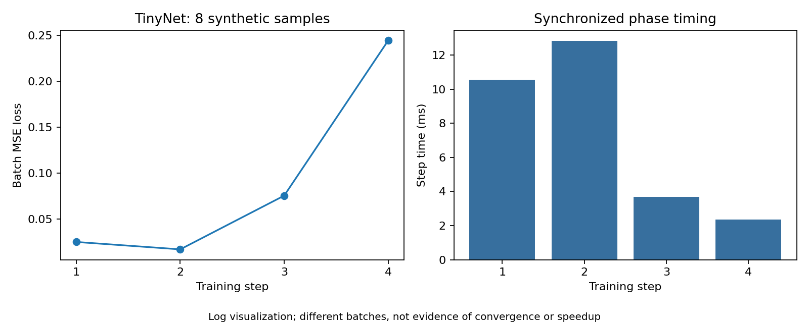
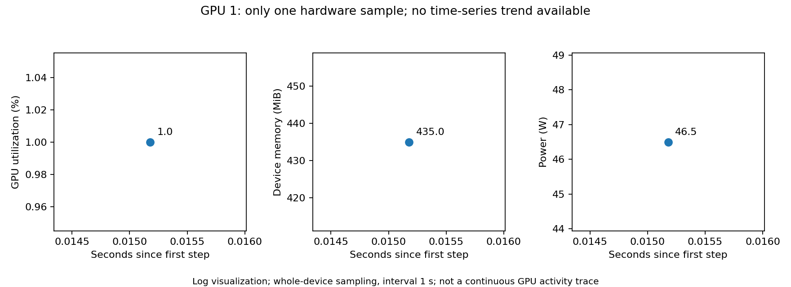

# HyTorch A100 阶段 1：环境、编译与正确性验收

**阶段 1 核心关卡已完成并通过；主机侧有 2 项可选 PyTorch 对照跳过，不能算作通过。** CUDA 编译、动态库加载、37 项 GPU 正确性测试和 TinyNet GPU 烟测均已真实执行。未执行正式性能 benchmark、真实 DonkeyCar、Nsight、ImageNet 或 Unity 适配，不宣称 CUDA 加速收益。

实验日期：2026-10-28（Asia/Shanghai）。GPU 编译和烟测在北京时间 23:12–23:15 完成；原始记录保留 UTC 时间。仓库工作目录 `/home/xymo/projects/hytorch`，实际路径 `/srv/lab-disks/disk2/users/xymo/projects/hytorch`。源代码基线 `edb6fbe3bfaa9eed461addd29e6943b22e28216e`，分支 `experiment/a100-stage1`。第一批环境/主机记录提交为 `06f8993`，当时状态保存在 [README-host-only.md](README-host-only.md)，该历史记录不代表当前状态。

## 实验状态

| 关卡 | 实测结果 |
| --- | --- |
| 独立环境 | requirements-cuda.txt 和 CuPy 安装成功；pip check 无依赖冲突 |
| 初始主机回归 | 20 passed / 0 failed / 2 skipped，pytest 2.18 s |
| 修改后主机回归 | 21 passed / 0 failed / 2 skipped，pytest 0.79 s；新增无哈希/Loss 日志检查 |
| CUDA 编译 | 成功，sm_80 + compute_80 PTX，生成 libhytorch_cuda.so |
| 动态库加载 | 成功，ABI=1；ldd 无缺失依赖 |
| GPU 正确性 | 37 passed / 0 failed / 0 skipped，4.71 s；PASSED / EXECUTED |
| TinyNet GPU 烟测 | COMPLETED / EXECUTED，8 样本、batch=2、4 步，所有 Loss 和最终权重有限 |



## 环境与设备映射

| 项目 | 实测值 |
| --- | --- |
| OS / CPU | Ubuntu 20.04.6，Linux 5.15.0-139-generic；2 × AMD EPYC 7763，128 物理核 / 256 逻辑 CPU |
| GPU | 8 × NVIDIA A100-PCIE-40GB，每张 nvidia-smi 显示 40960 MiB |
| 本次物理 GPU | **1**，UUID `GPU-c6683db1-d2aa-97b9-c1b4-e497bd7ff0c5`，PCI `0000:25:00.0` |
| 进程内逻辑 GPU | **0**，CuPy 可见设备数=1，compute capability=80 |
| NVIDIA 驱动 | 535.247.01，驱动支持 CUDA 12.2 |
| Toolkit / nvcc | `/usr/local/cuda-12.2`，Toolkit 12.2.2 / nvcc 12.2.140 |
| Runtime | CUDA 12.2，Runtime API 返回 12020；CuPy 编译版本亦为 12020 |
| Python / GCC | 3.8.10 / 9.4.0 |
| NumPy / CuPy / pytest | 1.24.4 / cupy-cuda12x 12.3.0 / 8.3.5 |
| 虚拟环境 | `/home/xymo/projects/hytorch/.venv` |
| 线程设置 | OMP_NUM_THREADS=4，OPENBLAS_NUM_THREADS=4 |

最初两次检查 8 张卡均有其他计算进程，按用户要求先完成主机工作。第三次检查物理 GPU 0–3 均为 0 MiB / 0% 且无计算进程；选物理 GPU 1，通过 UUID 设置 `CUDA_VISIBLE_DEVICES`，未使用其他卡。详见 [空闲快照](environment/gpu-availability-03.txt)、[进程快照](environment/gpu-processes-03.txt) 和 [实际可见设备/库加载记录](environment/selected-gpu.txt)。未使用 sudo 或修改系统环境。CUDA、CuPy 和绘图缓存均指向项目目录。

烟测结束、整理报告期间，物理 GPU 1 已被其他用户进程重新使用（PID 1336263，后续占用约 29734 MiB）；见 `environment/gpu-after.txt`、`gpu-after-processes.txt`、`gpu-after-owners.txt`。本轮 GPU 命令均已退出，没有遗留训练进程，也未再启动 GPU 计算。

安装记录包含原始失败：fastrlock 0.8.4 源码编译缺少 `Python.h`。通过 `--only-binary=:all:` 选择 fastrlock 0.8.3 wheel 后成功，未安装系统开发包。完整失败与成功日志分别为 `environment/install-requirements.log` 和 `environment/install-requirements-02-wheels.log`。CuPy 版本选择依据 [CuPy 12.3 安装兼容说明](https://docs.cupy.dev/en/v12.3.0/install.html)。完整环境和 Python 包列表见 `environment/system-info.txt`、`python-packages.txt`、`python-info.txt`。

## 实际命令与复现

从项目根目录执行。日志包装器 `run_logged.py` 保存完整合并 stdout/stderr、原始 argv、cwd、UTC 起止时间、环境及退出码，拒绝覆盖已存在日志。下列输出目录本轮已经使用；重跑必须换新目录。GPU 环境脚本记录的是本轮选择，不构成未来占用许可，重跑仍须先检查空闲情况。

```bash
cd /home/xymo/projects/hytorch
source docs/experiments/a100-stage1/environment/activate-host.sh
python -m pytest tests/test_cuda_host.py tests/test_conv2d_gemm_cpu.py tests/test_gemm_blocked_packed.py -q -ra --junitxml=docs/experiments/a100-stage1/host-tests/tests-02.xml

source docs/experiments/a100-stage1/environment/activate-gpu.sh
python scripts/build_cuda.py --device 0
python docs/experiments/a100-stage1/environment/gpu-info.py
ldd hytorch/backends/cuda/build/libhytorch_cuda.so

PYTHONPATH="$PWD/docs/experiments/a100-stage1:$PWD" \
PYTEST_ADDOPTS='-p numeric_audit' \
HYTORCH_NUMERIC_AUDIT="$PWD/docs/experiments/a100-stage1/validation/numeric-comparisons-01.jsonl" \
python scripts/validate_cuda.py --device 0 --output runs/gpu_acceptance_01

python benchmarks/bench_cuda_training.py \
  --device cuda --model tiny --samples 8 --batch 2 \
  --matmul shared --conv im2col --pool native \
  --no-fingerprints --output runs/gpu_smoke_01
```

初始安装命令及主机记录在 [commands.md](commands.md)，后续所有记录和精确参数在 [commands-gpu.md](commands-gpu.md)。数值审计插件参数补充在 `validation/audit-config.json`。验证插件只记录 NumPy 断言的误差，再调用原断言；未修改测试、容差或失败行为。

## 主机回归

原始结果为 20 passed / 2 skipped。新增 `--no-fingerprints` 与逐步 Loss 日志后，回归为 21 passed / 2 skipped，0 failed、0 errors；JUnit 时间分别为 2.183 s、0.797 s（pytest 控制台显示精度不同）。两次原始日志和 XML 均保留，没有覆盖。

跳过项均位于 `tests/test_cuda_host.py:114`，因为 `No module named 'torch'`：

- `test_torch_parity_forward_backward_update[tiny-shape0]`
- `test_torch_parity_forward_backward_update[donkey-shape1]`

可选 PyTorch 对照尚未验收。本次未安装 PyTorch、PaddlePaddle。新增测试将 SHA256 函数替换为一旦调用就失败的检查，实际验证关闭选项不会计算哈希，并验证逐步 Loss 与 epoch 加权平均一致。该测试在 CPU 上执行，与 GPU 烟测分开记录。

## CUDA 编译与 GPU 正确性

第一次 CUDA 编译即成功，没有失败重编译。`build/build.json` 保存实际 nvcc 命令，包含 `-gencode=arch=compute_80,code=sm_80` 和 `-gencode=arch=compute_80,code=compute_80`。编译命令总墙钟时间 2.403225569 s，含 Python/CuPy 启动，不单独等同于 nvcc 用时。`build/build.log` 为空表示 nvcc 没有输出；完整终端记录在 `build/terminal-01.log`。

动态库位于服务器 `hytorch/backends/cuda/build/libhytorch_cuda.so`，实际加载成功，ABI=1，链接 `/usr/local/cuda-12.2/lib64/libcudart.so.12`；未上传该二进制文件。

GPU 验收 `runs/gpu_acceptance_01/environment.json` 为 `status=PASSED`、`gpu_status=EXECUTED`。37 项测试覆盖 24 组 GEMM（basic/blocked/shared、tile 16/32、矩形与非整块形状、非默认 stream）、非连续视图/别名与类型拒绝、8 组 Conv2d 前向与梯度（stride/padding/bias）、Pooling 负数/重复值/padding 梯度和 NaN 首索引、框架 Linear 原生前向及原有反向。

共记录 68 次数值断言；每次的实际最大绝对误差、相对 L2 误差、shape、容差在 `validation/numeric-comparisons-01.jsonl`，汇总在 `validation/numeric-summary.csv`：

| 比较类别 | 比较数 | 最大绝对误差 | 最大相对 L2 误差 |
| --- | ---: | ---: | ---: |
| GEMM 形状/stream/tile/实现 | 24 | 5.7220458984375e-6 | 1.039333044668398e-7 |
| GEMM 非连续视图 | 1 | 0 | 0 |
| Conv2d 前向/梯度/CPU 参照 | 36 | 1.220703125e-4 | 1.1032500108105566e-7 |
| Pooling 前向/梯度 | 4 | 0 | 0 |
| 框架 Linear 前向/梯度 | 3 | 1.862645149230957e-7 | 5.072673034909718e-8 |

两列最大值分别取组内最大，不必来自同一次断言。GEMM 主要比较 atol=rtol=2e-5；Conv2d 与 CuPy 前向/梯度比较 atol=2e-3、rtol=2e-4，CPU 前向参照 atol=rtol=1e-4；Pooling 使用精确数组相等。特殊 NaN/索引、别名及类型测试另以原始测试断言验收，不能只用这 68 次浮点比较替代。

## TinyNet GPU 烟测

使用合成数据、FP32、SGD lr=0.001、seed=42、1 epoch、8 样本、batch=2，预热 2 次后恢复初始参数并清零 dispatch 计数。结果 `COMPLETED / EXECUTED`，4 个训练步骤。`config.json` 中 `status=RUNNING` 是脚本启动时的配置快照；最终状态以 `summary.json` 为准。

| 项目 | 实测值 |
| --- | ---: |
| Epoch 平均 Loss | 0.09037914965301752 |
| 第 1 / 2 / 3 / 4 步 Loss | 0.02499586157500744 / 0.01695609651505947 / 0.07541865110397339 / 0.24414598941802979 |
| gemm_shared / conv_im2col / pool_native | 8 / 4 / 4 |
| 训练循环墙钟时间 | 0.032655687071383 s |
| 四步计时总和 / 平均 | 0.029390851967036724 s / 0.007347712991759181 s |
| 各步耗时 | 10.549286 / 12.814799 / 3.678622 / 2.348145 ms |
| 完整命令墙钟时间 | 4.755440400913358 s，含初始化、预热、保存等 |

逐步 Loss 在 `smoke/losses.jsonl`，各阶段时间在 `smoke/steps.jsonl`。Step 计时不含之后的标量转换和日志写入，训练循环墙钟时间包含这些开销。`smoke/checks.json` 确认 Loss、最终权重均有限，逐步 Loss 加权均值与 summary 一致，必需 dispatch 均非零。所有数据/权重哈希字段为 null，`data_fingerprint=DISABLED`；没有执行本次禁止的哈希验证。



不同步骤使用不同 batch，4 点曲线不证明收敛或真实任务效果。该合成数据烟测仅验证 GPU 执行链路。

监控间隔 1 s，训练循环仅约 33 ms，实际只有 **1 个整卡采样点**：利用率 1%、显存 435 MiB / 40960 MiB、温度 35°C、功率 46.5 W；系统 CPU 13.6%、进程 RSS 427.91796875 MiB。采样错误列表为空。1% 不是本轮 GPU 是否执行的判据；真实执行由设备数组、CUDA 库测试及 dispatch 证明。一个点不构成时间趋势，不延长实验来制造曲线，不把整卡采样值当成精确进程峰值。



所有图像均由原始日志生成，不是真实终端截图。

## 修改、问题与验证

没有发现需要修改 kernel 或 CUDA wrapper 的数值 Bug；CUDA 编译和 GPU 测试第一次即通过。这只限定于本轮测试覆盖范围。

| 修改文件 | 原因和结果 |
| --- | --- |
| `benchmarks/bench_cuda_training.py` | 原脚本默认计算数据/权重 SHA256，且不保存逐步 Loss；增加 `--no-fingerprints` 和 `losses.jsonl`，保留原有有限值检查与计时边界。默认哈希行为未改变，本次明确关闭；关闭摘要的运行仅用于本轮烟测，不能直接用于要求初始状态/数据摘要一致的性能对照 |
| `tests/test_cuda_host.py` | 增加关闭哈希及真实 Loss 记录测试；主机结果从 20 passed / 2 skipped 变为 21 passed / 2 skipped |
| `docs/experiments/a100-stage1/` | 保存全部安装、环境、编译、数值误差、训练、监控、失败日志及生成图像的脚本 |
| 根 `README.md` | 更新实测完成状态，链接本报告 |

安装失败根因为 fastrlock 源码包需要未安装的 Python 头文件，wheel 重试解决；原错误、两次退出码和完整日志保留。早期推送预检曾缺少凭据，用户配置内存凭据后预检通过，未将 Token 写入项目或报告。

## 完整数据路径与文件索引

服务器完整原始数据根目录：`/home/xymo/projects/hytorch/docs/experiments/a100-stage1/`。另保留脚本原始输出 `/home/xymo/projects/hytorch/runs/gpu_acceptance_01/` 和 `/home/xymo/projects/hytorch/runs/gpu_smoke_01/`，上传的文本数据是对应文件的原样副本。模型权重 `runs/gpu_smoke_01/final_weights.npz`、动态库、虚拟环境及缓存仅留在服务器，不进入 Git。

| 子目录 | 关键文件 |
| --- | --- |
| `environment/` | system-info.txt、python-packages.txt、python-info.txt、selected-gpu.txt、三次 GPU 占用记录、安装失败与成功日志、pip-check.log、activate-host.sh、activate-gpu.sh |
| `host-tests/` | pytest.log / tests.xml / summary.json（原始）；pytest-02.log / tests-02.xml / summary-02.json（最终） |
| `build/` | build.log、build.json、terminal-01.log、dynamic-dependencies.log |
| `validation/` | environment.json、tests.log、tests.xml、summary.json、terminal-01.log、numeric-comparisons-01.jsonl、numeric-summary.csv、audit-config.json |
| `smoke/` | config.json、summary.json、steps.jsonl、hardware.jsonl、losses.jsonl、checks.json、terminal-01.log |
| `figures/` | acceptance-results.png、tinynet-loss-and-time.png、gpu-monitor-sample.png；保留历史 host-results.png 和两次生成日志 |

完整逐文件可点击索引在 [files.md](files.md)。每个命令日志旁的 `.command.json` 保存精确命令、环境、时间和退出码。所有原始失败记录和之前的实验文件保留。

## 交付与下一阶段建议

实验分支：[experiment/a100-stage1](https://github.com/i025/hytorch/tree/experiment/a100-stage1)。提交 ID 由最终回复和 Git 历史给出，避免在提交自身中写入循环引用。服务器无 GitHub CLI，因此没有通过 gh 创建 PR；可使用 [分支比较/创建 PR 页面](https://github.com/i025/hytorch/compare/main...experiment/a100-stage1)。

尚未解决或尚未覆盖：两项可选 PyTorch 对照跳过；硬件监控仅一个点；未做更大形状、长时间稳定性或真实任务验收。启动时出现“未找到 scipy，无法加载 SVHN 数据集”的仓库提示；本次使用合成数据，没有加载 SVHN，不影响本轮测试。

下一步先共同分析本阶段误差、Loss 和计时范围，决定是否补充 PyTorch 对照，再规划第二阶段规模与采样长度。本次数据不支持加速比、持续 GPU 利用率、收敛性或自动驾驶效果结论。**本轮完成提交和推送后停止，不自动执行第二阶段。**
