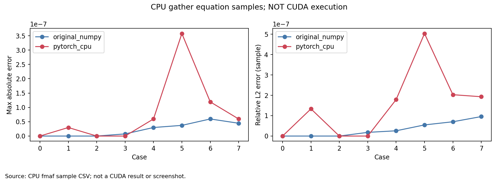
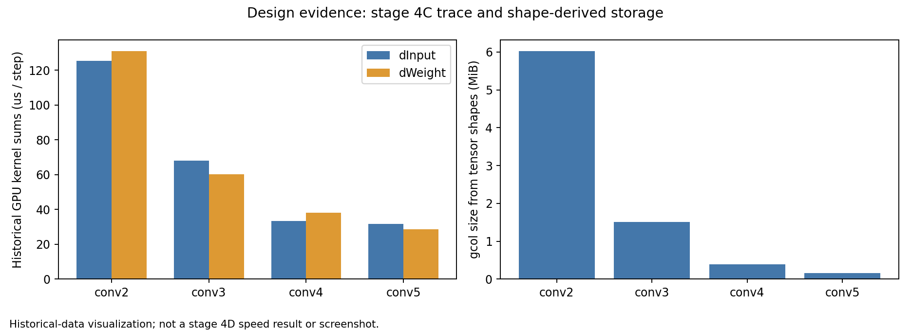

# 阶段 4D：Conv2d dInput CUDA gather 原型

**GPU 补测已完成：92 passed、0 failed、0 skipped；单算子、六版本训练和9份 Nsight 均已执行。** GPU6 同一窗口中 F/D 吞吐 +4.69%、F/A +13.14%，F 为 PyTorch 的55.56%；独立 GPU0 匹配 Trace 显示四层 dInput 各3→1 Kernel，但纯计算全部更慢，整个 Backward 核时 +39.87%、主机范围 −8.45%。详见 [GPU 补测报告](supplement-01/README.md)、[全部数据索引](supplement-01/data-index.md)、[最终状态](supplement-01/results/status.json) 和 [实测长期表](supplement-01/results/acceptance-01/progress-table.csv)。不同设备/插桩窗口不混算收益，后端默认关闭，没有进入 4E。

以下保留首次 CPU/编译交付记录，其 NOT_RUN 状态对应当时的 GPU 不可用窗口；后续实际 GPU 结果以上述独立补测报告为准，旧数据和报告正文未覆盖。

## 首次 CPU/编译交付记录

**状态：实现、CPU 验证、SM80 编译完成；GPU 正确性、性能和 Nsight 均为 NOT_RUN。** 本轮检查时 8 张 A100 都有已有计算进程，未使用任何 GPU，也没有生成新的 GPU 加速结论。不能把 CPU 公式通过或动态库编译通过当成 CUDA 验收通过。

基线为 `experiment/conv-backward-dinput-pruning` / `549f2ee4f9c046b3eeab2de1a54a47a5a2a16310`，新分支 `experiment/conv-backward-fusion`。只实现一个 dInput gather Kernel，没有重写 dWeight、Forward、SGD 或自动求导调度；没有进入 4E。

[设计选择](design-decision.md) · [源码和支持范围](source-analysis.md) · [命令](commands.md) · [数据索引](data-index.md) · [机器可读状态](results/status.json)

## 已完成内容

新 [`conv_dinput.cu`](../../../hytorch/backends/cuda/conv_dinput.cu) 使用 CUDA C/C++ 编译为动态库，经现有 ctypes 和当前 Stream 提交。每线程直接计算一个 dInput 元素，FP32 channel FMA + FP32 spatial sum，不创建完整 gcol、不使用全局原子加或 CuPy RawKernel/ElementwiseKernel。

显式使用方式：

```python
with backend(matmul="shared", conv="im2col", pool="cupy", tile=16,
             conv_backward="fused"):
    # x 可继续使用阶段 4C 的 Variable(batch, requires_grad=False)
    loss.backward()
```

默认 `conv_backward="original"`。native 仅支持同设备连续 CuPy FP32 NCHW/OIHW、stride 1/2、padding 0/1、groups=1、dilation=1；不支持的输入明确报错，不自动复制/回退。`create_graph=True` 明确保留原可微路径；首层不需梯度时仍直接跳过。该选项当前为**等待 GPU 验收的实验原型**。

修改生产路径仅为新增 CUDA 编译单元、runtime 选项/函数、Conv2d 的显式分支、编译脚本和 benchmark 参数。原 `kernels.cu`、Fused SGD、模型和 4A/4B/4C 历史文件未修改。

## 环境与 GPU 状态

| 项目 | 实测记录 |
|---|---|
| 系统 | Ubuntu 20.04.6，2 × AMD EPYC 7763，256 逻辑 CPU |
| GPU | 8 × A100-PCIE-40GB；本轮未分配任何卡 |
| 驱动 / Toolkit | 535.247.01 / CUDA 12.2.2，nvcc 12.2.140 |
| Python / 数值库 | 独立 .venv Python 3.8.10、NumPy 1.24.4、CuPy 12.3.0、PyTorch 2.4.1+cu121 |
| 编译器 / Profiler | GCC 9.4.0，Nsight Systems 2023.2.3 |
| 编译架构 | 显式 `--arch 80`，不借用被占用 GPU 来自动检测架构 |

环境原文在 [system.txt](environment/system.txt)。北京时间 **2026-10-29 23:13** 的环境检查、**23:27** 的 [GPU 检查](environment/gpu-availability-02.json) 和提交前 **23:40** 的 [最后检查](environment/gpu-final.log) 均没有空闲候选；即使瞬时利用率为 0，有计算进程也不视为空闲。CPU/编译阶段 `CUDA_VISIBLE_DEVICES` 为空；没有 sudo、安装包、GPU 权限修改、哈希/指纹校验或自动排队监控。

## CPU 与编译结果

| 项目 | 实际结果 | 数据 |
|---|---|---|
| 完整 CPU 回归 | **54 passed，0 failed，0 skipped**，5.26 s | [log](tests/host-01.log)、[XML](tests/host-01.xml) |
| 新插桩测试后的定向回归 | **7 passed，0 failed，0 skipped**，2.16 s | [log](tests/host-02.log)、[XML](tests/host-02.xml) |
| CPU gather 方程抽样 | **1884 次比较、0 超差** | [samples.csv](results/raw/conv_backward_fusion_cpu_equation_01/samples.csv)、[summary](results/raw/conv_backward_fusion_cpu_equation_01/summary.json) |
| CUDA 编译 | **PASS，SM80 + compute_80 PTX** | [完整终端](tests/build-01.log)、[build.log](results/raw/conv_backward_fusion_build_01/build.log)、[build.json](results/raw/conv_backward_fusion_build_01/build.json) |
| 主机加载 / 新符号 | **PASS，ABI=1，hy_conv_dinput 存在** | [log](tests/library-load-01.log) |
| GPU 测试收集 | **92 collected；未执行** | [collection log](tests/gpu-collection.log) |

两个 CPU pytest 批次共覆盖 **55 个不同用例**，其中 6 项重复，不能相加成 61 项独立测试。覆盖默认/显式路由、输入剪枝、参数梯度、上下文恢复、CPU 不支持输入报错、高阶图、普通/Fused SGD CPU 兼容、旧卷积/GEMM 回归和插桩还原。CPU 路由测试的 stub 只验证调度，不代表 native 在 CPU 运行。

CPU 方程检查采用真实 FP32 输入、libm.fmaf 和 FP32 空间加法，8 组形状、942 个位置，与原 NumPy 路径及 PyTorch CPU 各比较一次。最大绝对误差 **3.5762786865234375e-7**，各组样本相对 L2 最大 **5.030919980176054e-7**，沿用梯度 `atol=1e-5, rtol=1e-4`。这是抽样公式检查，不是全量 GPU 通过。实际输入、参考数组和位置保留服务器。

ptxas：新 Kernel **40 registers、0 stack、0 spill stores/loads、428 bytes cmem[0]**。这些是编译资源，不是实际 Occupancy、带宽或耗时。没有执行新 Kernel；本轮无编译失败或数值测试失败。已有缺 SciPy/SVHN 的导入提示保留在日志中，与本实验合成数据无关。



## 为什么选 dInput

阶段 4C 的 D Trace 显示 Conv2–Conv5 dInput 合计 **258.747 μs/step、12 次 Kernel**，其中 Col2im **174.124 μs**、Copy **18.804 μs**。相同四层 dWeight 约 257.810 μs；dWeight 还包含 Conv1 的工作，所以不能把 dInput 宣称为整个网络最大热点。

选择它是因为有可移除的 gcol 和独立 Col2im，且每输出元素独立 gather 不需全局原子归约。形状推导的 gcol 总量 **8,481,408 字节/step**，新 runtime 源码只分配 gx。代价是重复读取、OC 串行归约及索引分支，可能失去 GEMM 数据复用优势，必须实测。完整依据见 [design-decision.md](design-decision.md)。



这两张图分别来自 CPU 方程样本和历史 4C 数据，均明确标注来源；不是 4D 性能图或桌面截图。

## GPU 验收状态与待执行方案

| 验收问题 | 本轮可回答的事实 |
|---|---|
| 选择 dInput 还是 dWeight？ | 仅 dInput；依据见历史数据和设计文档 |
| 真正使用 CUDA C/C++？ | 源码、nvcc 动态库、ctypes 路径已完成；**GPU 实际执行 NOT_RUN** |
| 数值正确性通过？ | CPU 调度/高阶/公式检查通过；**CUDA 和 GPU DonkeyNet NOT_RUN** |
| 各层 Backward 加速多少？ | **NOT_RUN** |
| Launch 少多少？ | 源码预期每层 3→1、四层少 8 次；**新 Trace 尚未验证** |
| Copy / 中间显存少多少？ | 源码不产生 gcol/布局 Copy；**实际分配峰值与 Copy 数量 NOT_RUN** |
| 训练是否稳定提升？ | **NOT_RUN，不能判断** |
| 相对 4C 的 F/D？ | **NOT_RUN** |
| 相对无 Native 基线的 F/A？ | **NOT_RUN** |
| F/E 与 PyTorch 的差距？ | **NOT_RUN** |
| 是否值得保留？ | 可保留为默认关闭的研究原型；尚无 GPU 正确性/收益证据支持部署 |
| 如果没有端到端收益，原因是什么？ | 还没有此项观测；重复读取/索引成本/主机开销只是待验证风险，不能当归因结论 |

已有脚本按以下顺序准备 **64 条命令**：[计划 JSON](results/raw/conv_backward_fusion_plan_01/planned-commands.json)。该文件是 NOT_RUN 计划，不是执行成功记录，UUID 为 UNALLOCATED。

1. 92 项 GPU 测试：21 项新测试 + 既有剪枝/Fused/设备回归；请求 GPU 后失败必须终止，不以 skipped 替代通过。新测试含 8 组形状×默认/非默认 Stream、连续三次调用、dWeight/dBias、GPU 高阶及两种 SGD 的 DonkeyNet 三步对照。
2. 9 个独立单算子进程：original/fused/PyTorch 各 3 次，Conv2–Conv5，各测 dInput-only 和完整 backward，5 次预热、30 次正式 CUDA Event 测量。保存每次 Event、提交、同步等待、墙钟和分配统计。
3. 36 个独立训练进程：A/B/C/D/F/E × throughput/phases × 3 次，Batch4、FP32、SGD .001、seed42、Dropout0、TF32关闭、10 warmup、256正式Step，轮换顺序，实际数组比较相同初始权重/输入。所有训练使用 --no-fingerprints。
4. 9 份独立 Nsight：六训练 + 三微基准，另导出 SQLite；训练加入逐层 NVTX 和单独的 allocation hooks。吞吐数据不启用这些 hooks。

单算子保留梯度容差 `1e-5/1e-4`，训练 Loss/权重 `1e-6/1e-5`。PyTorch 与旧 HyTorch 均为对照；不把新方法调成恰好复现某个参考的舍入路径。

长期 A/B/C/D/F/E 表及 B/A、C/B、D/C、F/D、F/A、F/E 的收益须来自未来同一窗口。这里不填入 4C 的历史吞吐，不跨窗口计算累计收益。[分析脚本](scripts/analyze_results.py) 保存原始重复与误差，[绘图脚本](scripts/plot_results.py) 在真实结果齐备后生成要求的七张性能图；本轮缺 GPU 数据，未创建占位图或虚构 CSV。

## 未完成项和停止边界

GPU 测试、单算子性能、六版本训练、非默认 Stream 设备行为、实际 Native dispatch、分配变化及 Nsight 归因全部待执行。当前代码可编译，不等于可接受的性能后端。计划/后处理脚本完成语法和 CLI 检查，但其真实 GPU 数据链仍待验证。

本轮按“GPU 不可用时保留代码、CPU 测试与记录”的授权交付，提交推送后停止。保留全部原始日志和数组；没有覆盖历史实验，没有实现第二个 Kernel或启动 4E。
