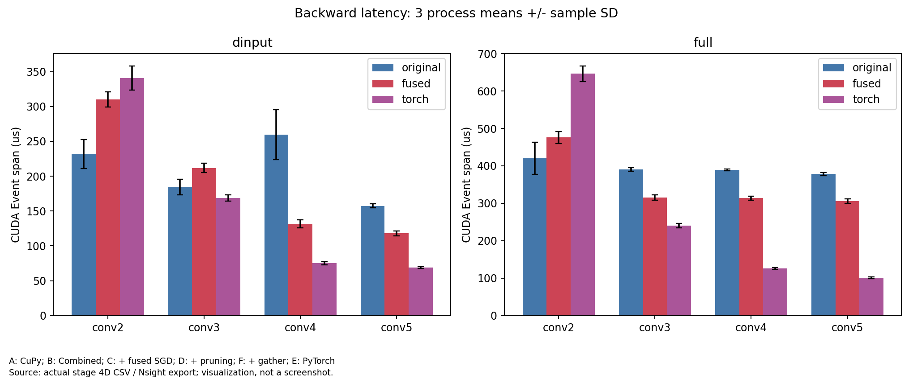
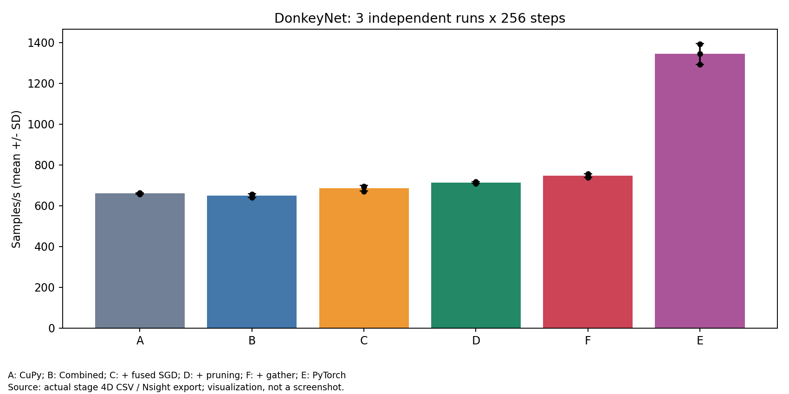
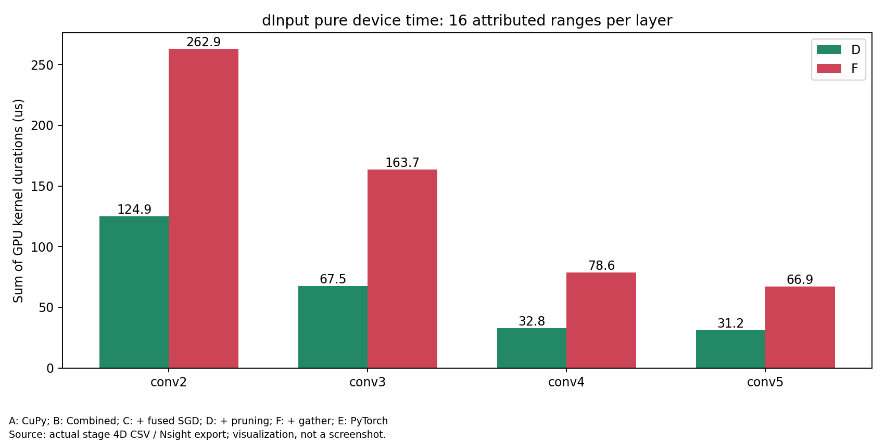
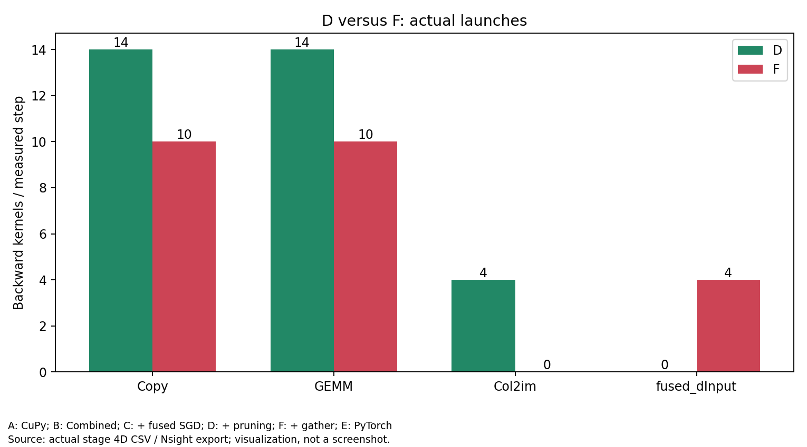
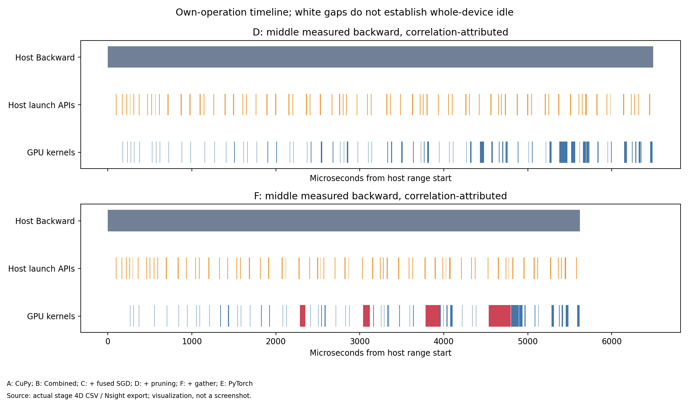

# 阶段 4D GPU 补测

**GPU 正确性通过，单算子、六版本训练和完整 Nsight 验证已完成。** 本窗口 F/D 吞吐 +4.69%、F/A +13.14%；但 Gather 的纯 GPU dInput 核时四层均退化，整网 Backward 核时 +39.87%。Trace 支持通过减少主机提交与间隙取得端到端收益的解释，不能称作更快的 GPU 计算实现。所有结论区分不同设备、窗口和计时口径。

基线分支 `experiment/conv-backward-fusion`，提交 `3e58e7093e152c7aae1c8a2334bb1f9f84f100ea`。本轮没有修改 CUDA Kernel、运行时、自动求导、模型或优化器，没有开始 4E。

[全部命令](commands.md) · [原始文件与全部图像索引](data-index.md) · [六版本原始训练结果](results/acceptance-01/training-raw.csv) · [长期进展表](results/acceptance-01/progress-table.csv)

[最终状态](results/status.json) 中 COMPLETED 表示实验已执行；数值和路由检查 PASSED 不代表所有性能指标改善。

## 单卡窗口与中断记录

从北京时间 **2026-10-29 23:52:47** 开始监控，上限 **2026-10-30 01:52:47**，每 20 秒检查进程、显存和活动；发现空闲后由原 guard 再检查两次并固定 UUID。没有使用已有计算客户端的卡。

1. 物理 GPU 0 首轮通过 92 项测试和全部 9 次微基准，但在第二次训练重复期间出现外部客户端，guard 立即终止。所有原始记录保留，不参与正式训练加速比。
2. 物理 **GPU 6** 的第二窗口重新通过 92 项测试，完成 **9 次微基准、36 次训练**。正式非插桩命令区间为北京时间 **2026-10-30 00:01:41–00:04:31**。之后外部客户端在 00:05:30 进入，guard 在采集 F Trace 期间终止；非插桩测量早已完成。
3. 后续先等待同一 GPU 6；用户明确允许其他空闲卡后，在北京时间 00:44 改为监控全部 8 张卡。新的完整匹配 Nsight 组仍固定同一 UUID，不将被打断的 Trace 与后续 Trace 拼成 D/F 对照，也不将不同设备上的插桩核时与正式吞吐混算。
4. 01:35 GPU6 短暂空闲，D/F 完成，但 guard 将 Nsight 被测 PID1995660 误判为外部客户端，终止后续流程。F 的报告可离线恢复；该 PID 身份由 SQLite PROCESSES 表确认，具体标记可见性/退出竞态原因未证实，原 guard 没有修改。见 [guard-review-04.json](results/guard-review-04.json)。此组仅保留为审计记录，不作为最终 D/F 对照。
5. 01:38 任意空闲卡监控选中物理 **GPU0**，完整执行六训练 Trace、三微基准 Trace 及九次 SQLite 导出，**01:40:19 完成**。84 个 guard 样本没有外部客户端。任务已完成，监控随即结束，没有继续等满剩余时间或开始其他 GPU 实验。

正式设备：NVIDIA A100-PCIE-40GB，物理 6，UUID `GPU-d40fdd6f-33be-8ccc-fc58-f4daf39a4b82`，进程逻辑设备 0。完整测量窗口内的监控没有外部 GPU 客户端。其他卡上的共享 CPU/系统负载和未锁时钟仍可能带来波动，三次重复不能外推所有负载。

最终 profiling 设备为物理 **0**、UUID `GPU-f099fdbd-adf2-6157-3462-4145bc2a8359`、逻辑 0。只在各自单卡匹配窗口内部比较，GPU0 的 Trace 不与 GPU6 的普通计时混算加速比。

系统 Ubuntu 20.04.6、2×EPYC7763、驱动 535.247.01、Toolkit/nvcc 12.2/12.2.140、独立 Python3.8.10、NumPy1.24.4、CuPy12.3.0、PyTorch2.4.1+cu121、Nsight Systems2023.2.3。复用此前 SM80 动态库，未更改 Kernel 源码、重新安装依赖或使用 sudo/哈希验证。环境原文见 [environment.txt](environment.txt)。

## 真实 GPU 正确性

| 项目 | 结果 |
|---|---|
| GPU 0 首轮 | 92 passed，0 failed，0 skipped，6.23 s |
| GPU 6 正式窗口 | **92 passed，0 failed，0 skipped，6.28 s** |
| 新 Gather 数值比较 | **533 条，0 超差，全部有限** |
| 最大绝对误差 | **2.980232238769531e-7** |
| 最大相对 L2 | **2.0723114272336258e-6** |

两批 92 项是重复执行，不合并成 184 个不同用例。覆盖 Conv2–Conv5、8 组形状、默认/非默认 Stream 的 producer→native→consumer、多次调用、边界、dWeight/dBias、GPU 高阶、两种 SGD 的 DonkeyNet 三步对照及既有剪枝/Fused/device 回归。

既有梯度容差 `atol=1e-5,rtol=1e-4`；Forward/Loss/权重 `1e-6/1e-5`，未放宽。正式 36 次长训练的初始权重、输入逐元素一致，**714 条权重/Loss 对照全部通过**，相对 A 总最大绝对差 `4.190951585769653e-8`，F 相对 D 最大 `1.4901161193847656e-8`。逐步 Loss 和最终权重已保存；这些是合成训练验收，不代表驾驶任务效果。

每个 F 训练进程在 256 正式 Step 中记录 **1024 次 conv_dinput_fused**，即四层/step；92 项测试中的原始、Gather、PyTorch 三方梯度一致性通过。首层剪枝与 Fused SGD 保持正常。最终新 Trace 实际捕获正式 Step 内 **64 次 conv_dinput_gather**，不是仅凭运行时计数宣称设备执行。插桩六版本另有 **119 条权重/Loss 对照全部通过**，最大绝对差 `4.1443854570388794e-8`。

## 单算子性能：同一 GPU 6 窗口

每方法 3 个独立进程，每层/范围 5 次预热、30 次正式测量，保留 2160 次原始延迟。以下为三个进程均值的均值，单位 μs。Event 覆盖完整提交序列，包含提交不足造成的间隙，不能当成纯 Kernel 核时；墙钟包含调用与结束同步。Forward/H2D 初始化不计入三种方法的 backward。

| 层 | 原 dInput Event | Gather dInput Event | PyTorch dInput Event | 原同步墙钟 | Gather 同步墙钟 | PyTorch 同步墙钟 |
|---|---:|---:|---:|---:|---:|---:|
| Conv2 | 231.811 | **309.953** | 340.924 | 243.528 | **321.094** | 367.163 |
| Conv3 | 184.263 | **211.593** | 168.914 | 195.831 | **222.928** | 194.148 |
| Conv4 | 259.812 | **131.482** | 74.980 | 271.319 | **142.677** | 100.122 |
| Conv5 | 157.389 | **118.090** | 68.915 | 168.887 | **129.121** | 93.455 |

**Conv2、Conv3 的独立 dInput 退化，未隐藏。** Gather Conv2 的 Event 约 310 μs，不能与历史 125.57 μs Kernel 求和直接作比。后续 GPU0 Trace 中纯设备时间为 262.88 μs，**没有低于历史参考**；正式纯设备比较采用同轮 D 的 124.92 μs，见下文。

完整 `Conv2d.backward` 同时计算 dInput/dWeight/dBias：

| 层 | 原 Event | Gather Event | PyTorch Event | 原/Gather Event 比 | 原/Gather 同步墙钟比 |
|---|---:|---:|---:|---:|---:|
| Conv2 | 420.500 | 476.171 | 646.292 | 0.883× | 0.886× |
| Conv3 | 390.463 | 315.108 | 240.299 | 1.239× | 1.231× |
| Conv4 | 389.564 | 313.628 | 125.998 | 1.242× | 1.234× |
| Conv5 | 378.084 | 305.721 | 100.762 | 1.237× | 1.227× |

完整调用与单独 dInput 的时间不能相减来精确推导 dWeight 核时；主机提交间隙、分配器复用和运行波动都可能改变 Event 跨度。dWeight/dBias 的数学和代码保持原实现，实际输出逐数组比较通过。完整每次值及各进程 mean/std/median/P95 见结果 CSV。

独立 dInput 主机调用返回时间（原→Gather，μs）：Conv2 `158.924→51.881`、Conv3 `154.613→50.612`、Conv4 `254.794→54.389`、Conv5 `152.469→52.018`。相应结束 Event 等待 Conv2 `76.391→263.271`、Conv3 `33.314→166.528`、Conv4 `8.482→82.281`、Conv5 `8.567→71.216`。这支持主机提交负担减少、部分等待转移到 GPU 完成阶段；提交和设备执行可以重叠，不能把两者当成互斥的 CPU/GPU 工作量。下文用独立新 Trace 进一步区分设备核时与提交间隙。

### 分配记录

在独立、非计时调用中，用 CuPy MemoryHook 记录 pool 请求和活跃请求峰值。以下是“峰值减保留输出”的临时字节，已包含池分配粒度：

| 层 | 原 dInput 临时峰值超出输出 | Gather | 原/Gather 分配请求数 |
|---|---:|---:|---:|
| Conv2 | 6,317,056 | 0 | 3 / 1 |
| Conv3 | 1,584,128 | 0 | 3 / 1 |
| Conv4 | 414,720 | 0 | 3 / 1 |
| Conv5 | 165,888 | 0 | 3 / 1 |

这支持“不再创建 gcol”，但各层独立调用的临时峰值不能相加后宣称为整网训练峰值节省；池请求不是实际 DRAM 流量。完整 backward 仍有原 dWeight 的 Im2col/Tensordot 临时存储。PyTorch allocator 与 CuPy hook 的口径也不能混作同一种分配器指标。

完整 backward 的分配请求由每层 **8→6**，但观测活跃请求峰值**没有下降**：Conv2–Conv5 的原/Gather 峰值分别都为 `14,266,880 / 3,805,184 / 1,085,952 / 559,104` 字节。减少独立 dInput 临时存储并不自动降低完整 backward 的峰值；未融合的 dWeight 路径仍决定本项测量的峰值。

## 长期统一性能表

所有六组在 **GPU 6 的同一正式窗口**，DonkeyNet `[4,3,66,200]`、FP32、SGD .001、seed42、相同初始化/输入/顺序、Dropout0、TF32关闭、10 warmup 后恢复权重，3 独立进程×256Step。A 的 Native 库路径为不存在文件，dispatch_counts 全空；B/C/D/F 使用 shared/im2col/cupy/tile16。

吞吐为均值 ± 样本标准差；完整 Step 墙钟由全部 epoch 训练墙钟/256 得到，包含迭代、传输、计算、Loss 读取及循环开销，另保留 StepProfiler 的 step_s。

| 版本 | 内容 | samples/s | 完整 ms/step | 对上一版吞吐比 | 对 A | 对 E |
|---|---|---:|---:|---:|---:|---:|
| A | 当前代码复现的无 Native CuPy + 普通 SGD | 659.640 ± 3.534 | 6.064026 | — | 1.000000× | 0.491053× |
| B | Native Combined + 普通 SGD | 649.646 ± 8.915 | 6.157977 | 0.984849× | 0.984849× | 0.483613× |
| C | Combined + Fused SGD | 685.467 ± 14.421 | 5.837179 | 1.055139× | 1.039153× | 0.510280× |
| D | 再加首层 dInput 剪枝 | 712.876 ± 4.071 | 5.611196 | 1.039986× | 1.080704× | 0.530683× |
| F | 再加 dInput Gather | **746.288 ± 9.689** | **5.360463** | **1.046869×** | **1.131356×** | **0.555556×** |
| E | PyTorch CUDA 对照 | 1343.317 ± 50.734 | 2.980544 | — | 2.036439×（对照） | 1.000000× |

| 比较 | 吞吐提升 | 耗时加速比 | 训练墙钟下降 |
|---|---:|---:|---:|
| B/A | **−1.5151%** | 0.984743× | −1.5493% |
| C/B | +5.5139% | 1.054958× | +5.2095% |
| D/C | +3.9986% | 1.040274× | +3.8714% |
| **F/D** | **+4.6869%** | **1.046774×** | **+4.4684%** |
| **F/A** | **+13.1356%** | **1.131250×** | **+11.6022%** |
| **F/E** | **−44.4444%** | **0.556024×** | **−79.8485%**（F 耗时更长） |

比值分别由当前窗口吞吐均值、墙钟均值计算；不同均值取法使二者不必完全互为倒数。不使用任何历史百分比相乘。A 为当前代码关闭自研 Native 的路径，不冒充最初历史 Commit 的原始测量。B 在本配置没有显示收益；该负结果保留。

三次正式吞吐：A=`663.617/658.448/656.857`，B=`654.070/639.384/655.484`，C=`692.888/668.847/694.667`，D=`712.544/717.103/708.981`，F=`745.137/737.226/756.501`，E=`1393.203/1291.776/1344.973`。每个 F 都高于每个 D，支持本窗口的正收益；尚不能称跨窗口稳定收益。F 仍需约为 PyTorch **1.7985×** 的墙钟时间。

独立同步阶段（3 次均值，ms/step）：

| 配置 | Forward | Backward | Update |
|---|---:|---:|---:|
| A | 1.677655 | 3.489940 | 0.447974 |
| B | 1.690941 | 3.490302 | 0.447440 |
| C | 1.713258 | 3.516516 | 0.130907 |
| D | 1.727592 | 3.384688 | 0.131176 |
| F | 1.736972 | 3.081116 | 0.130092 |
| E | 0.627087 | 1.599263 | 0.157129 |

F 的 Backward 同步墙钟比 D 减少约 0.304 ms/step，约 8.97%；不能用它替代未插桩吞吐。各阶段 SD 与逐步记录保留 CSV。

约秒级整进程监控的吞吐进程观测峰值 A/B/C/D/F/E 为 `469/469/477/469/467/569 MiB`，每进程只有 1–3 个活跃样本，包含初始化/预热/收尾，不是分配器瞬时训练峰值，不能把 F/D 的 2 MiB 差当成可靠显存收益。

## 完整 Nsight 验证：独立 GPU0 窗口

9 份 Trace 和 9 份导出全部成功，correlationId→提交 API→NVTX 归因 unmatched=0。每个训练 Trace 为10步 warmup、16步正式；GPU0 的全部新统计在 [trace-summary-02](results/trace-summary-02/trace-training-summary.csv)，原始事件和具体 Kernel 名称在 [解析文件索引](results/raw-analysis-01/file-index.csv)。

| 配置 | 全 Trace Kernel | 正式 Kernel/step | Backward Kernel/step | Backward 核时 μs/step | 主机 Backward NVTX μs/step |
|---|---:|---:|---:|---:|---:|
| A | 3952 | 152 | 77 | 883.855 | 7043.916 |
| B | 3848 | 148 | 77 | 872.803 | 6905.059 |
| C | 3042 | 117 | 77 | 872.737 | 6712.089 |
| D | 2964 | 114 | 74 | 790.908 | 6491.933 |
| F | 2756 | 106 | 66 | 1106.243 | 5943.342 |
| E | 2444 | 94 | 66 | 1545.237 | 3113.016 |

A 全 Trace 再次验证本项目 Native Kernel 为0。D/F 的 Conv1 均没有 dInput 范围；Conv2–5 每层各16个 dInput 范围，D 每个3 Kernel，F 每个1个真实 Gather。dWeight/dBias 五层范围各16个仍存在，输出比较通过。整个 Backward 的 Copy **14→10**、GEMM **14→10**、Col2im **4→0**、Gather **0→4**；因此不能说所有 Copy/GEMM 都消失。

### 纯设备时间与主机时间的相反变化

| 层 | D dInput 三 Kernel 核时 μs | F Gather 核时 μs | D/F 纯设备耗时比 | D→F 主机 dInput NVTX μs |
|---|---:|---:|---:|---|
| Conv2 | 124.918 | 262.884 | 0.475× | 268.808→102.892 |
| Conv3 | 67.454 | 163.750 | 0.412× | 268.837→99.757 |
| Conv4 | 32.840 | 78.596 | 0.418× | 270.143→99.033 |
| Conv5 | 31.188 | 66.928 | 0.466× | 276.059→102.842 |

**四层 Gather 纯计算全部更慢**，没有达到 Conv2 的历史 125.57 μs 参考。独立微基准 Trace 同样复现该方向：Conv2–5 原 dInput 核时 `124.693/66.773/32.554/30.315` μs，Gather `263.371/163.456/77.739/65.291` μs；完整 backward 的 GPU 核时四层也增加。两组 Trace 内各自匹配，不用 GPU6 Event 与 GPU0 核时计算比值。

D→F 的整个 Backward：核时 **790.908→1106.243 μs（+39.87%）**，主机 NVTX **6491.933→5943.342 μs（−8.45%）**，主机 Launch API 累计时间 **650.864→563.831 μs（−13.37%）**。自己这些 Kernel 之间的间隔 **5581.853→4719.228 μs（−15.45%）**；该间隔不是全设备 idle，API 时间也不是 GPU 核时。减少约862.6 μs 间隔、增加315.3 μs 核时，与该 Trace 的 Kernel 包络缩短约547.3 μs 相符。

这些数据支持“减少主机提交、布局转换及中间分配，抵消更慢的 Gather 计算”的解释；不同 GPU/插桩窗口使其不能精确分解 GPU6 正式吞吐 +4.69% 的因果贡献，也不能仅凭时间线将所有间隔称为 Python 开销。E 的 GPU Kernel 仍经 correlationId 关联 API，但部分 Backward API 在工作线程，采用旧解析器显式的唯一主线程 phase 规则；E 的同线程 NVTX Kernel 包络不完整，已设为不适用，不用于 D/F 间隙比较。

MemoryHook 的整个 Backward pool malloc 请求 **71→63 次/step**，请求字节 **39,848,649→30,823,881（−22.65%）**。这是请求量，不是峰值显存、物理 cudaMalloc 次数或 DRAM 流量。与前文独立完整 backward 峰值未下降的观察不矛盾。

## 中断与后处理记录

第二窗口 A/B/C/D Trace 已完成，F 被真实外部客户端打断；它们保留为中断原始记录，不与最终 GPU0 Trace 拼接成 D/F 对照。第四窗口守护误判与可恢复 F 的记录单独保留；最终结论只使用第五窗口完整匹配组。

已完成的部分组统计见 [partial-traces-02.csv](results/partial-traces-02.csv)，每组 16 个正式 Step；全 Trace 另外包含 10 步 warmup。以下 Copy/Col2im 计数为整个 Backward，不仅是 dInput：

| 配置 | 全 Trace Kernel | 正式 phase Kernel/step | Backward Kernel/step | Backward 核时 μs/step | Backward Copy/Col2im 次数/step |
|---|---:|---:|---:|---:|---:|
| A | 3952 | 152 | 77 | 899.396 | 15 / 5 |
| B | 3848 | 148 | 77 | 888.957 | 15 / 5 |
| C | 3042 | 117 | 77 | 888.335 | 15 / 5 |
| D | 2964 | 114 | 74 | 805.280 | 14 / 4 |

所有 Kernel 都通过 correlationId 找到提交 API，unmatched=0。该中断窗口 D 的主机 Backward NVTX 均值约 7.079 ms，仅属插桩运行，不能替代普通 phases 的 3.385 ms，更不能用设备核时占比当作训练墙钟占比或 GPU 利用率。该窗口缺匹配 F，不从这张部分表推断融合减少量；最终比较使用上方完整 GPU0 组。

硬件汇总首次复用 4B 工具时，因中断中的命令没有 finished_at，出现 KeyError。失败日志保留；随后从原始 manifest 中另存 45 条已完成的非插桩命令，复用原工具成功汇总。原 manifest 和旧工具均未修改。这是后处理输入范围问题，不是 CUDA 数值失败。

原始路径别名导致的归档失败、临时正则检查错误、首次 E 同线程包络统计范围不完整，都保留首次输出及更正记录，详见数据索引。未删除失败日志，未改数值容差。最终图为 `figures-final-02/`，另有3张 `figures-validation-01/` 数值/显存图；之前的图也保留。所有图是数据可视化，不冒充截图。

## 当前保留建议与边界

GPU 数值验收和本窗口端到端收益支持继续保留为显式可选后端，默认仍为 original。四层纯设备核时退化、Conv2/Conv3 独立 Event 退化、完整 backward 峰值未降以及相对 PyTorch 仍约 1.80× 的耗时，均不支持将其描述成通用更快的卷积反向实现。没有修复或调优生产 Kernel。守护误判的具体根因、跨窗口收益稳定性及更广形状表现仍待调查；本轮已停止 GPU 工作，提交推送后等待共同审查，不做第二个融合点或进入 4E。
