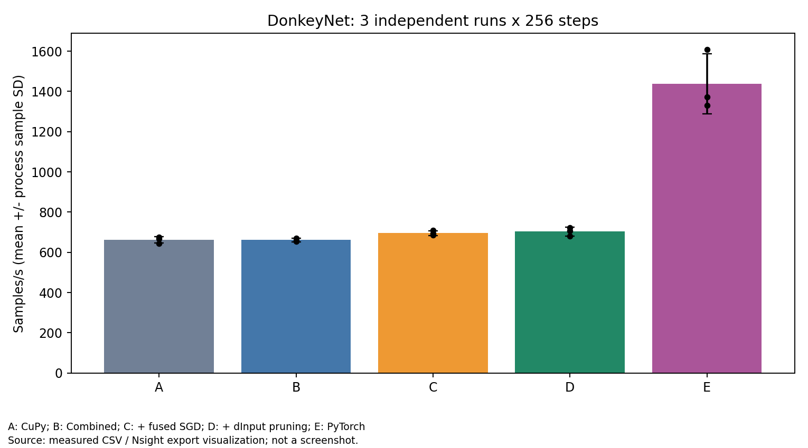
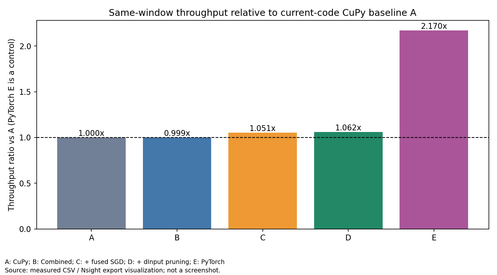
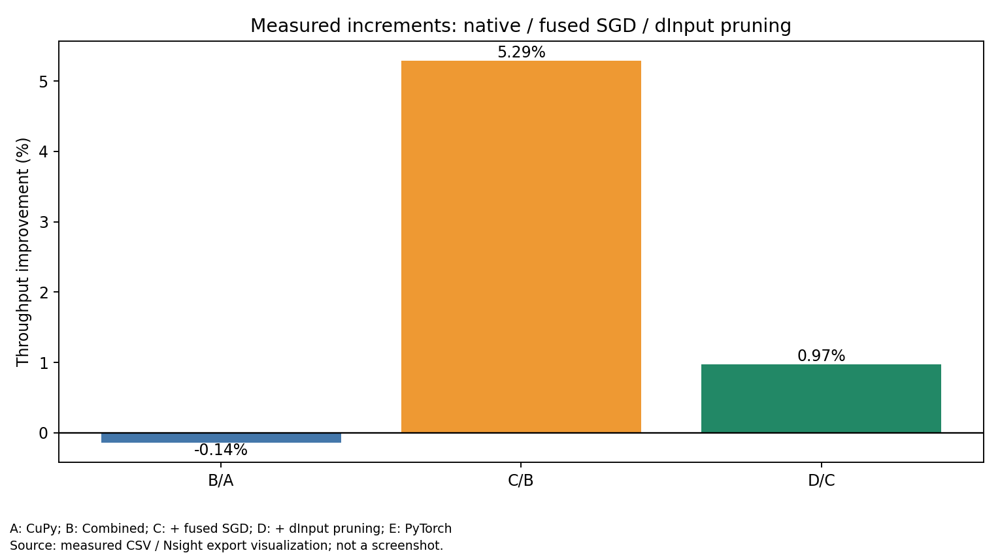
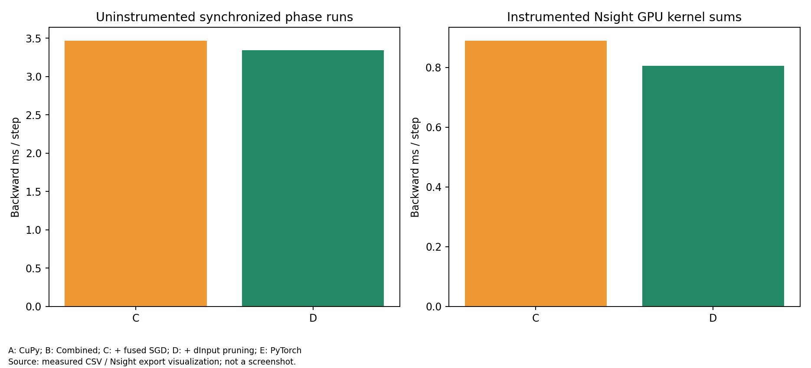
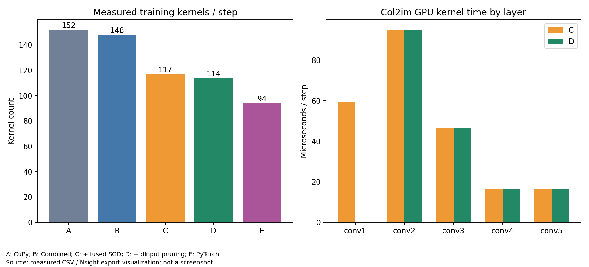
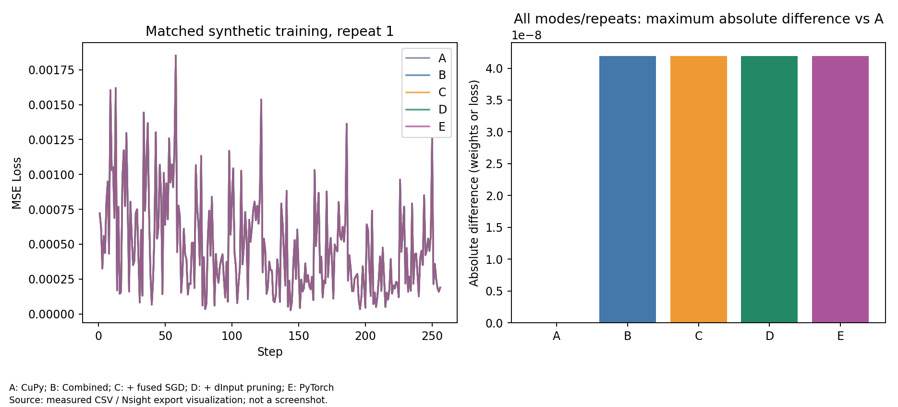

# 阶段 4C：Conv2d dInput 剪枝与统一性能基线

**实现、CPU/GPU 正确性和五组匹配实验完成；稳定的端到端加速尚未证实。** 首层 dInput 确实消失，C→D 每步少 3 个 Kernel，Backward GPU 核时减少 9.362%。训练吞吐均值增加 **0.970%**，但三次重复中两次略有退化。本次 D 相对同窗口 A 的累计吞吐比为 **1.061592×**，不是把历史阶段百分比相乘。

基线为 `experiment/fused-sgd-cuda` / `5476cb65f3b0493e8edc7a495551c9cae25587fb`；本轮分支 `experiment/conv-backward-dinput-pruning`。全部真实 GPU 实验在同一物理 A100 GPU 2 上，窗口 **2026-10-29 14:20:38–14:23:47 UTC**（北京时间 22:20:38–22:23:47）。没有开展阶段 4D。

[源码分析](source-analysis.md) · [全部命令](commands.md) · [原始数据索引](data-index.md) · [逐次训练](results/training-raw.csv) · [长期性能表 CSV](results/progress-table.csv) · [数值结果](results/numerical-summary.json)

## 1. 最小改动与使用

生产改动只有三个文件：

- [core.py](../../../hytorch/core.py)：`Variable(..., requires_grad=True)` 默认兼容；反向调度跳过 None 梯度和明确不需要梯度的变量。
- [functions_conv.py](../../../hytorch/functions_conv.py)：关闭输入梯度时不调用 dInput 的 Deconv2d，保留 dWeight/dBias；局部修正已复现的高阶反传 weakref 误用。
- [bench_cuda_training.py](../../../benchmarks/bench_cuda_training.py)：增加默认关闭的 `--prune-input-grad`。

```python
x = Variable(batch, requires_grad=False)
loss = F.mean_square_error(model(x), target)
model.cleargrads()
loss.backward()
optimizer.update()
```

需要输入梯度时保持默认 True。没有用 `creator is None` 推断需求；中间特征仍默认 True。这不是完整的 requires_grad 自动推导，不自动剪枝所有常量运算。模型、优化器、Forward 公式、CUDA 源码均未改；target 梯度未在本轮剪枝。没有新增 CUDA Kernel、静默回退、系统配置修改、sudo 或哈希验证。

## 2. 环境与 A–E 配置

| 项目 | 本轮环境 |
|---|---|
| 主机 | Ubuntu 20.04.6；2 × AMD EPYC 7763；256 逻辑 CPU |
| GPU | A100-PCIE-40GB，40960 MiB；物理 2 → 进程逻辑 0 |
| UUID | GPU-158426a4-6684-7863-8cbe-ed6595f97683，通过 CUDA_VISIBLE_DEVICES 设置 |
| 驱动 / Toolkit | 535.247.01 / CUDA 12.2.2，nvcc 12.2.140，SM80 |
| Python / 库 | 独立 .venv Python 3.8.10；NumPy 1.24.4；CuPy 12.3.0；PyTorch 2.4.1+cu121 |
| 编译器 / Profiler | GCC 9.4.0；Nsight Systems 2023.2.3 |
| Native 库 | 复用 4B 的 runs/fused_sgd_cuda_build_01/libhytorch_cuda.so；CUDA 源码未改，不重复编译 |

完整 [system.txt](environment/system.txt) 和各次 config 保留。首次拟选 GPU 0，启动前 guard 发现其他计算进程，因此**未在 GPU 0 开始任何实验**；[原检查](results/raw/conv_dinput_monitor_01/before.json) 保留。之后 GPU 2 两次空闲检查通过，140 个外层样本未发现外部客户端，[正常退出记录](results/raw/conv_dinput_monitor_02/completion.json) 保留。

共同条件：DonkeyNet、输入 `[4,3,66,200]`、FP32、SGD lr=0.001、seed=42、Dropout=0、TF32关闭、相同权重/输入/顺序。用实际数组比较，没有 fingerprint。预热 10 Step 后恢复权重；256 samples × 4 epochs / batch4 = **256 Step、1024 samples**。每方法每计时模式 3 个独立进程，轮换执行顺序，不挑最快结果。

| 版本 | 配置 |
|---|---|
| A | 当前代码复现的无 Native CUDA C 基线：CuPy matmul/conv/pool，普通 SGD，未剪枝 |
| B | Combined：shared matmul / im2col conv / cupy pool，tile16，普通 SGD，未剪枝 |
| C | 相同 Combined，Fused SGD，未剪枝 |
| D | 与 C 相同，明确关闭训练输入梯度 |
| E | 匹配模型的 PyTorch CUDA SGD；实际 Trace 为单个 foreach Update Kernel |

A 的全部 dispatch_counts 为 `{}`；Native 库路径故意设为不存在，误调用会失败；完整 A Trace 也不含本项目 Native GEMM/Conv/Pool/Fused SGD Kernel。CuPy 自身的 CUDA/cuBLAS 属于正常 A 路径，不算本项目自研 Kernel。A 是当前代码的功能等价配置，不冒充历史 Commit 原始测量。

## 3. 正确性与保留的失败

| 测试 | Passed | Failed | Skipped | 记录 |
|---|---:|---:|---:|---|
| CPU：新增 14 项 + 原回归 34 项 | 48 | 0 | 0 | [log](tests/cpu-01.log)、[XML](tests/cpu-01.xml) |
| A100：新增 14 项 + Fused SGD 18 项 | 32 | 0 | 0 | [log](results/raw/conv_dinput_gpu_01/gpu-tests.log)、[XML](results/raw/conv_dinput_gpu_01/gpu-tests.xml) |

新增测试覆盖默认/保留/关闭输入梯度、有无 bias、stride/pad、dWeight/dBias、None 不调度 creator、多层中间梯度、两种 SGD 的 DonkeyNet 三步训练、PyTorch Forward/Loss/梯度/更新、标量二阶以及卷积权重二阶/混合导数。CPU/GPU 各 **439 条**数值比较，超差元素均为 0；总最大绝对误差分别 `1.9073486328125e-6` / `9.5367431640625e-7`，来自不同张量与容差类别，不能仅与单一 atol 比较。

沿用参数/Forward/Loss `atol=1e-6, rtol=1e-5`，梯度 `atol=1e-5, rtol=1e-4`；同一路径剪枝前后还做零容差检查。30 次长训练的初始权重/输入一致，最终权重和逐步 Loss 全部通过 `1e-6 / 1e-5`，相对 A 最大绝对差 **4.190951585769653e-8**。**C/D 全部最终权重和 Loss 逐元素相等**，所有 Loss 有限。C/D 首末 Step Loss：`0.0007207734743133187 → 0.00018869037739932537`；这是合成训练链路，不是驾驶任务效果。

原高阶缺陷：`Conv2DGradW.backward` 将输出 weakref 传入卷积，报 `TypeError: <class 'weakref'> is not supported`。局部改为使用传入的高阶梯度 `gys`，并保留常量输入需求判断。[修正前日志](tests/higher-order-before.log)、[修正后复现](tests/higher-order-after.log) 与 PyTorch 数值对照全部保留。普通一阶训练不执行该高阶 backward；五组均在同一修正后版本测量。

## 4. 长期统一性能进展表

吞吐为 **3 个独立进程的均值 ± 样本标准差**。计时包括全部 epoch 训练墙钟中的数据迭代、传输、Forward/Backward/Update、Loss 读取和循环开销，不能用逐步 step_s 之和替代。

| 版本 | 优化内容 | 吞吐 samples/s | 相对上一阶段吞吐比 | 相对无 Native A | 对 PyTorch E 比值 |
|---|---|---:|---:|---:|---:|
| A | CuPy 原路径 | 662.072 ± 16.650 | — | 1.000000× | 0.460735× |
| B | Native Combined | 661.117 ± 8.455 | 0.998558× | 0.998558× | 0.460071× |
| C | Fused SGD | 696.100 ± 11.662 | 1.052915× | 1.051397× | 0.484415× |
| D | dInput 剪枝 | 702.850 ± 21.296 | 1.009697× | **1.061592×** | **0.489113×** |
| E | PyTorch 对照 | 1436.990 ± 149.393 | — | 2.170445×（对照） | 1.000000× |

[progress-table.csv](results/progress-table.csv)、[training-summary.csv](results/training-summary.csv) 可追溯到 [training-raw.csv](results/training-raw.csv) 和各次配置。以后保留 A–E 并添加新配置，每轮重新测量所比较版本，记录同一设备/窗口/口径，不能混用历史不同窗口的数字。

| 配置 | 训练墙钟 s，均值 ± SD | 三次实测吞吐 samples/s |
|---|---:|---|
| A | 1.547320 ± 0.039362 | 667.727 / 675.157 / 643.331 |
| B | 1.549061 ± 0.019678 | 657.434 / 670.789 / 655.128 |
| C | 1.471326 ± 0.024482 | 709.115 / 692.586 / 686.599 |
| D | 1.457823 ± 0.044461 | 705.759 / 722.543 / 680.249 |
| E | 0.717502 ± 0.070748 | 1331.592 / 1371.424 / 1607.955 |

| 比较 | 吞吐提升 | 耗时加速比 | 耗时下降 |
|---|---:|---:|---:|
| B vs A：Native 增量 | -0.1442% | 0.998876× | -0.1125% |
| C vs B：Fused 增量 | +5.2915% | 1.052833× | +5.0182% |
| D vs C：剪枝增量 | +0.9697% | 1.009262× | +0.9177% |
| D vs A：累计 | +6.1592% | 1.061391× | +5.7840% |
| D vs E：对照差距 | -51.0887% | 0.492174× | -103.1802%（D 耗时增加） |

吞吐提升=`(mean(new samples/s)/mean(old samples/s)-1)×100%`；耗时加速比=`mean(old wall)/mean(new wall)`；耗时下降=`(1-mean(new wall)/mean(old wall))×100%`。逐次吞吐先取均值，所以两种比值不必完全相等。E 吞吐为 D 的 **2.0445×**；D 墙钟为 E 的 **2.0318×**。

B 在本配置没有显示端到端 Native 收益，不代表所有模型/形状无收益。历史 4B 的 +7.92% 不参与此表计算，本窗口 C/B 是 +5.29%。D/C 对应三次变化为 **-0.473%、+4.325%、-0.925%**：均值 +0.97% 小于波动尺度，尚不足以证明稳定收益。没有删除退化重复或追加运行挑选好结果。







## 5. 另测同步阶段与显存

独立 `--mode phases` 每阶段同步，各组 3 次均值 ± SD（ms/step）如下。这不是 GPU 核时，也不代替正式吞吐。

| 版本 | Forward | Backward | Update |
|---|---:|---:|---:|
| A | 1.662568 ± 0.005479 | 3.430037 ± 0.024100 | 0.429965 ± 0.007151 |
| B | 1.686000 ± 0.022718 | 3.461887 ± 0.028888 | 0.436466 ± 0.003813 |
| C | 1.705028 ± 0.010022 | 3.466720 ± 0.005324 | 0.129039 ± 0.001159 |
| D | 1.740064 ± 0.050456 | 3.344946 ± 0.050590 | 0.130225 ± 0.001508 |
| E | 0.646186 ± 0.013805 | 1.618842 ± 0.023514 | 0.165748 ± 0.016821 |

C→D Backward 同步墙钟少 **0.121774 ms/step（3.513%）**，但同步 step_s 均值 `5.549041 → 5.584856 ms` 略增，其他阶段和循环开销也在波动。未插桩 throughput 墙钟均值另有小幅下降，不能只取有利口径。

外层监控按整个子进程窗口汇总，包含初始化、warmup、训练和收尾。A/B/C/D/E 吞吐进程观测显存峰值为 **477/477/469/469/569 MiB**；约秒级采样不是瞬时分配器峰值，不能据此宣布 D 节约了显存。每进程只有 1–4 个含本轮 GPU 客户端的样本。完整显存、负载、时钟、功率、温度见 [140 条监控](results/raw/conv_dinput_monitor_02/gpu-load.jsonl) 和 [进程窗口统计](results/hardware-process-windows.csv)。未锁 GPU 时钟，未排除共享 CPU/调度噪声。

## 6. Nsight 直接证据

五组各有一份 10 warmup + 16 正式 Step 的详细 NVTX Trace。GPU 事件经 correlationId 关联 CUDA 提交 API，再关联父 NVTX，unmatched=0。CPU 复核直接读取 SQLite 总数和每个正式 backward 范围，见 [event-scope-review.json](results/event-scope-review.json)。

| 每正式 Step | A | B | C | D | E |
|---|---:|---:|---:|---:|---:|
| Forward Kernel 数 | 43 | 39 | 39 | 39 | 27 |
| Backward Kernel 数 | 77 | 77 | **77** | **74** | 66 |
| Update Kernel 数 | 32 | 32 | 1 | 1 | 1 |
| 总 Kernel 数 | 152 | 148 | **117** | **114** | 94 |
| Forward GPU 核时 μs | 416.860 | 522.825 | 569.581 | 567.260 | 354.961 |
| Backward GPU 核时 μs | 899.009 | 823.671 | **889.494** | **806.219** | 1438.987 |
| Update GPU 核时 μs | 120.859 | 114.422 | 10.286 | 10.012 | 29.600 |
| 总 GPU 累计核时 μs | 1436.728 | 1460.918 | 1469.361 | 1383.490 | 1823.548 |

GPU 核时是 Kernel 时长求和，不是区间并集、利用率或端到端墙钟；不同 Stream 可重叠，不能拿 E 的核时之和推断 E 训练更慢。详细 NVTX/API/Kernel 导出 CSV 全部保留。

首层 dInput 的 16 个范围在 C 中有 **48 个 Kernel**，D 中为 **0 个范围、0 个 Kernel**。被去掉的每步实际工作为：

| Kernel 名称 | 次数/step | 核时 μs/step |
|---|---:|---:|
| cupy_copy__float32_float32 | 1 | 7.328000 |
| ampere_sgemm_128x32_nt（Tensordot 内） | 1 | 16.711938 |
| col2im | 1 | 59.047938 |
| 合计 | **3** | **83.087875** |

这是本轮实测，不是历史 83.49 μs。整个 Backward GPU 核时少 **83.275 μs/step（9.362%）**，与被剪掉的工作接近，不等同于墙钟节省。首层 dWeight 在 C/D 都是每步 5 Kernel，dBias 都是 1 Kernel，数值一致。conv2–conv5 的 dInput 在 C/D 各有 16 个范围、每步 3 Kernel，未被误剪。

| Backward 分类 | C 次数/step | D 次数/step | C 核时 μs/step | D 核时 μs/step |
|---|---:|---:|---:|---:|
| Col2im | 5 | 4 | 233.420 | 174.124 |
| Im2col | 5 | 5 | 107.618 | 107.390 |
| CuPy Copy | 15 | 14 | 135.156 | 128.236 |
| Tensordot 内 GPU Kernel | 29 | 27 | 343.542 | 319.636 |

Tensordot 分类包含内部 Copy，不能与 Copy 类相加。首层 dWeight 的 Im2col 和布局操作保留，只删除 dInput 的一次 Copy。详见 [gradient-components.csv](results/gradient-components.csv)、[layout-kernels.csv](results/layout-kernels.csv)、[被剪分支的原始事件](results/first-dinput-events.csv)。

**主机范围没有一致缩短。** C/D 详细插桩 Backward NVTX 均值 `5.702159 / 5.730913 ms`，D 增加 **0.504%**；训练包络 `150.909228 → 163.550830 ms`，增加 **8.377%**。Update 主机范围也有大幅波动（C 402.113 μs，D 134.954 μs，而 GPU Update 均约 10 μs）。Trace 支持“首层少算了 dInput”，不支持“整体主机窗口稳定缩短”；插桩、调度和实际主机工作各自贡献尚未隔离。

统计范围：全 Trace Kernel 数 A/B/C/D/E=`3952/3848/3042/2964/2444`；16 正式 Step 内=`2432/2368/1872/1824/1504`。全 Trace 包含 warmup，不能除以 16 得到正式每步数量。初稿图曾混入 warmup，复核后修正；原六张图稿保留服务器 `figure-drafts-01/`，原测量未改，见 [更正记录](tests/figure-review.txt)。全部最终图片来自真实 CSV/Nsight 数据，不冒充桌面截图。







## 7. 完成状态与未解决问题

1. **剪枝和正确性 PASS。** 首层 dInput 不再提交；dWeight/dBias、中间四层 dInput、普通/Fused SGD、高阶路径都通过测试。
2. **GPU 工作减少已证实。** 117→114 Kernel/step，Backward GPU 核时减少约 9.36%，未改 CUDA Kernel。
3. **稳定端到端收益未证实。** 当前吞吐均值 +0.97%，两次重复退化；插桩主机 Backward 和总体包络也未缩短。
4. **长期统一基线完成。** 本窗口 D/A 吞吐均值 +6.159%；A 无本项目 Native 调度已实际验证。历史收益未跨窗口拼接。
5. **保持显式开关、默认兼容。** 是否在具体训练入口采用，需要共同审查本次数据；需要输入梯度的调用方应保持 True。

未解决：更长运行/其他窗口能否重现小幅端到端收益、主机范围波动来源、剩余必要 Col2im/布局操作的优化优先级。这里只记录问题，没有实现阶段 4D 原型。

原始数据约 1.57 GB，全部留服务器；Git 上传可管理的原始文本、每步 CSV/JSON/XML、日志和六张最终 PNG。二进制 Nsight、SQLite 和张量数组未上传。路径见 [数据索引](data-index.md) 和 [1363 个原始文件索引](results/raw/file-index.csv)。本轮还新增回归测试、执行/分析/作图脚本，并在根 README 增加长期基线入口；4A/4B 数据和报告均未修改。
