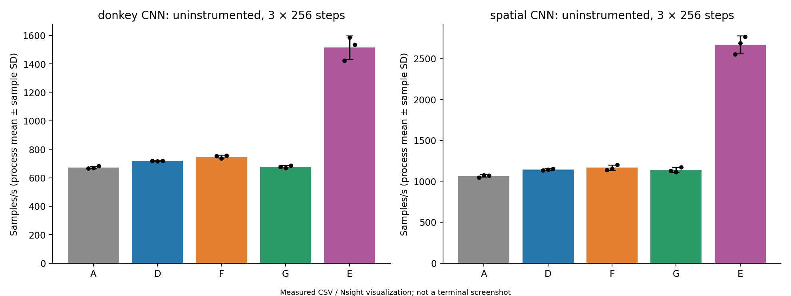

# 阶段 4E：通用 Conv2d dInput Shape-Aware 调度

**代码、GPU 正确性、跨形状验证、两个模型的匹配训练和 Nsight 已完成。Auto 仅在受限的小型 1×1 形状上有独立性能证据；本轮没有证实端到端训练收益，不建议替代默认 original 或显式 fused。**

基线 `experiment/conv-backward-fusion` 的 `d26667f160bf3af772ad24685f73049f6267a11a`；本分支 `experiment/conv-backward-shape-dispatch`。不修改阶段 4D 历史数据、不新增或修改 CUDA Kernel，不进行任何内容哈希验证。所有训练为合成数据，不是实际自动驾驶任务成绩。

## 验收状态

| 项目 | 实际状态 |
| --- | --- |
| 算法/调度分离、默认兼容 | 完成；original 默认，fused 显式模式保留，auto 显式实验模式 |
| 通用参数调度 | 仅 Tensor/卷积元数据，无模型或层号条件 |
| 跨形状测量 | 100 个不同几何形状；原路径/Gather/PyTorch，3 独立重复 |
| 独立泛化验证 | 最终规则冻结后全新24形状；选14个Gather，其余10个original |
| 含实际调度开销复测 | 24形状×4方法×3重复；14个Gather均超过原5%门槛 |
| CPU 回归 | **55 passed / 0 failed / 0 skipped**，5.32 s |
| 最终 A100 回归 | **188 passed / 0 failed / 0 skipped**，8.11 s |
| 首次 GPU 失败与修复 | 132 passed / 4 failed；新增测试模型FP64提升，局部修复后通过，原失败保留 |
| 匹配训练 | 2模型×5组×3重复×throughput/phases，共60进程、15,360 step |
| 训练数值比较 | 1,248项Loss/权重比较均通过，最大绝对误差4.1909516e-8 |
| Nsight | 23 Trace，correlation关联未匹配Kernel为0；采集与普通计时分开 |
| 端到端加速 | **未证实**；DonkeyNet G/D −5.81%，独立CNN G/D −0.52% |

完整入口：[命令](commands.md)、[源码与支持范围](source-analysis.md)、[冻结协议及拒绝记录](design-protocol.md)、[数据索引](data-index.md)。

## 环境和设备

Ubuntu20.04.6，Linux5.15.0-139，双路 AMD EPYC7763（256逻辑CPU）。Python3.8.10、NumPy1.24.4、CuPy12.3.0、PyTorch2.4.1+cu121、GCC9.4.0；项目独立 `.venv`，通过已有激活脚本使用，不改变系统环境。

全部GPU工作使用物理 **A100-PCIE-40GB #6**，UUID `GPU-d40fdd6f-33be-8ccc-fc58-f4daf39a4b82`，映射逻辑 **cuda:0**，其他卡不可见。驱动535.247.01，Toolkit/nvcc12.2/12.2.140，CuPy运行时12020；PyTorch自带CUDA12.1。Nsight Systems2023.2.3。复用4D SM80动态库 `/home/xymo/projects/hytorch/runs/conv_backward_fusion_build_01/libhytorch_cuda.so`，本轮未改Kernel、未重新编译或申请NCU权限。

正式60进程窗口：2026-10-29 **18:53:59–18:58:14 UTC**；另一次Nsight窗口 **19:03:34–19:07:49 UTC**。每个正式比值只来自同一前述训练窗口，不与4D或校准窗口拼接。[199次正式窗口监测](environment/gpu-windows.json)未见外部GPU客户端，采样显存最大743 MiB（全窗口监测峰值，不是逐配置分配峰值）。Nsight192次监测亦无外部客户端。主机仍为共享服务器，未独占CPU。

最早一次校准被其他计算进程打断，保留部分数据但不用于正式拟合。Nsight前严格0 MiB等待器因GPU6无进程但驻留3 MiB而没有启动；多次确认0利用率/无进程后，以显式4 MiB驱动驻留上限重启本轮guard。所有过程记录均保留，没有reset、sudo或系统配置修改。

完整系统、包版本及命令：[environment/system.log](environment/system.log)、[environment/system.log.command.json](environment/system.log.command.json)。

## 从宽规则失败到受限 Auto

32个校准形状覆盖Batch1/4/16、Cin3/16/32/64、Cout16/32/64、Kernel1/3/5、stride1/2、padding0/1和不同矩形/边界空间。随后20个、24个、24个验证形状包含未见Batch2/8、通道8/24/48及包络外输入。最终共100种几何形状，不穷举笛卡尔积。

每形状5次预热、30次完整操作计时，3个独立进程重复、轮换方法顺序；固定FP32输入、seed42+形状编号。每方法保存相同W/gy、完整dInput及原/PyTorch参考，使用既有 `atol=1e-5, rtol=1e-4`，不放宽容差。四个集合加实际auto复测共**2,376条完整张量比较记录**，全部通过；跨形状dInput最大绝对误差 **4.7683716e-7**。这代表这100个测量形状，不代表所有卷积形状。

| 候选 | 冻结/依据 | 独立验证 | 结论 |
| --- | --- | --- | --- |
| work单阈值 | 18:30:18 UTC，`work≤1,161,216`；32校准选11 | 20形状，选7；h10仅+3.47%，不足预设5% | NOT_VALIDATED，未集成 |
| work+串行量 | 18:41:05 UTC，`work≤10,321,920 && Cout*Kh*Kw≤576`；已观察52形状选33 | 全新24形状，选16；v10退化，v13仅+3.98% | NOT_VALIDATED，未集成 |
| 最终受限pointwise | 18:48:08 UTC，沿用首轮阈值，另限1×1/stride1/pad0 | 全新24形状，14选Gather，全部≥5% | VALIDATED；随后才接入auto |

`work=N*Cin*H*W*Cout*Kh*Kw/(Sh*Sw)`是工作量代理，不是精确FLOPs。校准要求平均耗时比≥1.10，且三次Gather进程均值全部低于三次original进程均值；这是超过观测波动的筛选，不称置信区间。独立验证的5%均指 `original_wall/new_wall−1`，不混成墙钟下降率。

第二候选的v10 `[1,64,23,31]`, W`[64,64,3,3]`, stride2/pad1，完整墙钟 **143.555→154.985 μs**；吞吐比−7.37%、墙钟增加7.96%。不能用3×3/5×5的大致工作量可靠预测Gather。旧验证一经观察就改称训练/诊断证据，不重复声称独立验证。最终规则不再拟合阈值；24个p形状在冻结后才计算，旧76个形状不是它的独立泛化证据。所有候选/拒绝记录均保留。

## 实际 Auto 规则和测得的代价

连续FP32 NCHW/OIHW、groups1/dilation1、**1×1，stride1，padding0**，且 `1≤N≤16, 3≤Cin≤64, 16≤Cout≤64, 3≤H≤65, 5≤W≤67`，`N*Cin*H*W*Cout≤1,161,216` 才选Gather。其他几何、dtype/layout、包络外、CPU、高阶图走明确的original；输入剪枝优先于选择器。支持边界的完整说明见[source-analysis.md](source-analysis.md)。

```python
from hytorch.backends.cuda import backend, dispatch_stats

with backend(conv_backward="auto"):
    loss.backward()
print(dispatch_stats())  # auto_original/auto_fused、原因计数和真实native调用数
```

原模型训练其余参数按需传入，不接收模型名/层号；默认无auto。`auto`只是主机元数据函数+计数，**每个调用都执行，但不做Benchmark**。没有在线调优，不把计算交给cuDNN。

实际auto再次测量同一24形状（是运行开销复测，不是另一组新泛化集合），14个Gather耗时比 **1.3124–2.0862×**；平均完整墙钟减少61.548 μs。另10个明确original，auto/original的耗时比对应 `original_wall/auto_wall=0.8229–0.8929×`，平均额外 **27.072 μs**。**原路径选择正确也会承担主机调度成本，Auto并不等于零开销。** 此部分退化没有被“验证通过”隐藏；独立验收门槛只约束被选择Gather的形状，不承诺original分支性能不变。

各形状原值、三进程波动、Event跨度、主机提交/同步、内存请求和实际选择：[actual-auto-01](results/actual-auto-01/)、[100形状配置](results/predeclared-shapes-04.json)。MemoryHook为独立非计时调用的池分配/临时峰值；Torch allocator口径另记，不称DRAM流量。

## CPU/GPU 数值和修复记录

最终CPU55项包含纯元数据边界、默认恢复、CPU原路径、高阶图、输入梯度保留/剪枝、原有4C/4D主机回归及独立CNN与PyTorch对比：[host-03.xml](results/host-03.xml)、[完整输出](logs/host-03.log)。

GPU完整188项包括继承的92项、20个h形状×默认/非默认Stream、24个p形状×两类Stream、独立CNN三步×原SGD/FusedSGD×输入梯度保留/剪枝、FP64/非连续original路由和Auto高阶/混合梯度。检验Forward/dInput/dWeight/dBias、生产者与消费者的非默认Stream顺序、多次反传、初值相同和更新后权重。最终[原始pytest输出](results/raw-01/conv_shape_final_tests_wait_01/attempt-01/guard/terminal.log)、[XML](results/raw-01/conv_shape_final_tests_wait_01/attempt-01/results/gpu-tests.xml)、[逐数值比较](results/raw-01/conv_shape_final_tests_wait_01/attempt-01/results/shape-correctness/comparisons.csv)可追溯到服务器NPZ。

首次GPU136项中4个新增SpatialNet训练用例失败，132通过：`TypeError`分别在Gather dInput（2项）和Fused SGD（2项）指出gy/参数梯度不是FP32。根因是新增模型使用 `F.average`，其Python浮点比例在CuPy路径生成FP64；CPU测试未暴露。**只修改新增SpatialNet**：`F.sum(x,axis=(2,3))*np.float32(1/(H*W))`，保持相同数学运算并加入梯度dtype断言；不修改F.average、优化器、自动求导或正式容差。之后184项全通过，再补路由/高阶测试，最终188项全通过。原失败的[日志](results/raw-01/conv_shape_measurements_wait_01/attempt-01/results/gpu-tests.log)、[XML](results/raw-01/conv_shape_measurements_wait_01/attempt-01/results/gpu-tests.xml)及当时已产生的比较CSV/NPZ均保留。4个失败在数值比较之前抛出类型错误，其现场输入没有单独抓取；后来按相同seed和未改变的初始化在CPU离线重建首批输入/初值，保存在 `runs/conv_shape_spatial_failure_inputs_01/`，其[provenance](results/failure-inputs-01/conv_shape_spatial_failure_inputs_01/provenance.json)明确标注“重建、非现场捕获”，没有冒充失败时保存的张量或再次GPU实测。

## 本轮长期训练性能表

所有行均来自本轮**同GPU6、同一个正式窗口**。DonkeyNet输入`[4,3,66,200]`；独立SpatialNet输入`[4,3,16,16]`。FP32、batch4、SGD0.001、seed42、相同初始权重/输入/顺序、Dropout0、TF32关闭，10step预热后恢复初值，3个独立进程×256step。A是**当前代码复现的无Native CUDA C基线**，不是历史Commit原始成绩。

吞吐来自未插桩的完整epoch训练墙钟，包括数据迭代、训练Step和该脚本的Loss记录/同步；不只用内部step计时。phases另开进程同步测量，不拿其结果计算吞吐。无Nsight/NVTX/MemoryHook插入正式吞吐进程。

| 版本 | 内容 | DonkeyNet samples/s，均值±SD | 相对A | 对PyTorch比值 | SpatialNet samples/s，均值±SD | 相对A | 对PyTorch比值 |
| --- | --- | ---: | ---: | ---: | ---: | ---: | ---: |
| A | CuPy、普通SGD、未剪枝，无本项目Native | 672.69±8.57 | 1.0000× | 44.42% | 1064.29±15.58 | 1.0000× | 39.91% |
| D | Combined + Fused SGD + 输入剪枝 | 718.96±1.30 | 1.0688× | 47.47% | 1142.35±10.03 | 1.0733× | 42.84% |
| F | D + 全部必要dInput Gather | 748.43±9.87 | 1.1126× | 49.42% | 1164.74±33.09 | 1.0944× | 43.68% |
| G | D + Shape-Aware Auto | 677.19±7.47 | 1.0067× | 44.71% | 1136.38±29.77 | 1.0677× | 42.61% |
| E | PyTorch CUDA | 1514.51±83.25 | 对照 | 100% | 2666.84±109.79 | 对照 | 100% |

SD为3个独立进程均值的样本标准差，不是256step混合标准误。不把空间CNN的−0.52%称为显著退化或稳定收益。B/C本轮未重复，沿用历史含义但**不把旧窗口B/C数字插入本表或拼接百分比**。

| 正式比值 | DonkeyNet 吞吐变化 | SpatialNet 吞吐变化 |
| --- | ---: | ---: |
| F/D，当前窗口复核4D | +4.10% | +1.96% |
| G/D，本轮增量 | **−5.81%** | **−0.52%** |
| G/F，较全Gather | **−9.52%** | **−2.44%** |
| G/A，累计 | **+0.67%** | **+6.77%** |
| G/E，达到PyTorch吞吐 | **44.71%** | **42.61%** |

G/D墙钟加速比分别 **0.94182×、0.99437×**，墙钟变化 **+6.18%、+0.57%**；G/A墙钟加速比 **1.00670×、1.06740×**，墙钟下降 **0.67%、6.31%**。吞吐均值之比与平均墙钟之比因先平均再取倒数而可略有不同。[speedups.csv](results/training-01/speedups.csv)保留两种计算。不能把+6.77%累计收益算成本轮Auto独立贡献，它包含D已有优化。

每次256step真实完整训练墙钟（秒）：

| 模型 | A，r1/r2/r3 | D | F | G | E |
| --- | --- | --- | --- | --- | --- |
| DonkeyNet | 1.537474 / 1.529053 / 1.500682 | 1.423035 / 1.427227 / 1.422560 | 1.360027 / 1.389204 / 1.355843 | 1.512323 / 1.528919 / 1.495549 | 0.719497 / 0.645550 / 0.667510 |
| SpatialNet | 0.978406 / 0.951684 / 0.956753 | 0.905054 / 0.894707 / 0.889563 | 0.898943 / 0.888101 / 0.851845 | 0.909444 / 0.919852 / 0.875246 | 0.401802 / 0.381151 / 0.370289 |

[训练逐进程CSV](results/training-01/training-raw.csv)、[15,360个step](results/training-01/training-steps.csv)、[Loss](results/training-01/training-losses.csv)、[同步phase统计](results/training-01/training-summary.csv)、[进展表](results/training-01/progress-table.csv)保留原始精度。每次实际执行顺序在commands.json，独立重复轮换A/D/F/G/E顺序。

训练数值：60进程的初始权重和输入通过数组逐元素比较一致，没有哈希。所有Loss有限、逐step/最终权重比较均在既有 `atol1e-6/rtol1e-5` 内。r1的G DonkeyNet Loss **0.0007207735→0.0001886904**，SpatialNet **0.0475530513→0.0037775037**；其他重复和与A/D/F/E的逐值误差全部保留，不以某一Loss下降声称任务准确率。

## Nsight：实际调度和开销

10份训练Trace（2模型×5组，各16step），12份跨形状Trace（四集合×original/fused/torch，各形状3次），1份24形状实际autoTrace。23份均完成导出/关联，**0个未匹配GPU Kernel**；Trace内共享输入/初值和Loss/权重比较也通过，最大绝对误差4.1443855e-8。

使用CUDA API correlationId归因，不按异步GPU时间与Host范围的重叠猜归属。原始A配置dispatch为空，Trace中本项目Native GEMM/Conv/Pool/FusedSGD/Gather均不存在；D/F/G有Native GEMM/Conv/FusedSGD，构成正对照。CuPy内部cuBLAS当然仍使用CUDA，不叫本项目自研Kernel。

G DonkeyNet实际**64次original/0次Gather**：4个必要dInput都是3×3/5×5。G SpatialNet实际**16次original/16次Gather**：其必要3×3走original、1×1走Gather。首层剪枝两者保持；选择器从未看模型名，层名只用于事后的Profiling标注。

以下分类按实际Kernel名称：Copy指`cupy_copy`，Col2im指`col2im`前缀，GEMM指名称包含`gemm`；其他Kernel完整留在other和原始导出。不能用此命名分类中PyTorch的Copy=0宣称其不存在任何布局转换。

| 模型/配置 | Backward Kernel/step | Copy/step | Col2im/step | Gather/step | 纯Kernel和，μs/step | Host backward NVTX，ms/step |
| --- | ---: | ---: | ---: | ---: | ---: | ---: |
| Donkey D | 74 | 14 | 4 | 0 | 760.20 | 6.6222 |
| Donkey F | 66 | 10 | 0 | 4 | 1124.78 | 6.0974 |
| Donkey G | 74 | 14 | 4 | 0 | 805.86 | 6.6089 |
| Spatial D | 45 | 8 | 2 | 0 | 326.49 | 3.7344 |
| Spatial F | 41 | 6 | 0 | 2 | 334.06 | 3.4109 |
| Spatial G | 43 | 7 | 1 | 1 | 323.65 | 3.7211 |

这些是独立插桩运行，不是正式吞吐时长。Spatial G少2个Backward Kernel/step（1个Copy、1个GEMM、1个Col2im被1个Gather替换），但纯核时只减少约2.84 μs/step，Host范围几乎未缩短。Donkey G不减少任何Backward Kernel。显式F减少提交数但Donkey纯核时反而更多，与4D“Gather计算未必更快、完整路径可能减少Host提交”的机制一致；加速比仍只取本轮正常计时。

Auto元数据Host NVTX均值为Donkey **23.916 μs/调用**、Spatial **25.388 μs/调用**，包含插桩开销，不冒充无插桩纯选择器耗时。普通单算子original分支平均多27.072 μs，是另一口径下的直接额外代价证据。两者支持“调度成本可抵消Kernel/Launch节省”的解释，但**不能把Donkey全部−5.81%因果归结为选择器**：独立Trace的Host范围差异很小，CPU共享、进程/顺序波动、记录开销也存在，尚未进行隔离因果实验。

[Kernel分类](results/profiles-01/kernel-categories.csv)、[各phase](results/profiles-01/trace-phases.csv)、[实际调度逐次记录](results/profiles-01/dispatch-decisions.csv)、[调度Host范围](results/profiles-01/dispatch-host.csv)、[各形状真实Kernel数与核时](results/profiles-01/shape-kernels.csv)、[分配请求](results/profiles-01/allocation-requests.csv)、[每次Backward时间窗](results/profiles-01/backward-windows.csv)均公开。更完整的API/Kernel/NVTX原始导出在数据索引中。

Event跨度、GPU Kernel累计时间、主机API提交时间、同步等待、端到端墙钟不可互相替代；时间线白区是该范围所提交工作的间隙，不是GPU/SM利用率。未进行NCU测量或Occupancy推断。

## 实测图像

图均由本轮CSV/JSON或Nsight导出生成，明确为数据可视化，不冒充终端截图；重建脚本为 [plot_results.py](scripts/plot_results.py)。

1. [100形状工作量与墙钟耗时比](figures/01-cross-shape-wall.png)
2. [独立验证24形状的实际Auto与开销](figures/02-held-out-auto.png)
3. [两个模型五版本吞吐，包含三次重复散点](figures/03-five-way-throughput.png)
4. [相对无Native基线的累计进展](figures/04-cumulative-progress.png)
5. [本轮与4D增量收益/退化](figures/05-incremental-gains.png)
6. [独立同步Forward/Backward/Update计时](figures/06-synchronized-phases.png)
7. [Loss与数值对齐](figures/07-loss-correctness.png)
8. [Backward真实Kernel Launch分类](figures/08-backward-launches.png)
9. [墙钟/Event跨度/纯Kernel和的口径比较](figures/09-timing-scopes.png)
10. [Correlation归属的首个Backward时间线，橙色为Gather](figures/10-backward-timeline.png)



## 结论与待人工审查项

1. 通用调度机制可行且不依赖模型；本轮只有受限pointwise规则取得独立形状验证，不能推广成3×3/5×5通用预测器。
2. 数值、Stream、高阶可微路径、dWeight/dBias、剪枝和FusedSGD均通过。保留两个失败候选、早期GPU失败和所有退化数据。
3. 对14个新小型1×1形状，即使计入选择器仍有31.24%–108.62%的耗时比收益；对保留original的10形状有明确调度开销。性能决策不能只看Kernel时间。
4. DonkeyNet与独立CNN都**没有证明Auto带来稳定训练增量收益**，目前不应将Auto设为默认或推荐训练配置。与PyTorch仍有明显差距。
5. 可将此默认关闭的有限规则/数据保留为研究原型；更宽规则、主机选择开销的隔离分析、选择结果缓存或离线成本表都需要下一轮人工审查后另行决定。没有在本轮继续调参、实现第二个Kernel或开始后续阶段。

完整服务器文件位置和Git便携原始记录见 [data-index.md](data-index.md)。本轮完成后提交推送本分支即停止，不合并main。
