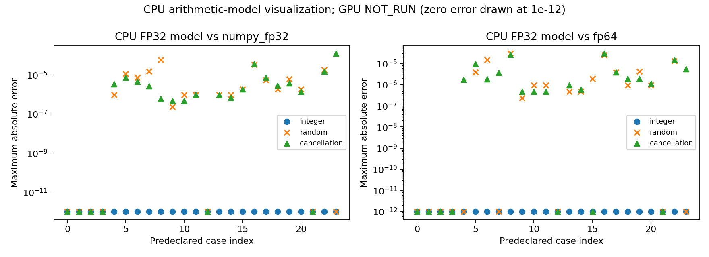
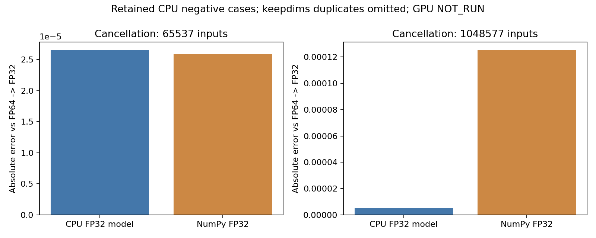

# CUDA算子路线图与通用Reduction基础

**CPU阶段交付完成；GPU正确性和性能尚未验收。**
基线 `experiment/dataloader-bounded-inflight` / `4530176dfdbd320bbd73c18293fabd391def86e4`，
本分支 `experiment/cuda-reduction-foundation`。本轮只实现一个通用FP32 **Sum** 原语，默认关闭；
Mean、SumTo及MSE中求和复用它，不开发第二种Kernel优化。

## 五种状态分开报告

| 状态 | 结果 | 证据/范围 |
|---|---|---|
| 已实现 | YES | 单一CUDA C/C++ Kernel、ctypes/当前stream集成；通用轴/shape，不按模型写分支 |
| 已编译 | YES | nvcc12.2、SM80 cubin+PTX、动态库装载/新符号解析；未执行设备入口 |
| CPU验证通过 | **语义/回归通过，算术诊断部分失败** | 主机196 passed/0 failed/0 skipped；两CNN三步312项通过；FP32算术模型284/288通过、4失败 |
| GPU验证通过 | **NOT_RUN** | 103项新GPU用例仅collect；已有ReLU也未GPU验收 |
| 性能收益已证实 | **NOT_RUN** | 无GPU算子时间、无训练吞吐/加速比、无本轮Nsight，不宣称快于CuPy/PyTorch |

所有执行均CPU或离线编译，CUDA_VISIBLE_DEVICES为空；未选卡、未运行nvidia-smi，GPU使用窗口不存在，
无需要释放的本轮设备Context。没有修改既有CUDA Kernel、优化器、DataLoader和旧报告，未安装依赖。

## 覆盖审查与路线图

[source-analysis.md](source-analysis.md)列出已有GEMM/Conv Forward/Pool Forward、dInput、
Split-K dWeight、FusedSGD、待验收ReLU；区分仍走CuPy的MatMul梯度、BMM、Pooling反向、
Softmax/Norm和逐元素链。[roadmap.md](roadmap.md)给出融合、tiling/shared/归约候选、
中间量和流量估算以及CNN/MLP/Transformer复用范围。
已有算子不重复实现；优先验收Sum/ReLU，再按端到端证据研究点算子链、Norm/Softmax或布局。

## 唯一原型及已知数值负结果

`backend(reduction='native')`显式启用。非空FP32、rank≤8、任意合法轴、keepdims；
256线程block/warp树归约，长归约分4096元素段，同一Kernel再归约部分和，无原子加或完整transpose。
非连续物化的成本需计入完整算子。CPU/非FP32、空输入、rank>8沿用原路径并计数。
Mean/SumTo/MSE公式与自动求导结构不变。设计和理论内存成本见[design.md](design.md)。

CPU FP32算术模型比较24种shape/axis×3种输入×2种keepdims×2个参考。
整数和普通随机样本均通过；强消去输入出现4条失败（2种输入，各重复keepdims）：
65537元素相对FP64超差2.65082344e-5，1048577元素相对NumPy超差1.30414963e-4。
后一例相对FP64误差为5.36581501e-6，比NumPy更小，说明“更像NumPy”与“更准确”并不等同。
**这仍不是全部数值通过**，不据此证明GPU正确或无Bug，不放宽原容差。
最终诊断命令返回1，失败输入、模型输出、两个参考、全部误差原样保存。

首次诊断/新增全量数组保存/修正失败退出码的三份记录都保留，算术和阈值未改变。
独立高精度参考是FP64 sum→FP32；不把NumPyFP32当唯一绝对真值，也没有为提高精度切换部署为FP64。
CPU索引笛卡尔映射已逐元素检查，不能替代GPU同步/访存正确性。

## 已执行检查

- 新主机测试：57 passed；总主机回归：196 passed，0 failed，0 skipped。
- DonkeyNet/SpatialNet各3步CPU Forward/梯度/SGD更新：312项比较通过。
  native请求在CPU上走原NumPy路径，**不是原生CUDA训练**。
- CPU算术诊断：288比较，284通过、4失败，最大绝对差1.30414963e-4；完整CSV/失败输入保留。
- SM80：编译成功，32寄存器、32B shared、0 spill、0 stack；资源量不是实测Occupancy。
- GPU用例103项仅收集；微基准CPU计划、两CNN×6实现共12份训练计划已生成验证。
- GPU正确性、微基准、端到端、Nsight：全部NOT_RUN。

环境为双EPYC7763、Ubuntu20.04、Python3.8.10、NumPy1.24.4、CuPy12.3.0、
PyTorch2.4.1+cu121、GCC9.4、nvcc12.2.140；4个逻辑CPU亲和性，BLAS1线程、CPU Torch4线程。
本轮不探测驱动/当前设备状态；历史驱动值不冒充当前测量。

## 后续GPU准备与停止边界

[gpu-acceptance.md](gpu-acceptance.md)和[commands.md](commands.md)包含单卡窗口入口、
CuPy/native/PyTorch多shape数值、kernel/完整算子、两模型共同状态与训练消融、ReLU验收和Nsight解析。
各配置相同4H真实输入/顺序/初始权重、FP32、TF32关、Dropout关、Batch4、SGD.001、10预热、
256step×3次独立重复；预取方式全组一致，不把CPU流水线收益归为本轮CUDA收益。
训练组A/I/S/R/SR/E分别隔离新增Sum和既有ReLU，不改既有默认行为。

必须先重放本轮负样本；若GPU失败则保存并停止性能测试。未来不能把Event span称纯Kernel时间，
不能按异步重叠错误归因，不能用插桩吞吐代替未插桩训练数据。

本轮提交推送后停止，不运行GPU计划、不继续开发其他算子。

## 数据与图

[完整原始数据索引](data-index.md)、[原始CSV/JSON/编译记录](results/raw-01)、
[stdout/stderr和命令记录](logs)、[CPU数值图](figures/cpu-01)。
服务器完整原始目录：`/home/xymo/projects/hytorch/runs/cuda_reduction_01/`。
GPU性能数值为空，未绘制虚构的性能图。以下为真实CPU数值可视化：

