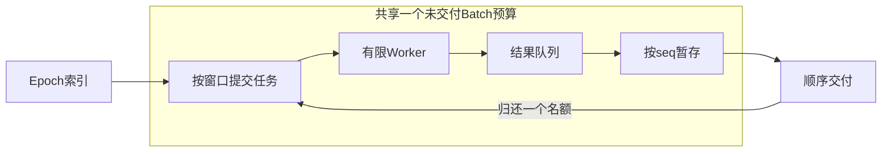

# Bounded In-flight：原因、实现与边界

基线 `dc77d065d58b13e69a67bdc098147964a9e15642`（上一阶段CPU流水线）。
修改仅位于 `hytorch/dataloaders.py`。输入预处理、CUDA、优化器和既有历史记录不变。

## 原因：结果队列有界不等于所有未交付任务有界

原 `_start_epoch()` 一次性向 index_queue 放入整个Epoch的Batch任务及结束标记。
Worker取任务，在CPU上按样本读取和组装Batch，向容量
`num_workers * prefetch_factor` 的 result_queue 提交结果。

消费者必须按seq交付；当seq0迟到时，`__next__()`仍持续get后续结果，并放进
`_pending`。这会腾出result_queue槽位，让Worker领取下一任务并继续生产，
直到几乎整个Epoch进入pending。限制pending字典插入数量会妨碍读到迟到结果，
不能简单阻塞消费者来修复。

已有生命周期修复解决的是满result_queue时的关闭；它没有限制正在计算和暂存的
总任务数量。本轮不重复计入该阶段的文件句柄或异步加载吞吐收益。

## 实现：在提交端维护唯一窗口

设B为Epoch Batch总数，W=`num_workers * prefetch_factor`。
`_send_seq`表示累计已提交任务，`_next_seq`表示已取出交付的连续Batch数。

- Epoch开始只提交`min(B,W)`个任务。
- Worker处理与结果队列协议保持原有CPU数据格式。
- 消费者找到所需seq、从pending取出并推进next_seq后，至多补交一个任务。
- 等待较早Batch期间不发新任务，因此慢Batch只会让有限窗口内的结果积累。

不变量：`0 <= _send_seq - _next_seq <= W`。
初始值满足；等待/Worker运行不增加提交数量；一次交付将差值减一，补交至多加一。
所以任务队列中、Worker处理中的、结果队列中和pending内的未交付Batch合计不超过W。
这是通用Batch调度，没有模型、层号、dtype或特定图像形状分支，没有在线调优或新线程池。

保留既有`prefetch_factor`接口，其含义从结果队列容量加强为总未交付窗口。
不增设一个允许无界缓存的兼容模式，不因为慢Batch吞吐退化而扩大默认值。
异步prefetch_factor必须为正；0原来会令Queue不设容量，现在不能表示合法有限窗口，
因此在Async初始化中用单一明确ValueError拒绝0/负值，没有重复检查或静默替代。
同步路径不变，未使用该异步参数。

## 生命周期与顺序

只提交窗口后，Worker可能等待空index_queue，不能再依赖Epoch开始时已排入末尾的
结束标记。现在关闭时设置原停止Event，并给每个Worker放一个唤醒标记；继续沿用
排空结果队列和真实join。正常耗尽由已知Batch数判断，不再等待结果侧结束标记，
删除了不再需要的active_workers计数。

空Epoch、少于Worker数的Epoch、队列已满、Worker异常、提前close和重新iter均有回归。
`indices`、重复样本、shuffle种子、末批和标签保持原实现；每个新Epoch重置两个seq
和窗口，旧线程关闭后才建立新Epoch。提前break仍使用上下文管理或显式close。
正在执行的用户dataset调用仍需返回后才能join；本轮不试图强行终止Python线程。

## Batch预算与内存指标的区别

窗口限制的是DataLoader内部尚未交付的任务，不是固定字节内存配额。
Worker可能同时持有样本列表与组装后的Batch；调用方当前/保留的已交付Batch、
Python/NumPy分配器缓存、解释器/图像库也占内存。Epoch索引向量仍与样本数成正比。
这些都不等于pending无界增长。可变大小样本也不能由固定Batch预算推出固定RSS。

诊断在pending插入时统计峰值，可能包含刚到达、即将被取出的顺序Batch，因此
瞬时pending峰值至多W；交付后至多W−1。提交/交付计数记录任务信用名额，
不把Worker工作临时副本计为另一个Batch任务。

## 实验与计时

CPU0–3，nice=10，最多4 Worker，BLAS/OMP/MKL=1，CUDA_VISIBLE_DEVICES为空。
正式吞吐不包裹Queue或pending，包含线程创建、整个消费和清理，独立子进程报告
生命周期RSS高水位，包含模块导入。每个配置三独立重复，固定seed42轮换运行顺序。

三个工作负载：相同1024张真实Udacity的快速消费者；相同图像、每Batch模拟消费者
sleep4ms；512个合成图像形状样本，首样本sleep1秒、每样本额外sleep0.5ms。
后两者是控制变量负载，不是实际训练或GPU结果。内存随Epoch长度的128/1024样本
补充点各仅一次，512样本点使用三重复，不能称为三重复全规模性能结论。

独立Queue诊断保存每次put/get（含失败尝试）的墙钟、线程、深度和状态。
pending追踪精确记录数组字节和插入峰值。Queue时间包含等待/锁/调度，Worker间可重叠，
不是CPU计算时间，更不能与正式吞吐相加或跨实验相减估算GPU训练收益。
index_queue.get等待增长表示有限窗口下Worker等待新名额，是预期背压证据。
