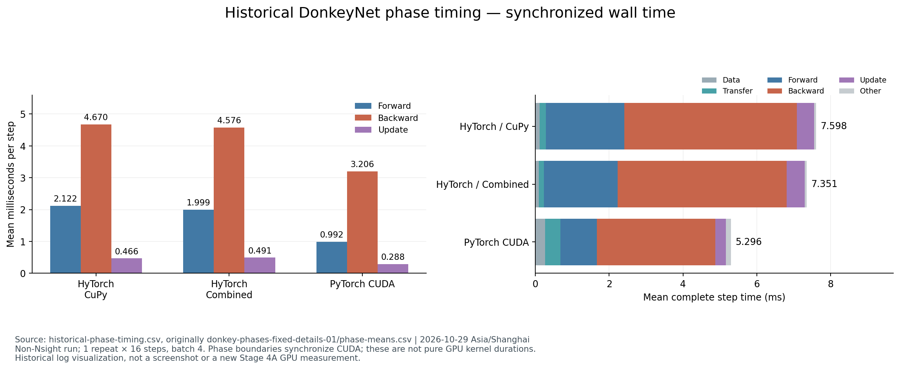
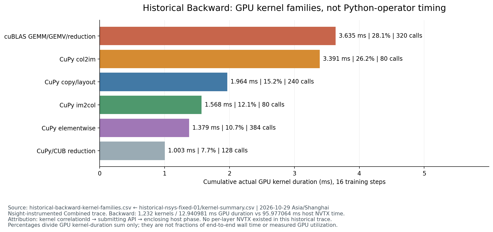
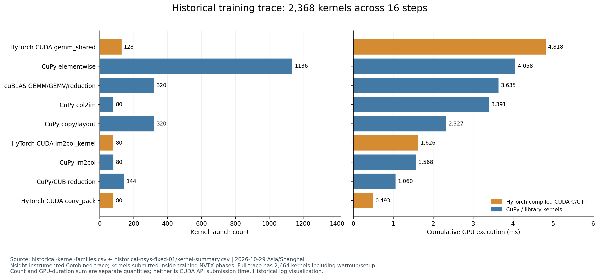
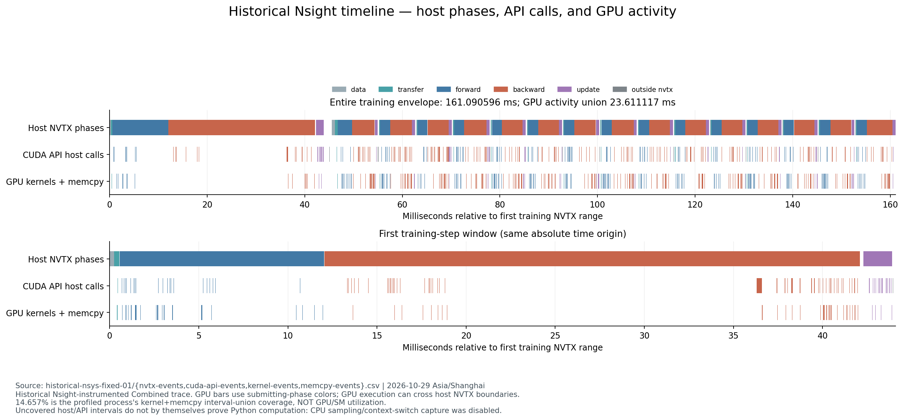
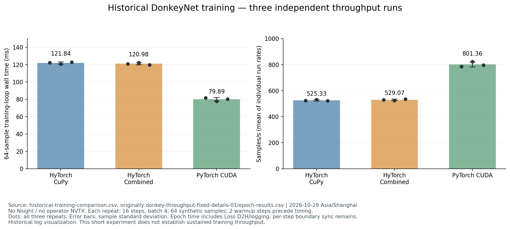
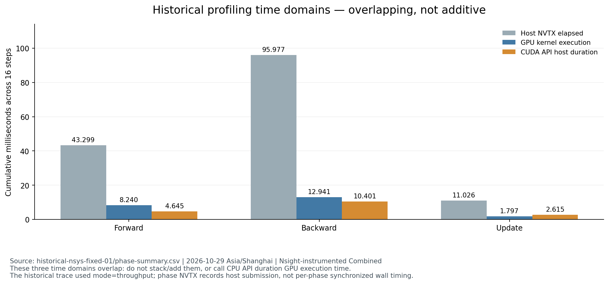

# HyTorch 阶段 4A：DonkeyNet Backward 性能诊断

**状态：PARTIAL / GPU BLOCKED。源码分析、历史 Trace 重算、CPU 插桩验证和可视化已完成；本轮新训练和新 Nsight 采集均为 NOT_RUN。** 下文所有 GPU 耗时来自明确标注的历史实测，不代表本轮完成了更长训练或算子级 GPU 插桩。

阶段 4A 日期：2026-10-29（北京时间）；机器日志使用 UTC。基线为 `experiment/a100-gpu-complete` 最新提交 `aad4d0562fd968083a727099e478e7db64d35dd0`，本轮分支 `experiment/donkeynet-backward-profiling`。继承 FP32 梯度修复和 PyTorch 对照，未集成阶段 3A/3B 原型。

## 1. 完成状态与 GPU 窗口

| 项目 | 状态 | 证据 |
|---|---|---|
| 阶段 1、综合实验和修复后 Nsight 复核 | PASS | [历史分析](historical-analysis.md)、原 SQLite 全事件导出 |
| 真实训练调用链与后端映射 | COMPLETED | [source-analysis.md](source-analysis.md) |
| 最小算子 NVTX / 内存池计数插桩 | IMPLEMENTED | 独立 wrapper，不新增算子间同步、不改计算 |
| CPU 数值透明性与上下文测试 | PASS | 10 passed / 0 failed / 0 skipped；最初 5 项日志亦保留 |
| 3 后端 × 3 重复 × 256 Step 新测量 | NOT_RUN | 启动前 GPU 被其他任务占用，保护程序拒绝启动 |
| GPU 算子归因、GPU 插桩等值、插桩开销 | NOT_RUN | 没有新的 GPU 数据，不以 CPU 测试代替 |
| 新 MemoryHook 实际 GPU 回调统计 | NOT_RUN | 不能从旧 CUDA API 表推断池内分配次数 |
| NCU / 实测 Occupancy | BLOCKED | 当前 RmProfilingAdminOnly=1；沿用已有权限结论，未修改权限或重试 NCU |

12:02 UTC 初查 GPU 6/7 空闲，选择物理 GPU 6，UUID `GPU-d40fdd6f-33be-8ccc-fc58-f4daf39a4b82`。12:04:56–57 UTC 启动保护的两次检查均发现该卡已有计算进程、显存 21960 MiB，因此退出码为 1，**没有启动训练子进程，也没有执行本轮 GPU 计算**。后续 [八卡快照](environment/gpu-busy.txt) 显示所有 GPU 均已被占用，按用户规则转为离线分析，没有争用设备或继续等待八小时。原始及公开脱敏记录见 [measurement-attempt-01](logs/measurement-attempt-01/)。

历史修复后对照与 Trace 使用的是物理 GPU 2，逻辑 GPU 0。不得将其误写为本轮 GPU 6 上的新测量。

## 2. 环境和匹配配置

本机 Ubuntu 20.04.6、双路 AMD EPYC 7763、8×A100-PCIE-40GB；驱动 535.247.01，Toolkit 12.2.2 / nvcc 12.2.140，Nsight Systems 2023.2.3。使用项目既有 `.venv`：Python 3.8.10、NumPy 1.24.4、CuPy 12.3.0、PyTorch 2.4.1+cu121；GCC 9.4.0，OMP/OpenBLAS=4。完整记录见 [system.txt](environment/system.txt)，未安装依赖或改变系统配置。本轮未初始化 GPU Runtime，不能把 Toolkit 版本当作新进程实际加载的 Runtime 版本。

模型输入为 `[4,3,66,200]`，FP32、seed 42、Dropout=0、SGD lr=0.001，无 momentum/weight decay，固定顺序合成数据。历史 Combined 的实际参数为 **matmul=shared、conv=im2col、pool=cupy、tile=16**，见 [历史 config](results/historical-training/phases/combined_r1/config.json)。DonkeyNet 没有 Pooling，不能把 TinyNet 的 native pool 配置搬过来。

历史 throughput 为每组 64 样本、16 Step、warmup=2、3 次独立重复；phases 为各 1 次、16 Step。输入/初始权重的逐元素一致性与最终参数误差沿用 [历史对照证据](../a100-gpu-window/training-comparison/README.md)。本轮未重新执行 GPU 数值对齐。

新方案已准备为 256 样本、batch=4、4 epochs（每次 256 Step）、warmup=10、3 次独立重复，分别执行 throughput 与 phases，按重复轮换三个后端顺序。所有训练命令带 `--no-fingerprints`；**该方案尚未执行**。

## 3. Forward、Backward、Update 的耗时

以下为历史非 Nsight 插桩的同步 phases 测量，各 16 Step 平均，单位 ms/step。phase 前后同步，因此包含主机执行/提交、GPU 工作和同步等待，不是纯 Kernel 时间。

| 后端 | Forward + Loss | cleargrads + Backward | SGD Update | 整个 Step |
|---|---:|---:|---:|---:|
| HyTorch / CuPy | 2.121641 | 4.669581 | 0.466341 | 7.598329 |
| HyTorch / Combined | 1.998631 | 4.576408 | 0.490751 | 7.351271 |
| PyTorch CUDA | 0.992028 | 3.205578 | 0.287597 | 5.296227 |

Combined 的 Backward 占同步 Step 约 **62.25%**；这不是 Conv2d 单算子的占比。Forward 和 Backward 都存在对照差距，不能只将差距归因于反向某一个 Kernel。

独立历史 throughput 数据（包括每步 Loss 回读与训练日志，排除预热/初始化）为：

| 后端 | 16 Step epoch 墙钟均值 ± sample std | 汇总吞吐量 |
|---|---:|---:|
| HyTorch / CuPy | 121.835324 ± 1.228059 ms | 525.299 samples/s |
| HyTorch / Combined | 120.976286 ± 1.242765 ms | 529.029 samples/s |
| PyTorch CUDA | 79.894889 ± 1.911741 ms | 801.052 samples/s |

吞吐量按三次总样本数 / 总墙钟计算，Torch 约为 CuPy 1.525×、Combined 1.514×。图中另展示三次独立速率的均值，定义和原始点均在 [historical-figure-data.json](results/historical-figure-data.json)。不能把这些短历史结果描述为本轮已完成的长测量。

## 4. 历史 Trace 的统计范围

修复后的同一份历史 SQLite 被重新逐行关联：`Kernel correlationId → CUDA API → 同线程 NVTX`。全部 Kernel 均能关联提交 API；GPU 的异步执行可以越过主机范围，不能仅用 GPU 起止时间贴阶段标签。

- 全 Trace **2,664 次 Kernel**，含 2 次 Warmup；训练 NVTX 包络内 **2,368 次**，也是训练 phase 内 API 提交的数量。
- 16 Step 每步均为 **39 Forward + 77 Backward + 32 Update = 148 次**。
- 训练包络 **161.090596 ms**；Kernel + Memcpy 区间并集 **23.611117 ms**，覆盖率 **14.6570424%**。这是所采进程的设备活动区间覆盖率，**不是 GPU/SM 利用率**。
- 训练 Backward 主机 NVTX 累计 **95.977064 ms**，CUDA API 累计 **10.400689 ms**（其中 launch 9.561872 ms），GPU Kernel 累计 **12.940981 ms**。这些时间可以重叠，不能相加作为耗时分解。
- 第一正式 Step 的 Backward NVTX 为 **30.056986 ms**，其余 15 Step 均值 **4.394672 ms**。短 Trace 有明显首步异常，不能把全部主机长间隔稳定外推到生产训练。

完整 API、NVTX、Kernel、Memcpy、同步事件和统计定义见 [历史复核](historical-analysis.md) 及 [historical-nsys-fixed-01](results/historical-nsys-fixed-01/)。原始时间戳、rowid、correlationId 保留；公开进程/线程标识使用稳定标签，未归一化副本留服务器。

## 5. Backward 热点排序和 Conv 占比边界

以下是真实 **GPU Kernel 类别** 排名，范围为历史 16 Step Backward。历史没有细粒度节点 NVTX，所以这不是逐层 Python 算子计时。

| Rank | 类别 | GPU 累计 ms | Kernel 次数 | 平均 µs | Backward GPU 核时占比 | 实现位置 |
|---|---|---:|---:|---:|---:|---|
| 1 | cuBLAS GEMM/GEMV/部分和归约 | 3.635086 | 320 | 11.360 | 28.09% | Conv `tensordot` 与 FC `MatMul(native=False)`；不能逐节点拆分 |
| 2 | Col2im | 3.391406 | 80 | 42.393 | 26.21% | `functions_conv._col2im_gpu` |
| 3 | CuPy Copy / 布局物化 | 1.964265 | 240 | 8.184 | 15.18% | CuPy 内部；具体父节点待采集 |
| 4 | Im2col | 1.568225 | 80 | 19.603 | 12.12% | `functions_conv._im2col_gpu` |
| 5 | CuPy Elementwise | 1.379434 | 384 | 3.592 | 10.66% | 激活、MSE、基础张量运算 |
| 6 | CuPy/CUB Reduction | 1.002565 | 128 | 7.833 | 7.75% | 包括 Conv/FC bias 归约，精确拆分待采集 |

完整原始数值见 [operator-hotspots.csv](results/operator-hotspots.csv)。单个 Kernel 名称中 **Col2im 累计最长**，最大单次 88.384 µs；cuBLAS 在按多个名称合并的类别统计中最多，两种说法的口径不同。

**Conv2d Backward 的总占比尚未精确测得。** 源码和 Trace 能直接确认的 Col2im+Im2col 子路径为 **4.959631 ms，占 Backward GPU 核时 38.3250%**，是可归属子集；还没有包括卷积相关 GEMM、Copy、bias 和主机组织时间。它仅占整个插桩包络的 3.0788%，不可将 38.3250% 写成端到端训练占比。

## 6. 自研 CUDA 是否实际参与，以及差距线索

**参与了 Forward，未参与本模型的 Backward。** 历史 dispatch 每 16 Step 为 `gemm_shared=128、conv_im2col=80`，对应每步 8 次 native GEMM（5 Conv + 3 FC）和 5 Conv。Trace 中自研 `gemm_shared`、`im2col_kernel`、`conv_pack` 均归于 Forward；Backward 的 1,232 次 Kernel 没有这些 native 符号。

- Conv dInput 为 CuPy `tensordot → rollaxis → col2im`；dWeight 为重新 `im2col → tensordot`；bias 另行归约。
- FC 真正调用链为 `MatMul + Add`，反向 GEMM 显式 `native=False`，保留 CuPy/cuBLAS；不是 `F.Linear.backward` 节点。
- ReLU、Tanh、MSE 和 SGD 是分拆的 CuPy 运算。HyTorch 的 Python 自动微分遍历、逐参数更新和大量小数组操作仍存在。
- 首层输入梯度和目标梯度会被 HyTorch 计算，即使它们不用于 SGD；PyTorch 输入 `requires_grad=False`。这是源码确认的差异和优化候选，节省多少尚未测得。

**Kernel Launch 是明显的诊断线索，但尚不能认定为唯一或主要因果瓶颈。** Backward 866/1232 个 Kernel 小于 10 µs；Update 全部 512 个均小于 10 µs。Backward launch API 累计 9.561872 ms，占其主机 NVTX 约 9.96%，这些值含工具观察开销，也不能与 GPU 核时相加。最大设备活动空隙 17.655379 ms 中仅 0.304583 ms 位于 CUDA API 内；没有 CPU 栈和调度事件，无法把其余时间全归因给 Python 或 Launch。

**有布局 Copy 开销，尚无“训练反复 cudaMalloc”证据。** 240 次 CuPy copy 是 GPU Kernel，不是 CUDA Memcpy 事件，不能都归给某个 transpose。Forward/Backward/Update 范围内未观察到 cudaMalloc/cudaFree 或显式同步 API；池内分配需要新增 MemoryHook，当前 NOT_RUN。正式 transfer 有 32 次 H2D、10,137,856 字节、GPU 0.596226 ms；包络内 phase 外有 15 次 Loss D2H（60 字节、GPU 0.038752 ms）和 30 次同步 API（主机 0.173473 ms）。最后一步 Loss 读取在包络外。不能将全进程初始化/退出时的分配开销塞进训练阶段。

因此，现有证据支持“Forward 替换覆盖有限，Backward/布局处理及主机组织仍值得调查”。缺少新的 PyTorch 算子 Trace，**无法给出 HyTorch–PyTorch 差距的精确因果分摊**，也不能据此断言重写 GEMM 一定最有效。

## 7. 三个候选方向，等待人工审核

这些是研究优先级，不是已验证的优化收益；本轮没有实现任何优化 Kernel。

| 优先级 | 候选 | 直接测得的范围 | 优化空间及最小后续原型 |
|---|---|---|---|
| 1 | Conv dInput 的 Col2im | GPU 3.391406 ms / 80 次；Backward GPU 核时 26.21%，插桩训练包络 2.1053% | 定位五层各自的 Col2im，随后用独立 CUDA C 原型比较循环/索引成本、正确性和完整 dInput 路径；优先补测首层无用 dInput 的份额。影响 Backward，端到端收益需另验。 |
| 2 | Conv dWeight 的 Im2col 与布局物化 | Im2col GPU 1.568225 ms，占包络 0.9735%；另有全 Backward copy 1.964265 ms，占包络 1.2194%，不能全部归给 dWeight | 先按父节点拆分 copy，验证直接生成 GEMM 所需布局或减少中间物化的独立原型；CUDA C 适合明确的数据搬运/展开工作，不能仅以改语言推定加速。 |
| 3 | 高频短 Kernel，先以 SGD 更新为小范围候选 | Update 512 核 / GPU 1.796988 ms；主机 NVTX 11.025846 ms，占插桩包络 6.8445% | 16 参数各两次运算可考虑独立融合更新原型，量化 Launch 数下降与实际 Step 墙钟；保持 SGD 公式。该方向影响 Update/端到端，不把它包装成 Conv Backward 优化。 |

GPU 核时占包络的比例不是关键路径份额。由于异步重叠、主机空隙和插桩首步效应，不据此套用 Amdahl 得出已可实现的端到端加速比。开始 4B 前应先补齐 4A 新匹配重复、节点归因和插桩开销，再决定最终目标。

## 8. 插桩验证与保留限制

[profile_training.py](scripts/profile_training.py) 可选包装已加载 Function 的 backward、必要 forward、Im2col/Col2im 和 CuPy dot/tensordot/连续化入口；shape 仅访问元数据。父子范围可恢复、用 finally 保证配对，无微算子间同步。Torch 使用原生 `emit_nvtx(record_shapes=True)`，其 context 进入/退出各有一次同步，位于正式训练循环之外。可选内存池 hook 仅在 RAM 累计次数/字节，结束后写 JSON。

唯一原文件变更是 [bench_cuda_training.py](../../../benchmarks/bench_cuda_training.py) 的 NVTX 参数校验允许 Torch CUDA 复用现有阶段范围；普通未插桩路径、模型、生产 Kernel 和调度均未改变。

10 项 CPU 测试中，TinyNet 和 DonkeyNet 的 Loss、全部梯度与 SGD 后全部权重在插桩前后逐元素相等；其他测试覆盖范围配对、恢复、参数转交和假的 Torch context 合约。**真实 GPU NVTX、MemoryHook、Torch profiler、GPU 等值与插桩开销没有验证。** 通用新 Trace 分析器的可用范围见其 CPU 测试和 [插桩说明](scripts/instrumentation.md)。

## 9. 数据、命令、图与交付

- [commands.md](commands.md)：实际执行与 NOT_RUN 的预备命令分开列出。
- [file-index.tsv](file-index.tsv)：本轮全部文件及字节数，无哈希。
- [raw-file-index.tsv](raw-file-index.tsv)：服务器原始 Nsight、历史训练和本轮拒绝启动记录。
- [profiling-summary.json](results/profiling-summary.json)：机器可读状态，未测 Conv 总占比为 null。
- [historical-training](results/historical-training/)：12 个选定历史运行的完整 config、summary、steps、losses、hardware 副本及来源索引。
- [historical-nsys-fixed-01](results/historical-nsys-fixed-01/)：全 Trace 原始事件与分范围统计，不只上传摘要。
- [source-analysis.md](source-analysis.md)、[historical-analysis.md](historical-analysis.md)：完整源码机制和事件归因。
- [logs](logs/)：CPU 测试、拒绝启动、离线分析、图表及失败记录。

历史原始 Nsight 文件保留于服务器：

```text
/home/xymo/projects/hytorch/runs/nsys_dtype_fixed_01.nsys-rep
/home/xymo/projects/hytorch/runs/nsys_dtype_fixed_01.sqlite
```

本轮数据目录为 `/home/xymo/projects/hytorch/docs/experiments/donkeynet-backward-profiling/`。没有新 `.nsys-rep`，没有上传模型权重、训练样本、工具二进制或凭据。

以下六张图均由真实历史 CSV/SQLite 派生数据生成，明确标明历史来源和计时范围，不是桌面截图：

1. [Forward / Backward / Update](figures/phase-timing.png)
2. [Backward Kernel 类别分布](figures/backward-kernel-distribution.png)
3. [Kernel 次数与累计执行时间](figures/kernel-launches.png)
4. [CPU / API / GPU 时间线](figures/cpu-gpu-timeline.png)
5. [HyTorch 与 PyTorch 训练对照](figures/training-comparison.png)
6. [主机与 GPU 时间口径](figures/host-gpu-time-accounting.png)








提交并推送 `experiment/donkeynet-backward-profiling` 后停止，不合并 main、不开始 4B。当前成果支持候选排序和下一次采集计划，尚不支持宣布完成精确的节点级 GPU 瓶颈归因。
