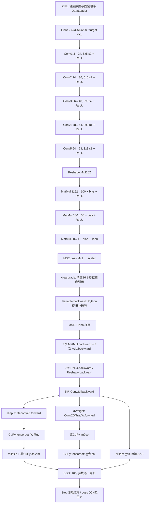

# DonkeyNet 训练调用链与插桩边界

本分析以阶段 4A 基线 `aad4d0562fd968083a727099e478e7db64d35dd0` 的源码为准。这里的次数、形状和路径是源码推导；结果目录中的耗时、GPU Kernel 数量和关联归因来自历史修复后数据的重新分析。本轮 GPU 均有其他进程占用，新测量为 **NOT_RUN**。没有修改生产 Kernel、模型、训练公式或默认调度，也没有集成阶段 3A/3B 原型。

## 实际模型和一次 Step

`bench_cuda_training.py` 明确建立 `DonkeyNet(dropout_rate=0.)`，采用同一份显式 FP32 初始参数、seed=42 的合成输入、SGD lr=0.001，无 momentum/weight decay。模型定义见 [model.py](../../../donkeycar_hy/model.py#L38)，训练循环见 [bench_cuda_training.py](../../../benchmarks/bench_cuda_training.py#L254)。

**实际结构没有 Pooling、BatchNorm，也没有生效的 Dropout。** `L.Dropout` 在 `p<=0` 时直接返回原 Variable（[layers.py:247](../../../hytorch/layers.py#L247)）；不能把通用 `F.dropout` 的实现当作本次路径。五层 Conv 后均有 ReLU，前两层全连接后也有 ReLU，共七次 ReLU；最后一层使用 Tanh。

特别注意：`L.Linear.forward` 调用的是 `F.linear_simple`（[layers.py:112](../../../hytorch/layers.py#L112)），所以实际自动微分图是 **MatMul + Add**，不是 `F.Linear`。`F.Linear.backward` 即使存在也不能用于解释本次 FC 反向的调用次数。



图中的 Backward 分支是计算依赖示意，实际 Python 遍历顺序由 `generation` 控制，并非并行执行。源文件 [core.py:126](../../../hytorch/core.py#L126) 每次取一个 Function、调用 `f.backward`、给输入赋梯度或相加、加入上游 Function；`create_graph=False` 时不建立高阶反向图，但仍经过 Python Function/Variable 包装。

| 层 | Batch=4 输出 | 卷积窗口矩阵 M×K（M=4×OH×OW，K=C×KH×KW） | 单个 FP32 col/gcol 数据大小 |
| --- | --- | --- | ---: |
| Conv1 | 4×24×31×98 | 12152×75 | 3,645,600 B |
| Conv2 | 4×36×14×47 | 2632×600 | 6,316,800 B |
| Conv3 | 4×48×5×22 | 440×900 | 1,584,000 B |
| Conv4 | 4×64×3×20 | 240×432 | 414,720 B |
| Conv5 | 4×64×1×18 | 72×576 | 165,888 B |

这些是源码形状计算，合计每组 col/gcol 为 12,127,008 B；不是实测峰值显存，也不说明这些缓冲区同时存活。每次卷积的 dInput 产生 gcol，dWeight 重新产生 col；Forward 的 col 是函数局部数组，未保存为 Backward 缓存。

## 后端配置的来源

复用修复 FP64 梯度后的 [Combined 原始 config](../a100-gpu-window/training-comparison/donkey-phases-fixed-01/combined_r1/config.json)：

```text
--matmul shared --conv im2col --pool cupy --tile 16
```

原 CuPy 后端为 `--matmul cupy --conv cupy --pool cupy --tile 16`。DonkeyNet 没有 Pooling，所以不能因 Combined 之名把 pool 改为 native，也不能期待 `pool_native` dispatch。原始 16-Step Combined 结果是 `gemm_shared=128`、`conv_im2col=80`：源码解释为每步五个 Conv 内部 GEMM + 三个 FC GEMM，全部位于 Forward。

[阶段 1](../a100-stage1/README.md) 验证的是编译、数值与 TinyNet 链路，不是本模型完整反向 CUDA C 路径；[综合实验](../a100-gpu-window/README.md) 的修复后训练及 [Nsight 记录](../a100-gpu-window/profiling/README.md) 才是本轮历史依据。历史原始 Combined 配置中的 `backward_backend="original"` 与下列源码一致。

## 主要算子到 Python / GPU 的映射

表中“原 CuPy”表示保留的 CuPy 路径，其中既有库 GEMM，也有仓库内写成 `cupy.ElementwiseKernel` 的 CUDA 代码；它不等于在 CPU 上计算。“自研 CUDA C/C++”特指本项目独立编译的 `libhytorch_cuda.so` 及 `kernels.cu`，应与 CuPy JIT 的 `im2col`/`col2im` 名称分开。

| 操作与源码次数/Step | Python 调用及位置 | 实际 GPU 路径/Kernel | 自研动态库参与 |
| --- | --- | --- | --- |
| Conv Forward ×5，原 CuPy | `L.Conv2d.forward` [layers.py:174](../../../hytorch/layers.py#L174) → `Conv2d.forward` [functions_conv.py:56](../../../hytorch/functions_conv.py#L56) → `conv2d_cpu_tensordot_array` [405](../../../hytorch/functions_conv.py#L405) | `_im2col_gpu` 的 `im2col` JIT → `cupy.tensordot`（库 GEMM及可能的布局准备）→ bias add → rollaxis | 否 |
| Conv Forward ×5，Combined | 上述 `Conv2d.forward` → `runtime.conv2d` [runtime.py:144](../../../hytorch/backends/cuda/runtime.py#L144) | `hy_im2col` → `im2col_kernel` [kernels.cu:72](../../../hytorch/backends/cuda/kernels.cu#L72)，`hy_gemm` → `gemm_shared<16>` [33](../../../hytorch/backends/cuda/kernels.cu#L33)，`hy_conv_pack` → `conv_pack` [111](../../../hytorch/backends/cuda/kernels.cu#L111) | 是，三种 Kernel |
| FC Forward ×3 | `L.Linear.forward` [layers.py:112](../../../hytorch/layers.py#L112) → `linear_simple` [functions.py:319](../../../hytorch/functions.py#L319) → `MatMul.forward` [269](../../../hytorch/functions.py#L269) + `Add.forward` [core.py:230](../../../hytorch/core.py#L230) | CuPy=`x.dot(W)`；Combined=`runtime.gemm(shared,tile16)`；bias 为单独 CuPy 加法 | Combined 的 GEMM 是；bias 否 |
| Conv Backward 总计 ×5 | `Conv2d.backward` [functions_conv.py:70](../../../hytorch/functions_conv.py#L70) | 依次生成 dInput、dWeight、dBias，无 native 后端选择 | 否 |
| Conv dInput ×5 | `deconv2d` → `Deconv2d.forward` [functions_conv.py:95](../../../hytorch/functions_conv.py#L95) | `cupy.tensordot(W, gy, (0,1))` → `rollaxis` → `col2im_array` [442](../../../hytorch/functions_conv.py#L442) → `_col2im_gpu` [507](../../../hytorch/functions_conv.py#L507) 的 `col2im` JIT | 否 |
| Conv dWeight ×5 | `Conv2DGradW.forward` [functions_conv.py:147](../../../hytorch/functions_conv.py#L147) | `im2col_array(...,to_matrix=False)` → `_im2col_gpu` [468](../../../hytorch/functions_conv.py#L468) 的 `im2col` JIT → `cupy.tensordot(gy,col,((0,2,3),(0,4,5)))` | 否 |
| Conv dBias ×5 | `Conv2d.backward` [functions_conv.py:79](../../../hytorch/functions_conv.py#L79) → `Sum.forward` [functions.py:201](../../../hytorch/functions.py#L201) | CuPy `gy.sum(axis=(0,2,3))` 归约 | 否 |
| FC dInput/dWeight ×6 GEMM | `MatMul.backward` [functions.py:277](../../../hytorch/functions.py#L277) → `MatMul(native=False).forward` | `gy.dot(W.T)`、`x.T.dot(gy)`；显式绕过 selected/native | 否，即使 Combined 也不调用 `hy_gemm` |
| FC dBias ×3 | `Add.backward` [core.py:235](../../../hytorch/core.py#L235) → `SumTo.forward` [functions.py:241](../../../hytorch/functions.py#L241) | 对广播轴做 CuPy sum | 否 |
| ReLU Backward ×7 | `ReLU.backward` [functions.py:382](../../../hytorch/functions.py#L382) | `x.data>0` 生成 mask，再 `gy*mask`，两个独立数组表达式 | 否 |
| Tanh Backward ×1 | `Tanh.backward` [functions.py:53](../../../hytorch/functions.py#L53) | FP32 `one`、`y*y`、`one-y*y`、乘 gy，多次 CuPy 元素运算 | 否 |
| MSE Forward / Backward ×1 | `MeanSquareError` [functions.py:471](../../../hytorch/functions.py#L471) | diff、平方、sum、除 FP32 batch 常量；反向 diff、乘 gy、乘 FP32 scale、取负 | 否 |
| SGD Update ×16 参数 | `Optimizer.update` [optimizers.py:18](../../../hytorch/optimizers.py#L18) → `SGD.update_one` [91](../../../hytorch/optimizers.py#L91) | `self.lr*grad` 后原地减入 parameter；Python 参数循环，无本项目融合更新 Kernel | 否 |
| Flatten / Transpose | `Reshape` [functions.py:101](../../../hytorch/functions.py#L101)、`Transpose` [121](../../../hytorch/functions.py#L121) | 根据 strides 可仅产生 view，也可能由后续 GEMM/reshape 触发布局 copy | 否；不能把每次调用都算一个 Kernel |

CuPy/cuBLAS 最终选择的 `ampere_sgemm_*`、`gemv*` 等具体符号、归约符号以及 copy Kernel 名称是运行期结果；不由 Python `dot` 或 `tensordot` 的函数名唯一决定。归因必须将 CUDA API correlationId 对应的实际 Kernel 关联到 NVTX，不能只按时间重叠给异步 Kernel 贴标签。

## Conv Backward 的计算与布局

输入 `x` 为 N×C×H×W，权重 O×C×KH×KW，输出梯度 `gy` 为 N×O×OH×OW。

1. **dInput**：`tensordot(W,gy,(0,1))` 沿 O 收缩，形成 C×KH×KW×N×OH×OW；`rollaxis(...,3)` 得到 N×C×KH×KW×OH×OW 的 view；`col2im` 将重叠窗口求和还原 N×C×H×W。`col2im` JIT 内部每个输出像素循环 KH/KW，带边界与 stride 可整除判断，没有 Python 像素循环，也没有原子 scatter。
2. **dWeight**：重新运行 `im2col` 得到 N×C×KH×KW×OH×OW，按 N/OH/OW 三轴与 gy 收缩，输出 O×C×KH×KW。这里没有复用 Forward 的展开缓存，没有调用 native `hy_im2col`，也没有调用 native `hy_gemm`。
3. **dBias**：沿 N/OH/OW 三轴归约，与 dWeight 分开执行。

本机 CuPy 12.3.0 的 `.venv/lib/python3.8/site-packages/cupy/linalg/_product.py:321–333` 先 `_move_axes_to_head`，然后进入 `_core.tensordot_core`；该移动在 418–427 行通过 transpose 实现。源码只确认轴重排/后续收缩入口，**不能仅凭 transpose 就断言实际发生 D2D 数据复制**。是否物化、复制大小及耗时应结合运行期 strides、copy Kernel 和 CUDA Memcpy 表判断。

另一个真实差异是 **HyTorch 总是计算第一层卷积的输入梯度**。`Conv2d.backward` 无按输入需求跳过 dInput 的判断；`Variable.backward` 是得到 gx 并赋到叶子后，才根据 `x.creator is not None` 决定不继续遍历。训练输入和 target 都没有上游 creator，输入梯度并不用于 SGD。PyTorch 的输入由 `torch.from_numpy(...).to(device)` 建立，默认 `requires_grad=False`；其引擎可不计算首层 dInput。具体执行差异及可能节省的时间仍需之后补采有逐层标记的 HyTorch/PyTorch trace 验证，不能把五层 dInput 当作完全匹配的必需工作。历史数据没有相应逐层标记，本轮新测量为 NOT_RUN。MSE 也总是计算未使用的 target 梯度 `-gx0`。本轮均保留原行为。

## 分配、Copy 和同步边界

已由源码确认的事项：

- `runtime._arrays` [runtime.py:87](../../../hytorch/backends/cuda/runtime.py#L87) 对输入调用 `cp.ascontiguousarray`。Combined Conv 的 `w.reshape(oc,-1).T` 传入 `gemm` 后会走该入口；转置权重的连续化是明确的候选布局工作。`ascontiguousarray` 对已经连续的输入可直接返回，不能将每次调用都计作复制。
- Combined Conv 每次申请 `y`、`col`、GEMM result；GEMM 默认申请 output。原 CuPy `_im2col_gpu` 和 `_col2im_gpu` 每次申请输出。它们是数组分配请求，不必一一对应驱动 `cudaMalloc`，CuPy memory pool 可能复用先前分配。
- `Function.__call__` [core.py:183](../../../hytorch/core.py#L183) 每次包装 inputs/outputs、生成 weakref；`Variable.backward` 通过 Python `while`、列表、排序、上下文管理和属性操作组织整个反向；`Optimizer.update` 再逐参数处理。主机提交成本有源码依据，但占比必须实测。
- 生产 C ABI [kernels.cu](../../../hytorch/backends/cuda/kernels.cu#L50) 只 launch 并调用 `cudaGetLastError`；`runtime._call` 传入当前 CuPy stream，**没有显式设备同步，也没有 H2D/D2H**。共享内存 GEMM 内部的 `__syncthreads()` 是 block 屏障，不是 CPU/GPU 全局同步。
- 每步 `transfer` 阶段把 x、target 从 NumPy 传到 GPU。`scalar(loss)` 在 `profile.end` 之后将一个 Loss 回读到 CPU，且每步写 steps/losses JSONL；这些不在 `step_s` 内，但在 epoch `train_wall_s` 内。末尾参数 snapshot 的 D2H/NPZ 保存位于正式训练循环之后；完整 trace 可能包含它，训练 NVTX 包络应排除它。
- FP32 修复已在基线：Tanh 的 `one` 和 MSE 的 scale/denominator 按输入 dtype 创建。它们仍可能导致小标量创建/传输，不能再把修复前 float64 Copy/GEMM 当作本轮瓶颈证据。
- `StepProfiler.begin/end` 均同步；`mode=phases` 还在每个 phase 前后同步。该模式的 `forward_s/backward_s/update_s` 是同步墙钟，包括主机提交、GPU 执行、等待，不是纯 GPU Kernel 时间。`mode=throughput` 去除 phase 边界同步，但仍保留每步边界同步和每步 Loss 回读。

## 历史数据的范围与本轮插桩选择

修复后历史 trace 的 **2,664 个 Kernel** 是完整采集范围（含初始化、warmup 等）；**2,368 个**位于训练 NVTX 的首尾包络；**23.611117/161.090596 ms = 14.657%** 是该包络内 Kernel+Memcpy 时间区间并集覆盖率。它不是 SM 利用率、吞吐效率或每个阶段纯 Kernel 时间。主机 NVTX 范围、CUDA API 提交/等待时间与 GPU Kernel 执行时间分别统计；嵌套范围的 inclusive 值不能直接相加。

合理的最小插桩点是每类 Function 的 `backward` 与 Conv 的 dInput/dWeight 子函数，再对 `_im2col_gpu`、`_col2im_gpu`、`cupy.tensordot` 及 native runtime 的 GEMM/Conv 包一层 NVTX；通过原方法执行实际计算，不替换算法，不在每个微小节点之间加入同步。FC 的父范围必须识别为 `MatMul.backward`，并将 `Add.backward` 的 bias 归约单列或明确计入其他项。可以在独立诊断运行使用 CUDA Event 记录区间，但异步 Event 区间仍可能包含主机供给间隙，不能当作 Kernel 累计执行时间。

源码提出的待验证问题如下，**不预先赋予热点排名**：

| 待验证问题 | 源码依据 | 所需实测证据 |
| --- | --- | --- |
| Conv dWeight 的展开、重排和 GEMM 是否比计算本身更贵 | 每层重新 im2col，再多轴 tensordot | dWeight 父范围关联 Kernel、copy、API 及主机独占时间 |
| Conv dInput 的 col2im 是否是单次较慢 Kernel | 每像素 KH×KW 循环和 stride 分支 | 各层 col2im 实际持续时间与占阶段比例 |
| 小 Kernel 与 Python 调度是否造成供给间隙 | 逐节点 autodiff、七个 ReLU、分拆 Tanh/MSE、16参数 SGD | 主机区间、Launch次数、Kernel时长分布、GPU无任务区间联合分析 |
| native Forward 被布局/分配成本抵消多少 | 显式 weight contiguous、col/result/y、conv_pack | Forward范围内实际 copy、allocation API、native Kernel 总时长 |
| 首层 dInput 和 target 梯度是否是可省工作 | 无 requires_grad/needs_input_grad 剪枝 | 对应范围时间；与 Torch 实际 Backward trace 对比 |

历史修复后数据可支持提出优化候选，但没有逐层/逐算子 NVTX，不能给出精确 Conv Backward 父节点的主机耗时份额。本轮新匹配测量和细粒度 GPU 插桩为 NOT_RUN，仍需空闲 GPU 后补采验证。源码可确认“哪些路径尚未替换”，不能由此直接推出“用 CUDA C 重写一定更快”。本轮不实现任何候选优化。
