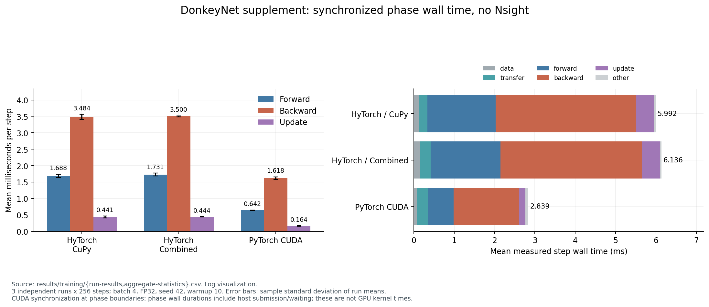
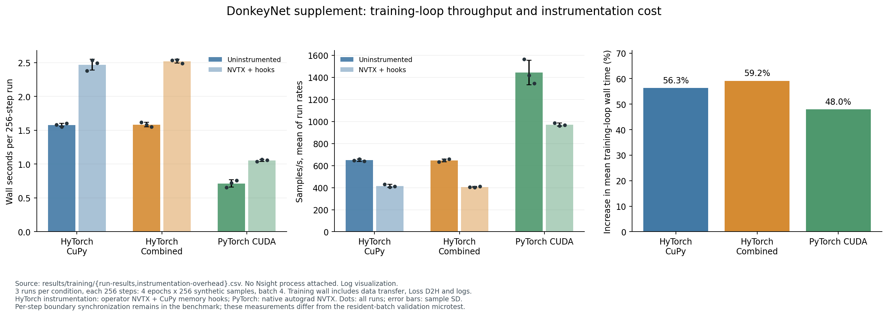
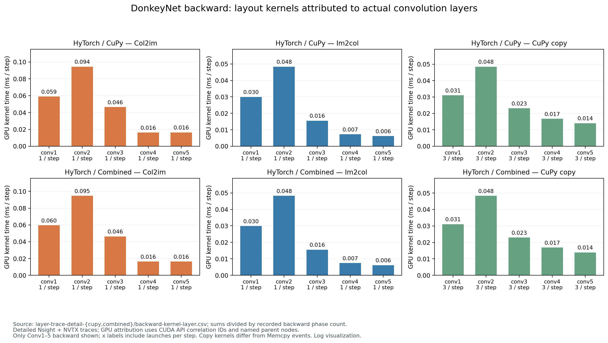
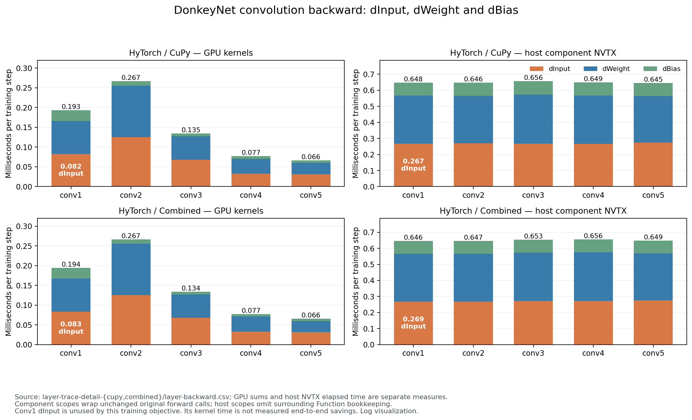
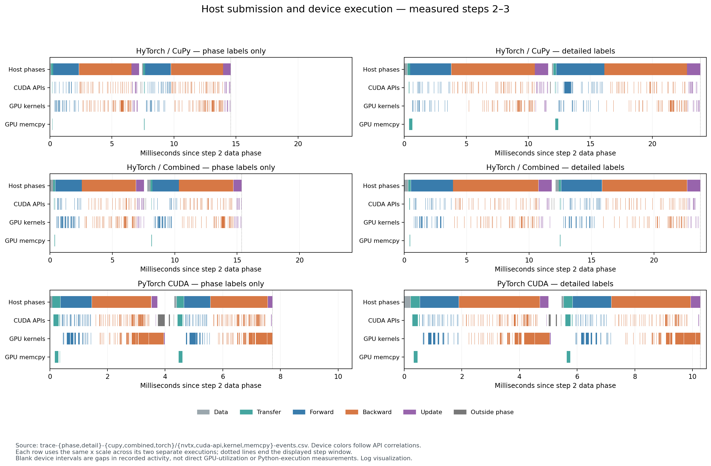

# 阶段 4A GPU 补测：DonkeyNet 的逐层反向与训练瓶颈

**状态：COMPLETED / GPU EXECUTED / 数值检查通过。** 2026-10-29 在物理 A100 2 上完成补测。基于提交 `053ea938af3e280aa604c0ed6ea9a66f102ba2c5`，仍在 `experiment/donkeynet-backward-profiling`；没有修改生产 Kernel、自动求导算法、模型、训练公式或容差，没有进入 4B。

本次证据支持：**HyTorch 的主要端到端差距更应优先从主机提交与执行组织调查，不能简单归因为 GPU 卷积 Kernel 计算太慢。** 首层 dInput 确有无用工作，Col2im 与布局 Copy 也有明确成本；但 PyTorch 的 GPU Kernel 时间并集反而更长，同时训练吞吐量约为 HyTorch 的 2.22 倍。尚无 CPU 栈采样或调度事件，因此不能将所有设备活动间隙直接称为 Python 执行时间。

## 1. 本轮完成了什么

| 项目 | 实测状态 |
|---|---|
| CPU 插桩回归 | 10 passed / 0 failed / 0 skipped |
| GPU 小规模数值验证 | 264 项比较全部通过，其中 160 项插桩前后完全相等 |
| GPU 驻留批次插桩开销 | 3 后端 × 2 插桩条件 × 3 重复，每次 32 Step |
| 无插桩正式训练 | 3 后端 × 2 计时模式 × 3 重复，每次 256 Step，共 18 次 |
| 插桩正式训练 | 3 后端 × 3 重复，每次 256 Step，共 9 次 |
| Nsight Systems | 3 后端 × 阶段标签/详细标签，共 6 份 Trace，各 16 正式 Step，先 warmup 10 次 |
| 逐层与异步归因复核 | 全部 GPU 事件有唯一 CUDA API correlation；独立 SQLite 重算与分析器零差异 |

GPU 保护器于 **12:43:52 UTC** 启动，**12:47:16 UTC** 正常结束，退出码 0，`external_load_interruption=false`。之后仅进行 CPU 离线分析、绘图、文档与提交。保护器每秒检查所选 GPU 的外部计算进程；本轮记录中没有外部进程干扰。

## 2. 环境、设备与配置

- Ubuntu 20.04.6，双 AMD EPYC 7763，共 256 逻辑 CPU；共享 CPU，未绑核或锁定 GPU 时钟。
- **物理 GPU 2**，A100-PCIE-40GB，UUID `GPU-158426a4-6684-7863-8cbe-ed6595f97683`，通过 `CUDA_VISIBLE_DEVICES` 映射为进程内 **逻辑 GPU 0**。未使用其他卡。
- 驱动 535.247.01；Toolkit / nvcc 12.2 / 12.2.140；CuPy Runtime 与 cuDNN 的运行时查询保存在 [GPU 验证 config](raw/gpu-run/validation/config.json)。
- 实际 CuPy Runtime 查询为 12020（CUDA 12.2），Torch cuDNN 为 90100（9.1.0）。`config.json` 保留启动快照；完成状态以相应 `summary.json` / `completion.json` 为准。
- 项目既有 `.venv`：Python 3.8.10、NumPy 1.24.4、CuPy 12.3.0、PyTorch 2.4.1+cu121；Nsight Systems 2023.2.3；OMP/OpenBLAS=4。没有安装新包、使用 sudo 或改变系统权限。
- DonkeyNet 输入 `[4,3,66,200]`，FP32，seed 42，Dropout=0，SGD lr=0.001，无 momentum/weight decay；TF32 关闭；Torch cuDNN deterministic=true、benchmark=false。
- CuPy 后端：`matmul=cupy, conv=cupy, pool=cupy, tile=16`；Combined：`shared/im2col/cupy/tile16`；DonkeyNet 无 Pooling。没有集成 Block32 + Tree。
- 正式训练：256 个合成样本、batch 4、4 epochs，即每次 256 Step；warmup 10 后恢复相同初始权重。无数据增强、无 shuffle，全部显式 `--no-fingerprints`。

环境详见 [server-system.txt](environment/server-system.txt)。最初 [system.txt](environment/system.txt) 是沙箱内查询，NVIDIA 设备不可见；保留该记录，实际设备证据采用随后在服务器执行的 `server-system.txt`。这不是 CUDA 计算失败。合成数据只验证性能与执行链路，不代表真实 DonkeyCar 任务准确率。

## 3. 数值透明性与公平性

GPU 小测试用相同输入和初始权重分别执行 CuPy、Combined、Torch 的未插桩/插桩版本，保留预测、Loss、全部参数梯度、更新后权重和 HyTorch 两个叶子梯度的原始数组。

| 检查 | 结果 |
|---|---|
| 插桩前后 dtype、shape、逐元素等值 | 160 项完全相等，无失败 |
| 对 Torch 的预测/Loss/梯度/更新参数比较 | 68 项通过原 `tests/test_cuda_host.py` 对应容差 |
| 跨框架输入与初始权重等值 | 36 项完全相等 |
| CuPy/Combined vs Torch 最大梯度绝对差 | 两者均为 `2.2351741790771484e-08` |
| CuPy/Combined vs Torch 最大更新参数绝对差 | 分别 `1.862645149230957e-09` / `3.725290298461914e-09` |
| 首层输入与 MSE target 梯度 | HyTorch 实际存在且非零；Torch 两个输入均 `requires_grad=False` 且 `.grad is None` |

沿用容差：预测/Loss/更新参数 `atol=1e-6, rtol=1e-5`，梯度 `atol=1e-5, rtol=1e-4`；插桩透明性要求完全相等，未用容差替代。

27 次正式训练另完成 **486 项输入/初始权重等值、432 项最终参数容差比较、153 项插桩与未插桩最终权重及完整 Loss 序列等值**。全部通过，Loss 全有限。最终参数沿用历史 `atol=1e-4, rtol=1e-3`，最大绝对差 `4.190951585769653e-08`。完整逐参数记录见 [training 结果目录](results/training/)，GPU 小测试见 [tensor-comparisons.csv](raw/gpu-run/validation/tensor-comparisons.csv)。原始 NPZ 保留服务器，不上传权重或样本。

## 4. 未插桩训练速度与分阶段计时

以下是 **没有 Nsight、没有算子插桩** 的 3 次独立重复。墙钟包括 DataLoader、H2D、每步边界同步、Loss 回读与日志，排除初始化与 warmup。吞吐量按三次总样本数除以总训练墙钟计算；图中另显示逐次速率均值及各原始点。

| 后端 | 每次 256 Step 墙钟秒，均值 ± sample SD | 汇总 samples/s | 最后一步 Loss |
|---|---:|---:|---:|
| HyTorch / CuPy | 1.578965 ± 0.025449 | 648.525970 | 0.000188690290087834 |
| HyTorch / Combined | 1.583650 ± 0.032364 | 646.607643 | 0.000188690377399325 |
| PyTorch CUDA | 0.712882 ± 0.053786 | 1436.422412 | 0.000188689751666971 |

Combined 与 CuPy 的均值差小于观测波动，不能宣称本配置的 Forward 替换带来了端到端收益。Combined 每次正式运行的真实 dispatch 为 `gemm_shared=2048, conv_im2col=1280`，对应每步 8 次 GEMM 和 5 次 Conv；Backward 仍走原有 CuPy 路径。

独立 `--mode phases` 的同步墙钟均值如下，单位 ms/step。每个 phase 边界会同步，包含主机提交与等待，不能当纯 GPU 时间；Step 还包含 data/transfer/other。

| 后端 | Forward + Loss | cleargrads + Backward | SGD Update | Step |
|---|---:|---:|---:|---:|
| CuPy | 1.687691 | 3.484027 | 0.440829 | 5.992160 |
| Combined | 1.730504 | 3.500408 | 0.443822 | 6.136422 |
| Torch | 0.642153 | 1.618480 | 0.163772 | 2.839417 |

Combined 的 Backward 约占同步 Step 的 **57.04%**。它与 Torch 的差为约 1.882 ms/step，Forward 差约 1.088 ms，Update 差约 0.280 ms；这些是同一 phases 计时口径下的比较，不与 throughput/Trace 时间混加。

正式训练中，HyTorch 的算子 NVTX + MemoryHook 增加墙钟 **56.34% / 59.15%**，Torch 原生 autograd NVTX 增加 **47.95%**。另一个固定 GPU 驻留批次的 32 Step 小测试得到 59.73% / 58.09% / 74.10%，因排除了数据加载、每步回读与日志，不能与正式训练数字互换。**详细 Trace 用于归因，性能结论用未插桩重复测量。**

## 5. 首层 dInput 与 MSE target 的额外工作

Combined 的详细 Trace 中，首层 `Conv2d.backward → Deconv2d.forward` 标记为 `layer=conv1, leaf_input=true`。16 Step 共提交 48 个 Kernel：每步 1 GEMM、1 Copy、1 Col2im。

| 首层 dInput 子项 | 16 Step GPU 累计 ms | 每 Step µs |
|---|---:|---:|
| GEMM | 0.266563 | 16.6602 |
| Copy | 0.115520 | 7.2200 |
| Col2im | 0.953766 | 59.6104 |
| **完整 dInput** | **1.335849** | **83.4906** |

它占该 Trace **Backward GPU Kernel 累计时间的 9.4436%**。对应主机组件 NVTX 为 4.309198 ms，即每步 0.269325 ms，包含详细插桩开销，而且不含外层 `Function.__call__` 的全部对象管理。两种时间可重叠，不能相加；也不能将它们当作已经验证的端到端节省。此梯度未用于当前 SGD，因此是确实执行但训练目标不需要的工作；本轮没有剪枝。

MSE 目标梯度额外取负为 16 个 Kernel、GPU 0.050272 ms，即 **3.142 µs/step**。共享的误差与预测梯度算术仍对训练有用，不把整段 MSE 全算作 target 浪费。

## 6. 完整 Conv Backward、Col2im、Im2col 与 Copy 对应关系

所有 GPU Kernel 先按 `correlationId → 提交 CUDA API → 同线程 NVTX 父节点` 关联，再按层聚合；不按异步 GPU 时间是否落入 CPU 范围猜归属。下表是 Combined 详细 Trace 的 **GPU Kernel 累计时间**，16 Step，含该层全部 dInput/dWeight/dBias，不重复加子项。

| 层 | 完整 Conv Backward ms | 占全部 Backward GPU 核时 | Col2im µs/调用 |
|---|---:|---:|---:|
| conv2 | 4.269069 | 30.1796% | **94.7829** |
| conv1 | 3.111582 | 21.9969% | 59.6104 |
| conv3 | 2.145938 | 15.1704% | 46.2883 |
| conv4 | 1.239433 | 8.7620% | 16.3922 |
| conv5 | 1.054954 | 7.4579% | 16.3441 |
| **五层合计** | **11.820976** | **83.5668%** | — |

完整 Conv Backward 的主机 NVTX 为 **59.405370 / 108.237469 ms = 54.8843%** 的 Backward 主机范围。这是含算子插桩的主机比例；83.5668% 则是 GPU 核时比例，两者均不是未插桩端到端占比。

- 五层每步各 1 次 Col2im，属于各层 dInput；最重为 **conv2**，其次 conv1、conv3。
- 五层每步各 1 次 Im2col，属于各层 dWeight，重新展开原前向输入；conv2 最大。其全部事件和每层耗时在 [backward-kernel-layer.csv](raw/trace-analysis/layer-trace-detail-combined/backward-kernel-layer.csv)。
- **240 次 Backward Copy 全部属于卷积的 CuPy `tensordot` 内部**：dInput 每层每步 1 次，共 80 次、GPU 0.412862 ms；dWeight 每层每步 2 次，共 160 次、GPU 1.717354 ms；合计 **2.130216 ms**。
- 这些是 GPU Copy Kernel，用于收缩计算需要的布局物化，与 CUDA Memcpy 事件不同。不能把它们全归给 `rollaxis`，也不能把每个 transpose 都当成物理复制。
- FC 的 MatMul Backward 仍为 CuPy/cuBLAS，三个层共 96 个 Kernel、GPU 0.655077 ms。自研共享内存 GEMM 与 Conv im2col/pack 符号出现在 Forward，没有出现在 Backward。

完整的父节点、内部函数与 Kernel 名称保存在 [copy-sources.csv](raw/trace-analysis/layer-trace-detail-combined/copy-sources.csv)、[layer-backward.csv](raw/trace-analysis/layer-trace-detail-combined/layer-backward.csv) 和原始事件表中。

按不重计的 Kernel 类别排序如下，仍为 Combined 详细 Trace 的 16 次 Backward。cuBLAS 是多个符号合并的类别，Col2im 是单个 Kernel 名称，不能混用两种排名口径。

| Rank | 类别 | GPU 累计 ms | 调用次数 | 平均 µs | Backward GPU 核时占比 |
|---|---|---:|---:|---:|---:|
| 1 | cuBLAS GEMM/GEMV/部分和 | 3.972813 | 320 | 12.4150 | 28.0853% |
| 2 | Col2im | 3.734687 | 80 | 46.6836 | 26.4019% |
| 3 | CuPy Copy | 2.130216 | 240 | 8.8759 | 15.0593% |
| 4 | Im2col | 1.716920 | 80 | 21.4615 | 12.1375% |
| 5 | Elementwise | 1.496663 | 384 | 3.8976 | 10.5805% |
| 6 | Reduction | 1.094249 | 128 | 8.5488 | 7.7356% |

按外层 Backward 节点归因，Conv 为 11.820976 ms，ReLU 1.009140 ms，MatMul 0.655077 ms，MSE 0.253055 ms，Tanh 0.193732 ms，Add 0.172832 ms；另有 0.040736 ms 的 `cupy_fill` 未落在这些节点内，保留未标记状态，不按时间重叠硬归给某一层。完整事件和分组定义见 [review-01](raw/trace-analysis/review-01/)。

## 7. 与 PyTorch 的差距来自哪里

为减少细粒度插桩影响，另采仅有 phase NVTX 的三份 Trace。每份包含 10 次 warmup 与 16 正式 Step，训练 Kernel 数分别为 **2432 / 2368 / 1504**，即每 Step **152 / 148 / 94**。全部 Trace 的事件匹配成功；Torch 的 1040 个跨线程训练 Kernel 均经提交 API 与唯一主线程 Backward 窗口关联，详细 Trace 另有 worker 本身的 Backward NVTX 佐证。

Torch phase-only Trace 的首步 Forward 有一次 **21.540393 ms 的 cudaMalloc**，因此保留全 16 步统计，另列首步和后 15 步。详细 Torch Trace 的对应分配仅 1.254246 ms；两份完整包络都约 86 ms 是异常与插桩开销的共同结果，不能据此宣称算子插桩没有成本。

下表仅比较 **phase-only Trace 的后 15 步**，仍属 Nsight 测量，不代替第 4 节独立训练：

| 方法 | 每步主机训练窗口 ms | 每步 GPU Kernel 时间并集 ms | 每步 Kernel 数 |
|---|---:|---:|---:|
| CuPy | 7.815090 | 1.431649 | 152 |
| Combined | 7.600043 | 1.570680 | 148 |
| Torch | 3.973256 | 1.726077 | 94 |

这里主机窗口按每步 data NVTX 起点划分，最后截止最后一个 update NVTX 结束，不包含末步之后的边界同步和最终 Loss 回读。Kernel 按 API 提交步骤归属，即使 GPU 执行越过窗口结束也保留其完整执行时长；因此两列不是同一时间轴上互斥的墙钟分解。

Torch 使用 3 个 stream，有实际重叠；其全 16 步 Backward Kernel 累计 24.754420 ms，但并集只有 21.014235 ms。HyTorch 此处单 stream，sum=union。**GPU Kernel 更短不能解释 HyTorch 的端到端慢；当前证据更指向提交组织、细碎操作与 GPU 活动间隙。** 内存布局 Copy 是实测成本，但仅优化这几个 GPU Kernel 不能据此推定能弥合约 2.22 倍吞吐差距。

重要边界：

1. Kernel+Memcpy 区间覆盖率是所采进程设备活动在指定窗口中的覆盖，不是 GPU/SM 利用率；GPU 核时、CUDA API 时间、NVTX 主机时间可能重叠，不能相加。
2. 未采 CPU 栈或 OS context switch，主机 NVTX 中不在 CUDA API 内的时间可能含 Python、CuPy/Cython、对象管理、插桩和 OS 调度，不能全部写成 Python 时间。
3. 后 15 步单短 Trace 不是 3 次重复性能测量；它用于检查首步异常与异步归因的稳健性。
4. MemoryHook 按 phase/最内层操作聚合，记录池请求、backing alloc 与归还；不是逐层分配或显存峰值统计。逐层 Copy 归因来自 Trace。

在 Combined 详细 Trace 的训练包络内，32 次 H2D 共 10,137,856 bytes、GPU 0.621504 ms；phase 外有 15 次 Loss D2H、60 bytes、GPU 0.040256 ms，以及 30 次 StreamSynchronize、主机 0.148238 ms。末步 Loss 回读位于包络之后。该窗口内没有 malloc/free API；不能据整个进程初始化记录声称训练持续 `cudaMalloc`。显式同步在这个 Trace 中没有占据主要墙钟，但主机间隙和池内请求仍需区分。

PyTorch 详细 Trace 的卷积反向父节点包含 `aten::convolution_backward`，Kernel 有 wgrad/dgrad、FFT、Winograd 等实现。首层只观察到权重梯度与归约，没有 dInput Kernel，与 `requires_grad=False` 一致；不能再把其路径描述为 CuPy `tensordot + im2col/col2im`。

## 8. 下一步建议：区分主要瓶颈与最小 CUDA 原型

**主要研究优先级是减少 Backward 主机提交与细碎操作。** Conv Backward 是最大的 GPU 工作集合，conv2 最重；只重写 Col2im 单个 Kernel 不能保证减少 Python 图遍历、CuPy 调用与布局物化。

如果下一轮先选一个范围小、因果清楚的 **CUDA C/C++ Kernel 原型**，建议先验证 **多张量 SGD 融合更新**：

- 本轮直接观察到 HyTorch 每 Step **16 次 multiply + 16 次 subtract = 32 Kernel**；Torch 为 **1 个 `multi_tensor_apply_kernel`**，父操作 `aten::_foreach_add_`。这是实测实现差异。
- 可用独立多张量更新原型保持相同 SGD 公式，验证数值、launch 数和未插桩 Update/端到端墙钟；能直接检验减少主机提交的收益。
- Update 仅占 Combined 同步 Step 约 **7.23%**；即使理想消除整个 Update，在该同步计时模型中上限也只有约 **1.078×**，不是已经得到的加速比，也不能套到其他吞吐口径。
- 更大的候选是 conv2 dWeight 的展开、两次 Copy 与收缩调用组织，先以单层 C++ 入口/布局原型验证能否减少提交和物化。它工程范围更大，应在人工审查后决定。
- 首层 dInput 与 target 梯度剪枝属于自动求导需求传播，不能冒充 CUDA Kernel 优化；本轮仅标记，不修改。

本轮没有实现任何优化原型。未解决的是主机残余时间的精确 CPU 栈分摊、上述候选的真实端到端收益，以及长时间/真实数据训练下结论是否保持。NCU 权限未改变，也未用它伪造性能计数器结果。

## 9. 原始数据、复现命令与全部图像

- [commands.md](commands.md)：执行命令与日志入口。
- [raw-file-index.tsv](raw-file-index.tsv)：每份服务器原始文件、字节数及 GitHub 副本路径，无哈希。
- [file-index.tsv](file-index.tsv)：本补测交付文件索引。
- [raw/gpu-run](raw/gpu-run/)：全部配置、stdout/stderr、逐步 Loss/时间、GPU 验证与命令记录。
- [raw/monitor](raw/monitor/)：设备选择、UUID 映射、运行期间整卡监测、完成状态。
- [raw/trace-analysis](raw/trace-analysis/)：六份完整原始事件 CSV、分阶段/逐算子/逐层统计、首步/后 15 步、命令与日志。
- [results/independent-review](results/independent-review/)：独立 SQLite 复核，96 条逐步 Kernel 记录。
- [results/training](results/training/)：27 次训练的全部 6912 条逐步记录、108 条 epoch 记录及数值比较。

服务器原始文件完整保留在：

```text
/home/xymo/projects/hytorch/runs/donkeynet_4a_supplement_01/
  validation/*.npz
  measurements/*/{initial_weights,comparison_inputs,final_weights}.npz
  trace-{phase,detail}-{cupy,combined,torch}.nsys-rep
  trace-{phase,detail}-{cupy,combined,torch}.sqlite
/home/xymo/projects/hytorch/runs/donkeynet_4a_supplement_monitor_01/
/home/xymo/projects/hytorch/runs/donkeynet_4a_supplement_analysis_01/
```

大型 Nsight、SQLite、权重/样本 NPZ 留服务器；适合 Git 的日志、CSV/JSON/XML、最终 PNG 同步上传。旧历史报告、原始日志与初稿图保留。图像全部来自真实 CSV/日志可视化，不是桌面截图。

1. [同步 Forward / Backward / Update](figures/phase-comparison.png)
2. [未插桩吞吐与插桩开销](figures/throughput-and-overhead.png)
3. [完整训练 Loss](figures/loss.png)
4. [各层 Col2im / Im2col / Copy](figures/trace-layer-layout-hotspots.png)
5. [逐层 dInput / dWeight / dBias](figures/trace-convolution-gradient-components.png)
6. [三后端 Kernel 次数与时间](figures/trace-kernel-count-and-time.png)
7. [CPU/GPU 时间线，前两步含首步异常](figures/trace-host-device-timelines.png)
8. [CPU/GPU 时间线，第 2–3 步](figures/trace-host-device-timelines-steps2-3.png)







提交并推送本实验分支后停止，等待共同审查数据，不启动阶段 4B。
