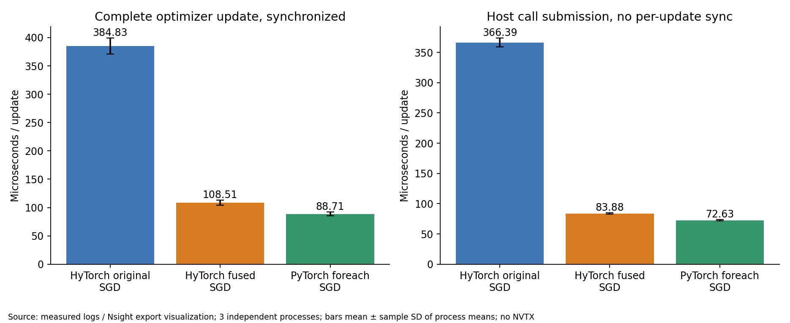
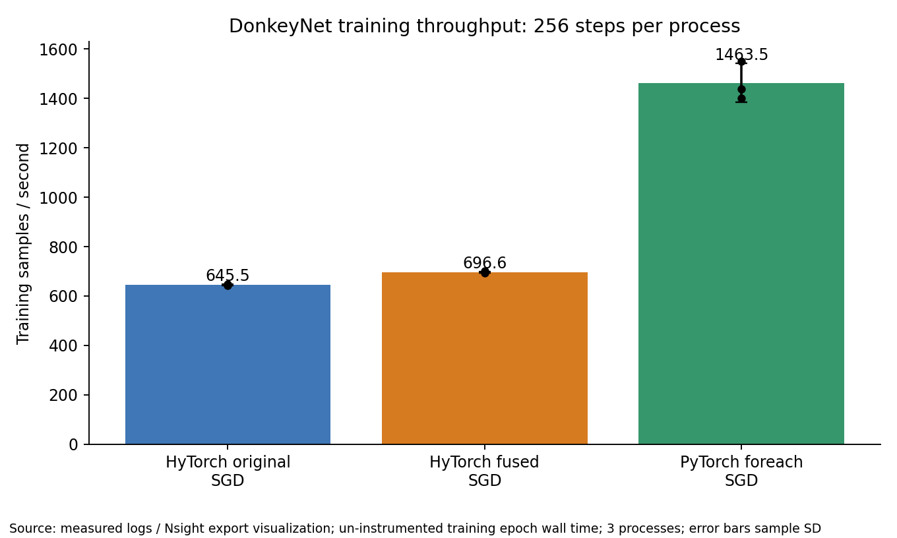
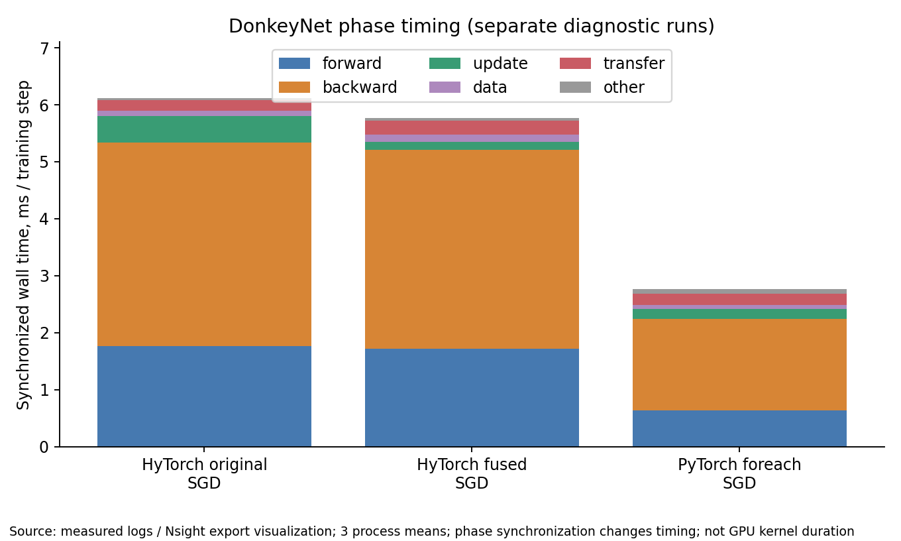
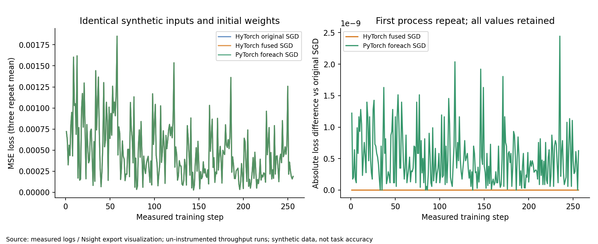
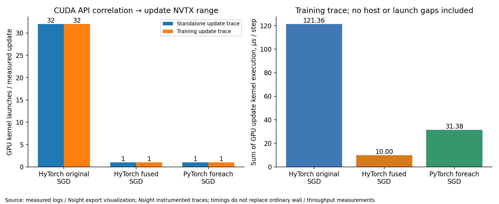
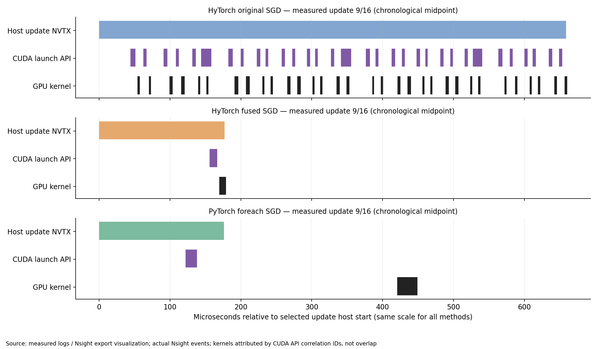

# 阶段 4B：原生 CUDA Multi-Tensor SGD

**状态：PASS，GPU 实测及数值对照完成；保留为显式可选后端。** 本轮在物理 A100 GPU 2 上，将 DonkeyNet SGD 的实际 Kernel 数从 **32 降至 1（减少 96.875%）**。完整独立 Update 同步墙钟从 **384.828 μs 降至 108.512 μs，3.546×**；未插桩训练吞吐从 **645.514 增至 696.609 samples/s，+7.915%**。PyTorch 为 1463.531 samples/s，仍是 Fused HyTorch 的 **2.101×**。这些是同一空闲窗口、三次独立进程的结果，不代表全部模型或持续负载下的通用收益。

基线：`experiment/donkeynet-backward-profiling`，提交 `8e803e1007ad56d3255a2ea75f78517b62cbdbe1`。本轮分支：`experiment/fused-sgd-cuda`。实验时间为 2026-10-29 21:38:40–21:41:33（北京时间，UTC+8；原始日志 13:38:40–13:41:33 UTC）。阶段 4A、3A、3B 记录未修改；不涉及 Conv/GEMM/Backward 算法优化。

## 1. 数据、实现与复现入口

- [全部命令与参数](commands.md)、[源码、形状及内存生命周期分析](source-analysis.md)、[数据索引](data-index.md)。
- [完整环境](environment/server-system.txt)、[额外编译器及 PyTorch 版本](environment/extra-versions.txt)。
- [逐文件服务器路径、字节数和 Git 副本索引](results/raw/file-index.csv)。大文件保留服务器，原始文本、CSV、JSON、XML 和图片随报告提交。
- [正确性原始记录](results/raw/fused_sgd_cuda_01/correctness/correctness.csv)、[数值汇总](results/numerical-comparison.json)、[计时汇总](results/analysis-summary.json)、[Nsight 汇总](results/trace/trace-summary.json)。

新增核心为 [fused_sgd.cu](../../../hytorch/backends/cuda/fused_sgd.cu)，通过 [runtime.py](../../../hytorch/backends/cuda/runtime.py) 和 [SGD 接口](../../../hytorch/optimizers.py) 显式启用：

```python
optimizer = SGD(lr=0.001, fused=True).setup(model)
```

默认 `SGD(lr=...)` 保留原实现。CPU 参数保留原更新；hooks 顺序、FreezeParam 和无梯度过滤保持。CUDA Fused 当前支持同设备、连续 FP32、最多 64 个活跃参数张量，拒绝参数与参数/梯度的存储重叠及混合 CPU/CUDA 参数，不静默回退。DonkeyNet 16 张量共 251749 元素，映射为 993 个 256 线程块，一次 Launch 更新。每步重读梯度地址，无参数打包拷贝、额外同步或持久梯度指针缓存。

## 2. 环境与计时口径

| 项目 | 本次实测 |
|---|---|
| 主机 | Ubuntu 20.04.6；2 × AMD EPYC 7763；256 逻辑 CPU |
| 设备 | NVIDIA A100-PCIE-40GB，40960 MiB，SM80 |
| 映射 | 物理 GPU **2**；UUID `GPU-158426a4-6684-7863-8cbe-ed6595f97683`；进程逻辑 GPU **0**；PCI `0000:41:00.0` |
| 驱动 / Toolkit | 535.247.01 / CUDA 12.2.2，nvcc 12.2.140 |
| CuPy runtime / Python | runtime 12020（12.2）/ Python 3.8.10，独立 `.venv` |
| 数值库 | NumPy 1.24.4；CuPy 12.3.0；PyTorch 2.4.1+cu121 |
| Profiler | Nsight Systems 2023.2.3；CUDA + NVTX，关闭 CPU sampling/context-switch tracing |

复用阶段 4A 单卡 guard，启动前两次检查该 UUID 无计算进程、显存占用和 GPU 活动；运行中约每秒检查外部客户端。本轮 133 个监控样本，无外部客户端，正常结束。其他 GPU 未被本轮使用。没有安装新包、sudo、系统配置修改或哈希校验。

所有方法 FP32、SGD lr=0.001、seed=42；训练 DonkeyNet 输入 `[4,3,66,200]`，Dropout=0。HyTorch 两组完全相同 Combined 配置：`matmul=shared, conv=im2col, pool=cupy, tile=16`，仅 SGD 开关不同。PyTorch 使用既有匹配模型和 foreach SGD。TF32 关闭；相同权重、输入和数据顺序通过实际数组逐元素比较验证。

- **Update 微基准**：每方法 3 个独立进程，每进程两个分开的模式，各预热 5 次、恢复相同权重、正式更新 100 次；实际 DonkeyNet 形状和固定相同梯度。共 1800 次逐次测量。
- **完整 Update 同步墙钟**：计时前同步，计时包含 `update()` 和结束同步。包含 Python、元数据、提交、设备执行和等待。
- **主机提交时间**：另一轮更新中仅计主机调用；循环结束统一同步。不能称为纯 GPU 时间。
- **训练吞吐**：每方法 3 个独立进程，预热 10 步并恢复权重；256 samples × 4 epochs / batch 4 = 256 正式 Step、1024 samples。吞吐采用全部 epoch 训练墙钟；包含训练循环开销，区别于逐步 `step_s` 之和。
- **阶段时间**：另开同配置 3 次 `--mode phases`，各阶段同步；不能代替未插桩吞吐。所有训练均 `--no-fingerprints`。
- **Nsight**：另开 6 份 Trace，仅用于归因。Update Trace 每模式 100 次；训练 Trace 16 正式 Step，另有 10 次 warmup。NVTX 时间、CUDA API 时间和 GPU Kernel 时间严格分开。

## 3. 编译与正确性

SM80 动态库成功编译、加载并参与 GPU 计算；独立保存 [build.json](results/raw/fused_sgd_cuda_build_01/build.json)、[build.log](results/raw/fused_sgd_cuda_build_01/build.log)。原 `kernels.cu` 保持原样，新增独立 CUDA 编译单元。PTX 检查为 12 registers、0 stack/spill；详见源码分析。无编译失败、数值失败或需要修复的历史 CUDA Bug。

| 验证 | Passed | Failed | Skipped | 记录 |
|---|---:|---:|---:|---|
| 既有 CUDA host / CPU Conv / packed GEMM 回归 | 25 | 0 | 0 | [日志](logs/host-regression-01.log)、[XML](logs/host-regression-01.xml) |
| 新增 SGD CPU/default/hooks 测试 | 9 | 0 | 0 | [日志](logs/fused-host-tests-01.log)、[XML](logs/fused-host-tests-01.xml) |
| 真实 GPU 独立 Kernel 与 DonkeyNet 集成 | 18 | 0 | 0 | [日志](results/raw/fused_sgd_cuda_01/gpu-correctness.log)、[XML](results/raw/fused_sgd_cuda_01/gpu-correctness.xml) |

GPU 测试先执行单 Tensor、多尺寸、极小/大数组、尾块，再覆盖多步更新、非默认 Stream、原地写入与梯度不变、hooks/冻结、无梯度、64 Tensor 边界和错误输入，最后运行三步 DonkeyNet 对照。303 条逐数组比较均无超差，最大绝对误差 `4.172325134277344e-7`。两张量各 10 步持有旧梯度并产生 10 个不同新地址，排除了内存池地址复用掩盖过期指针的情况。

采用既有参数更新对齐 `atol=1e-6, rtol=1e-5`，DonkeyNet 梯度 `atol=1e-5, rtol=1e-4`；未放宽标准。Kernel 用 `__fmul_rn` 后 `__fsub_rn`，保留原 CuPy 先乘后减的两次 FP32 舍入，不改为一次 FMA。

独立 Update 的 288 条跨方法参数比较通过，最大绝对误差 `3.725290298461914e-7`；所有固定梯度保持不变。18 次长训练的初始参数/输入一致，逐 Step Loss 和最终参数均通过同一 `1e-6 / 1e-5` 标准。**Fused 与原 SGD 全部最终参数及 Loss 逐元素相等**；PyTorch 最大绝对差 `2.9802322387695312e-8`。其最大非零参考相对差 `4.7214177463905576e-5` 出现在小参考值，按组合绝对/相对容差通过，不能仅比较相对项。

原 SGD/Fused 第一与最后一次 Loss 均为 `0.0007207734743133187 → 0.00018869037739932537`；PyTorch 为 `0.0007207746966741979 → 0.00018868975166697055`。全部有限。这是合成训练执行链路对照，不是驾驶任务效果。

## 4. 独立 Update 性能

下表为 **3 个独立进程均值的均值 ± 样本标准差**；不把 300 次相关调用当成 300 次独立实验。

| 未插桩口径（μs/update） | 原 SGD | Fused SGD | PyTorch foreach |
|---|---:|---:|---:|
| 完整同步墙钟 | 384.828 ± 14.207 | **108.512 ± 4.290** | 88.710 ± 3.267 |
| 无逐次同步的主机提交 | 366.392 ± 7.252 | **83.878 ± 1.303** | 72.631 ± 0.943 |

完整 Update 加速 **3.5464×**、时间减少 **71.803%**；Fused 独立完整 Update 仍需 PyTorch 的约 **1.223×** 时间。每个进程内 100 次调用的 mean/std/median/P95 全部保存在 [逐进程统计](results/update-benchmark-per-repeat.csv)；[汇总](results/update-benchmark-summary.csv) 的 median/P95 是三个进程均值的分布，不能用作单次尾延迟。

单次调用同步墙钟的各重复 median / P95（μs）：原 SGD `381.561/412.678, 370.496/438.708, 366.919/402.428`；Fused `93.971/169.590, 96.431/185.562, 96.276/125.436`；PyTorch `85.355/103.308, 83.267/106.003, 82.961/97.746`。尾部波动没有被删除。

独立 Nsight 微基准同步模式下，纯 GPU 核时原 SGD **109.477 μs**、Fused **8.223 μs**、PyTorch **24.047 μs**。这与完整同步墙钟属于不同实验，不能用 GPU 核时比值代表完整更新加速。



## 5. 端到端训练与阶段时间

| 未插桩 256 Step，3 次均值 ± SD | 原 SGD | Fused SGD | PyTorch |
|---|---:|---:|---:|
| 全部 epoch 训练墙钟（s） | 1.586363 ± 0.008457 | **1.470002 ± 0.007233** | 0.700996 ± 0.036817 |
| 吞吐（samples/s） | 645.514 ± 3.437 | **696.609 ± 3.430** | 1463.531 ± 78.631 |

三次原始吞吐分别为原 SGD `648.658, 646.038, 641.844`；Fused `693.328, 700.170, 696.329`；PyTorch `1437.714, 1551.824, 1401.053`。本窗口每个 Fused 重复均高于每个原 SGD 重复，支持本配置的正向收益。吞吐均值提升 **7.9155%**，墙钟均值减少约 **7.335%**，两个百分比的分母不同。PyTorch 波动较大；3 次重复不足以对所有服务器负载和模型外推精确提升幅度。

| 另测同步阶段（ms/step，3 次均值 ± SD） | 原 SGD | Fused SGD | PyTorch |
|---|---:|---:|---:|
| Forward | 1.769158 ± 0.050765 | 1.719379 ± 0.021372 | 0.637407 ± 0.011821 |
| Backward | 3.571741 ± 0.078117 | 3.495255 ± 0.054301 | 1.609859 ± 0.017184 |
| Update | 0.457494 ± 0.013426 | **0.136526 ± 0.008695** | 0.163853 ± 0.002694 |
| `step_s`（另含 data/transfer/other） | 6.120952 ± 0.203636 | 5.764154 ± 0.274666 | 2.759823 ± 0.097650 |

训练阶段 Update 缩短 **3.351×**。Fused Update 占同步 `step_s` 约 **2.369%**；Backward **60.638%**、Forward **29.829%**。二者没有被本轮代码优化，主机调度/布局及反向计算仍是后续诊断重点。Forward/Backward 同步墙钟也有变化，不能把全部 7.915% 吞吐增益精确归因成单一 Update 节省；更不能从同步阶段相加替代吞吐计时。

外层监控的吞吐进程活动样本显存峰值分别为 HyTorch 原/Fused **469/469 MiB**、PyTorch **569 MiB**；这是约秒级采样峰值，非分配器或瞬时真峰值。每个吞吐进程只有 1–3 个带本轮 GPU 客户端的样本，包含初始化、预热和收尾，因此不能当精确训练 GPU 利用率。完整 [133 条监控](results/raw/fused_sgd_cuda_monitor_01/gpu-load.jsonl) 和 [逐进程窗口统计](results/hardware-process-windows.csv) 保留显存、负载、时钟、功率和温度；未锁时钟，未排除共享 CPU 调度噪声。







## 6. Nsight：Launch、元数据与实际时间线

| 训练 Trace，每正式 Step | 原 SGD | Fused SGD | PyTorch |
|---|---:|---:|---:|
| Forward Kernel 数 | 39 | 39 | 27 |
| Backward Kernel 数 | 77 | 77 | 66 |
| Update Kernel 数 | **32** | **1** | **1** |
| 整步 Kernel 数 | 148 | 117 | 94 |
| Update GPU Kernel 累计执行（μs） | 121.356 | 10.002 | 31.382 |
| Update CUDA Launch API 主机累计（μs） | 180.265 | 10.471 | 20.088 |
| Update NVTX 主机范围（μs，插桩） | 694.865 | 191.307 | 209.579 |
| Update 显式 GPU Memcpy | 0 | 0 | 0 |

全部 648 个正式 Update 范围都符合 32/1/1 的实际数目。Fused Kernel 名为 `multi_tensor_sgd_kernel`，不是 CuPy ElementwiseKernel。训练 Forward GPU 累计核时为原/Fused `561.277/564.589 μs`，Backward 为 `882.576/883.186 μs`，数量与时间基本一致，变化集中于 Update。

Fused 使用固定 **1544 字节** Kernel 参数 POD，在提交时带入设备，不另启动描述符复制 Kernel，不显式 `cudaMemcpy`。训练 Trace 的 Python 元数据验证/准备主机范围为 **78.476 ± 13.889 μs**（median 73.093，P95 103.019）；微基准同步模式为 **61.326 ± 15.637 μs**（median 55.754，P95 111.274）。训练 native_submit 包含 ctypes 子范围，均值分别 **39.169 / 30.067 μs**；对应微基准为 **23.968 / 16.853 μs**。这是带 NVTX/Nsight 的主机路径计时，嵌套范围不能相加，也不是未插桩净开销。**参数隐式传输和 C++ 填描述符混在提交路径，当前 Trace 无法单独量出纯传输时间；不能宣称元数据零开销。**

原 SGD 的训练 Update GPU 核区间跨度内，排除这些 Kernel 后平均还有 **516.765 μs** 间隙；Fused 单 Kernel 的这一内部间隙为零。仅表示该 Update 的碎片化提交消失，不证明整个 GPU 在原间隙都空闲，也不包含 Fused Kernel 启动前的主机准备/排队。

**保留的退化观测：** 单次插桩训练包络原 SGD **132.246857 ms**、Fused **141.723813 ms**，Fused 反而增加约 **7.166%**；PyTorch 为 **75.598456 ms**。这份 Trace 支持 Update 窗口缩短，却不支持整步训练变短。没有隔离插桩额外开销与运行波动各自的贡献，因此不把退化单独归咎于某一原因；端到端结论采用独立的三次未插桩实验，所有 Trace 保留。

统计范围：训练全 Trace Kernel 数 `3848/3042/2444` 包含 10 warmup + 16 正式 Step；正式 NVTX 内为 `2368/1872/1504`。微基准全 Trace `6720/210/210` 包含两种模式共 10 warmup + 200 正式更新；正式范围为 `6400/200/200`。GPU Kernel 通过 correlationId → CUDA 提交 API → 同线程 NVTX 关联，6 份 Trace unmatched=0。PyTorch 1040 个 Backward Kernel 的跨线程提交使用现有解析器明确标注的唯一 phase 提交时间窗口，未按异步 GPU 时间重叠归因。

包络 Kernel+Memcpy 覆盖率原/Fused/Torch 约 `19.442%/16.930%/37.283%`，只代表这些记录区间的并集，不是 SM/GPU 利用率。GPU 核时、API 提交耗时、NVTX 主机窗口、等待和未插桩训练墙钟均保留各自口径。





以上图片全部由实际 CSV/Nsight 导出绘制，并标注来源，不是桌面截图。时间线选择各方法按时间排序的第 9/16 次 Update；PyTorch GPU 更新可能在其主机 NVTX 结束后执行，按 correlation 归因仍属于该次 Update。

## 7. 验收结论与边界

| 验收项 | 状态 |
|---|---|
| CUDA 编译、实际 native dispatch、当前 Stream | PASS |
| 支持范围数值正确性、PyTorch 对照、梯度不变 | PASS |
| 默认 SGD、CPU、hooks/冻结兼容 | PASS |
| Update 三次独立计时、实际 Launch、元数据主机成本 | PASS |
| DonkeyNet 三次匹配训练、Loss、参数误差、硬件记录 | PASS |
| 六份 Nsight、原始记录、可复现图表 | PASS |
| 隐式参数传输的独立净时间 | 当前采集不可分离；提交总开销已记录 |

建议将其保留为**明确支持边界内的可选 SGD 后端**，默认仍关闭。本次 3.546× Update 与 7.915% 训练吞吐收益足以支持继续保留，不支持把它称作已解决 HyTorch/PyTorch 训练差距。独立微基准中 Fused 完整 Update 仍慢于 PyTorch；同步训练 Update 已较 PyTorch 小，但整个训练仍慢 2.101×，说明优化优先级应依据剩余 Forward/Backward 和主机调度数据，不能仅追求更快的 SGD GPU 核时。

下一阶段需人工审查：不同运行窗口/更长训练能否重现 7.9% 的幅度；metadata 主机成本能否在不缓存失效梯度地址的前提下降低；如何依据 4A 原始数据选择后续反向或布局操作。这里仅提出问题，未执行这些优化，也未修改 Conv2d Backward、GEMM、模型、自动求导、其他优化器或历史报告。

## 8. 修改文件清单

生产及入口改动仅为：新增 `hytorch/backends/cuda/fused_sgd.cu`；修改 `hytorch/backends/cuda/runtime.py`、`hytorch/optimizers.py`、`scripts/build_cuda.py`、`benchmarks/bench_cuda_training.py`。新增 `tests/test_fused_sgd_host.py`、`tests/test_fused_sgd_gpu.py`。其余全部位于本实验目录：源码报告、执行/分析脚本、原始记录、CSV/JSON/XML、日志与六张 PNG。构建库、NPZ 权重/输入、PTX/cubin、SQLite、`.nsys-rep` 只在服务器保留，见数据索引。
