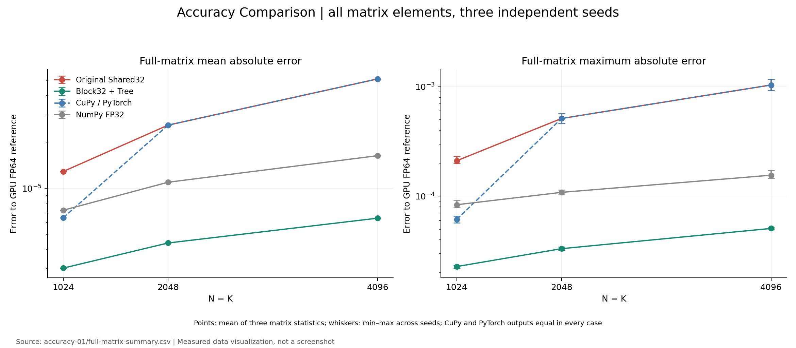
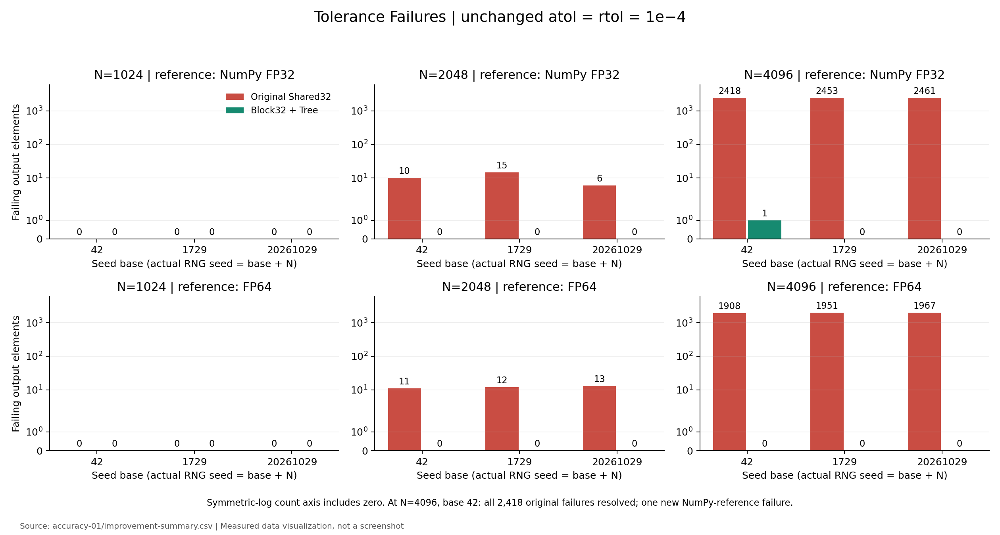
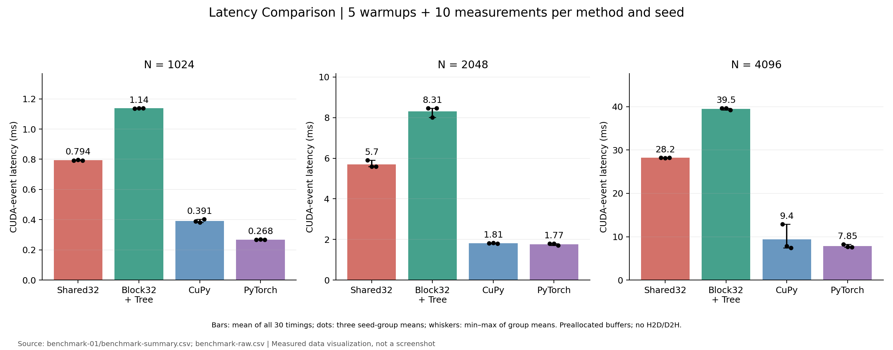
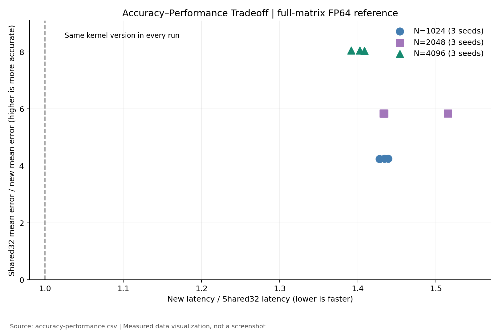
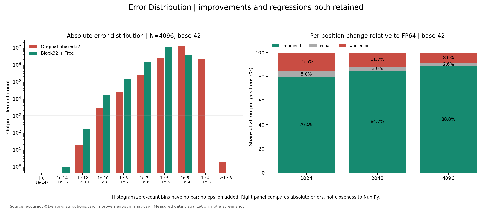
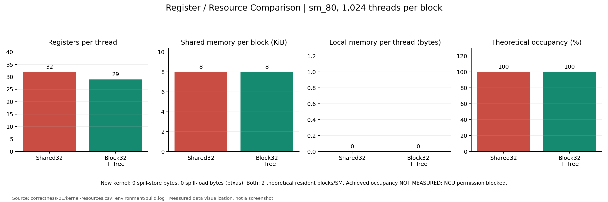
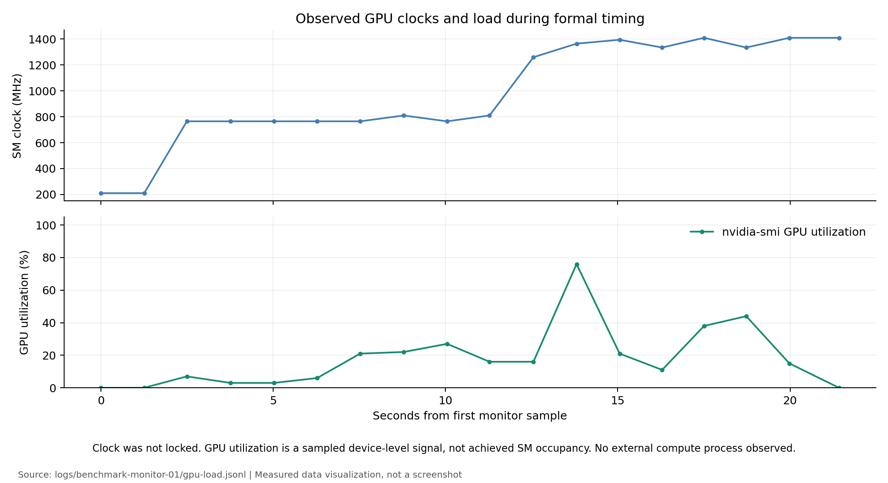

# HyTorch 阶段 3B：Block32 + Tree CUDA GEMM 精度与性能

**实验已完成；独立 Kernel 和 FP64 数值验收 PASS，原 NumPy FP32 标准仍有一个 FAIL，Nsight Compute 为 BLOCKED。** 新方案在全矩阵上提高了精度，但显著增加延迟，不建议直接替换生产默认 GEMM。

日期：北京时间 2026-10-29，原始机器日志保留 UTC。分支 `experiment/gemm-block32-tree`，基线为阶段 3A 的 `3bdd482f1c8e1cece33ff90f8f895feb80151d62`。只实现、编译和测量一个新 Kernel 版本；未修改生产 Kernel、现有 CUDA ABI、默认 runtime dispatch、正式容差或 3A 原始数据。

## 1. 实验状态与十个问题

| 项目 | 状态 | 实测证据 |
|---|---|---|
| 独立 CUDA 编译及运行 | PASS | sm_80 编译、加载、GPU 执行成功 |
| CPU 归约树测试 | PASS | **26 passed / 0 failed / 0 skipped** |
| 小矩阵/边界/抵消语义 | PASS | **12 组、1,376 个元素，与 3A CPU 结果逐位一致** |
| 大矩阵与 3A 语义对照 | PASS | 原种子 1,548 个已有 block32 样本逐位一致 |
| 新 Kernel 对全矩阵 FP64 参考 | PASS | 9 组、66,060,288 个输出位置，相同 `atol=rtol=1e-4` 下 0 超差 |
| 新 Kernel 对原 NumPy FP32 参考 | FAIL | 8 组通过，N=4096 原种子仍有 1 个超差 |
| 正式 CUDA Event 测量 | COMPLETED | 36 组、每组 5 次预热和 10 次测量，360 条原始延迟 |
| Nsight Systems | PASS | 12 个实际 Kernel 区间和资源记录；首次中断及修正记录保留 |
| Nsight Compute / 实测 occupancy | BLOCKED | `ERR_NVGPUCTRPERM`；未提升权限 |

1. **新 Kernel 成功运行**，独立库、独立调用，不接入默认后端。
2. **数值语义一致**：在线二叉归并与 3A 相邻 pairwise tree 完全对应，边界和抵消测试没有逐位差异。
3. **历史原容差超差数量**：N=2048 从 10→0，N=4096 从 2,418→1。旧的 2,418 个位置全部消除，剩下的是一个新增位置，不能写成“旧失败还剩一个”。
4. **相对 FP64 的全矩阵误差**：平均绝对误差降低 4.24–8.05 倍，最大绝对误差降低 8.49–23.34 倍，具体规模/种子见下表。
5. **并非逐点改善**：全部 66,060,288 个位置中，57,832,388 个更准确，1,922,874 个绝对误差相等，6,305,026 个变差。完整逐位置分类已保留并核对。
6. **相对 Shared32 变慢**：同一组输入的平均 event 延迟比为 1.3915–1.5152，即增加约 39.15%–51.52%。没有性能收益。
7. **无 Spill 证据**：新 Kernel ptxas 为 0-byte spill stores/loads、0-byte stack，最终二进制 local memory=0。
8. **资源和瓶颈**：寄存器 32→29，shared memory 都为 8 KiB，理论 occupancy 都为 100%；不是寄存器压力升高造成的明显退化。新增归约、边界判断和编译调度变化有开销，但具体 stall/bandwidth 归因受计数器权限限制。
9. **相比 CuPy/PyTorch**：新 Kernel 全矩阵平均误差更低，但平均 event 延迟约为 CuPy 的 2.82–5.29 倍、PyTorch 的 4.23–5.16 倍。库的版本、TF32 设置、动态时钟和全部样本均记录。
10. **集成建议**：可作为精度优先的候选路径继续评审，当前不宜替换默认后端。仍需正式参考方法决策、K>4096/其他形状及输入覆盖、部署场景的精度需求和性能预算；本轮没有自动推进这些工作。

## 2. 环境、设备和范围

使用项目已有独立 `.venv`，Python 3.8.10、NumPy 1.24.4/OpenBLAS 0.3.21（4 threads）、CuPy 12.3.0、PyTorch 2.4.1+cu121、GCC 9.4.0。Ubuntu 20.04.6，CPU 为双路 EPYC 7763。驱动 535.247.01，Toolkit CUDA 12.2，nvcc V12.2.140；CuPy runtime=12020，Torch wheel build CUDA=12.1。

唯一使用的卡是**物理 GPU 3，A100-PCIE-40GB，40960 MiB**，UUID `GPU-6deac1db-e8b2-558c-0285-ff9639a06a43`，通过 `CUDA_VISIBLE_DEVICES` 映射为逻辑 0。每阶段启动前两次空闲检查，运行中监控外部进程。成功的正确性、全矩阵、正式计时和 Systems 采集均未观察到外部计算进程。最终显存 0 MiB、利用率 0%，见 [释放状态](environment/gpu-after.txt)。

TF32 全部禁用；设置和实际 runtime 元数据见 [精度元数据](results/accuracy-01/summary.json) 与 [计时元数据](results/benchmark-01/summary.json)。没有安装软件、使用 sudo、改系统配置或锁 GPU 时钟，没有使用其他 GPU。本轮不运行 Conv/Pooling/Backward 或自动驾驶任务。

新 Kernel 明确支持 FP32 contiguous row-major 输入、`1<=K<=4096`、非方阵及不完整 Tile。每个输出维护最多 8 个层槽位，块内 `__fmaf_rn`，树节点 `__fadd_rn`；归约证明、编译与资源事实见 [source-analysis.md](source-analysis.md)。

## 3. 完整矩阵输入与参考

测试 N=1024/2048/4096，每种规模使用三个 seed base：42、1729、20261029，实际 NumPy RNG seed 为 base+N。沿用 `default_rng(seed)`，先生成 A、再 B，`standard_normal((N,N), dtype=float32)`。所有方法共享相同输入数值。

对 Shared32、新 Kernel、CuPy、PyTorch 和 NumPy FP32 保存完整输出；GPU FP64 GEMM 为独立参考。另计算 FP64 `abs(A)@abs(B)`，定义消去条件 `sum(abs(a*b))/abs(reference)`。`NEAR_ZERO` 为 `abs(FP64)<=0.01`，`SEVERE_CANCELLATION` 为该条件>=10000；这些阈值只用于分组报告，没有替换验收容差。

4,758 个位置交叉验证 CPU `math.fsum`、CPU FP64 dot 和 GPU FP64，GPU 与 fsum 最大绝对差 `6.304956556846264e-13`。另检查唯一新增 NumPy 失败位置，差 `6.054878820549447e-14`。其中两处极近零参考值在舍入为 FP32 后与 fsum 相差 1/7 ULP，详见 [reference-rounding-differences.csv](results/reference-rounding-differences.csv)；因此 ULP 相对于记录的 GPU FP64 舍入参考定义，不把它当作无限精度真值。

以下平均/最大误差、失配数量、改善/退化数量均来自**全部矩阵元素**。只有 fsum 交叉核查与旧 CPU 样本复用是抽样，二者不混淆。

## 4. 全矩阵精度结果

原种子（base 42）相对 FP64 的结果：

| N | Shared32 平均绝对误差 | 新 Kernel 平均绝对误差 | 平均误差降低倍数 | Shared32 最大绝对误差 | 新 Kernel 最大绝对误差 | 最大误差降低倍数 |
|---|---:|---:|---:|---:|---:|---:|
| 1024 | 1.28910391e-5 | 3.02677254e-6 | 4.2590× | 1.98453899e-4 | 2.33637787e-5 | 8.4941× |
| 2048 | 2.57362570e-5 | 4.40772763e-6 | 5.8389× | 4.61792476e-4 | 3.29043297e-5 | 14.0344× |
| 4096 | 5.14538573e-5 | 6.39175800e-6 | 8.0500× | 1.18034329e-3 | 5.05813383e-5 | 23.3355× |

跨三个种子的平均误差改善范围分别为 4.2447–4.2590、5.8389–5.8445、8.0480–8.0516 倍，方向一致。最大误差改善范围分别为 8.4941–10.4925、14.0344–16.5312、17.9522–23.3355 倍。完整 RMSE、relative L2、ULP P50/P95/P99/max、最大位置及两种参考下的统计见 [full-matrix-summary.csv](results/accuracy-01/full-matrix-summary.csv)。

| N | seed base | 原 NumPy 参考：旧→新超差 | FP64 参考：旧→新超差 |
|---|---:|---:|---:|
| 1024 | 42 / 1729 / 20261029 | 各 0→0 | 各 0→0 |
| 2048 | 42 | 10→0 | 11→0 |
| 2048 | 1729 | 15→0 | 12→0 |
| 2048 | 20261029 | 6→0 | 13→0 |
| 4096 | 42 | 2418→1 | 1908→0 |
| 4096 | 1729 | 2453→0 | 1951→0 |
| 4096 | 20261029 | 2461→0 | 1967→0 |

始终使用 `abs(actual-ref)<=1e-4+1e-4*abs(ref)`，在 FP64 中计算误差/阈值；没有改原 benchmark。CuPy 与 PyTorch 在全部九组中数值完全一致；N=2048/4096 也与原 Shared32 一致。N=1024 库输出不同于 Shared32，新 Kernel 的平均误差约比 CuPy/PyTorch 低 2.12–2.13 倍；大两个规模约低 5.84 和 8.05 倍。

原种子逐位置结果：

| N | 更准确 | 绝对误差相等 | 变差 | 变差比例 |
|---|---:|---:|---:|---:|
| 1024 | 832,833 | 52,678 | 163,065 | 15.55% |
| 2048 | 3,550,808 | 152,807 | 490,689 | 11.70% |
| 4096 | 14,893,234 | 435,507 | 1,448,475 | 8.63% |

其他两个种子的变差比例非常接近，均明确保留，不能将平均精度收益描述为逐点单调改善。所有 66,060,288 个位置有无损分类图，并从保存的完整输出重新逐元素核对，见 [map-audit.csv](results/map-audit.csv)。

### 唯一新增 NumPy 失败位置

N=4096、seed=4138、位置 **(4081,3777)**：

| 值 | 输出 | 相对 CPU fsum 的绝对误差 |
|---|---:|---:|
| CPU fsum | -0.03898794417308567 | — |
| GPU FP64 | -0.038987944173146216 | 6.05e-14 |
| NumPy FP32 | -0.03889346122741699 | 9.44829457e-5 |
| Shared32 / CuPy / PyTorch | -0.038959190249443054 | 2.87539236e-5 |
| Block32 + Tree | -0.03899955749511719 | **1.16133220e-5** |

新结果比旧结果更准确，但与 NumPy 差 `1.0609626770019531e-4`，超过允许的 `1.0388934612274171e-4`。所以原标准的 **FAIL 必须保留**；它不能被解释为新 Kernel 在该点的真实误差增加。详细数据见 [introduced-failure-fsum.csv](results/introduced-failure-fsum.csv)。

## 5. 性能、资源和限制

基础语义通过、九组完整精度评估结束后才开始计时。每组 5 次预热、10 次 event 测量；三种子各自独立，不把 H2D/D2H 包含在 GPU 区间。方法顺序按矩阵 case 循环轮换；预分配所有输入输出。计时结束后的 36 组输出再次与精度阶段原始矩阵精确比较，均相等。

原种子每组十次的平均延迟（ms）：

| N | Shared32 | Block32 + Tree | CuPy | PyTorch | 新/旧延迟 |
|---|---:|---:|---:|---:|---:|
| 1024 | 0.792576 | 1.136640 | 0.387994 | 0.267264 | 1.4341× |
| 2048 | 5.906739 | 8.468070 | 1.805824 | 1.801114 | 1.4336× |
| 4096 | 28.258816 | 39.637196 | 12.905165 | 8.254464 | 1.4026× |

三个种子的新/旧延迟范围为：1024 **1.4279–1.4388×**，2048 **1.4327–1.5152×**，4096 **1.3915–1.4084×**。准确性随 K 的收益增加，延迟代价始终明显，范围不呈严格单调关系。

[benchmark-raw.csv](results/benchmark-01/benchmark-raw.csv) 保留全部 360 次延迟；[benchmark-summary.csv](results/benchmark-01/benchmark-summary.csv) 保留 mean/median/sample-std/P95/GFLOPS 与相对三个基线的速度比。GFLOPS 统一按 `2*N^3/time` 计算有效矩阵乘工作量，没有把新树节点额外操作加进分子。

设备时钟没有锁定，监控中 SM clock 为 210–1410 MHz，含初始化/空闲阶段；正式各组前后状态见 [group-load.json](results/benchmark-01/group-load.json)。例如 CuPy N=4096 原种子的 mean=12.905 ms，另两种子为 7.874/7.416 ms；该组前后时钟为 795/1260 MHz，不能把 seed 当成造成性能变化的唯一原因。N=1024 的库测量波动也较大。全部保留，不删慢样本或补做挑选性的快速结果。Event 区间排除了传输，但短 Kernel 仍可能受到 host 提交间隙和动态时钟影响；这些是本次共享环境协议的实测值，不是固定时钟下的峰值性能。

新 Kernel 29 寄存器/线程（原 32），0 Spill、0 Local Memory，shared memory 8192 B，与原实现相同。理论两个 1024-thread block/SM、理论 100% 驻留比例没有降低。NCU 返回 `ERR_NVGPUCTRPERM`，因此没有实测 occupancy、stall 或带宽效率。静态指令数、分支和共享加载指令增加；源码中每 Tile 仍为两次屏障，树合并为线程内计算。不能把开销归咎于未测得的 occupancy 下降。

成功 NSYS capture 的 12 个 Kernel 及资源见 [kernel-intervals.csv](results/nsys-02/kernel-intervals.csv)，Shared32/new 的平均时长分别约 26.93/40.60 ms。该独立插桩结果支持存在真实 Kernel 执行开销，不能与非插桩 benchmark 混用，也没有进行第二版优化或定量瓶颈消融。

## 6. 问题与修正记录

没有修改新 Kernel 的第一版算法，也没有修复生产 CUDA。唯一代码修正发生在实验进程监控：第一次 NSYS 将应用放进新进程组，监控误判为外部负载并中断，wrapper exit=75，未生成完整 capture。旧监控源码保留在 [run_gpu-before-nsys-fix.py](logs/run_gpu-before-nsys-fix.py)，原始记录见 [nsys-monitor-01](logs/nsys-monitor-01/)。

修正为检查子进程继承的本轮专用标记，识别自有的独立进程组；不记录进程环境内容。第二次相同参数采集确认多个自有子进程确实处于其他进程组，外部进程数为 0，最终成功。见 [nsys-monitor-02](logs/nsys-monitor-02/)。没有放宽对其他用户 GPU 进程的保护。

其他限制：本轮只测一个硬件/软件环境、三个规模及三组矩阵；原型 K 上界为 4096；极近零的 FP64 参考仍有可见于 ULP 的不确定性；正式 NumPy 标准有 1 个失败；实际 occupancy 无权限测量。下一步应由人工决定参考方法和是否需要可选精度路径，不直接把它作为默认性能优化集成。

## 7. 文件、原始数据与图像索引

所有命令见 [commands.md](commands.md) 和 [command-records.md](command-records.md)。完整文件及字节数见 [file-index.tsv](file-index.tsv)；大型服务器原始文件见 [raw-file-index.tsv](raw-file-index.tsv)。未进行哈希或 checksum 验证。

| 路径（相对本报告） | 内容 |
|---|---|
| [独立实现](../../../experiments/gemm_block32_tree/) | Kernel、独立编译、绑定、CPU tree 与测试 |
| [environment/](environment/) | CPU/软件环境、build.log/json、原库编译配置、GPU 释放记录 |
| [results/correctness-01/](results/correctness-01/) | 12 组结果、全部小矩阵输出、资源 CSV、GPU 元数据 |
| [results/accuracy-01/](results/accuracy-01/) | 135 行全矩阵/分组指标、误差分布、全部超差及最大位置、参考交叉核查、框架比较、逐位置改善图 |
| [error-positions.csv](results/accuracy-01/error-positions.csv) | 各方法对任一参考超差位置的并集及最大误差位置；保留所有方法值、两种误差、判断及消去条件 |
| [max-error-inputs.json.gz](results/accuracy-01/max-error-inputs.json.gz) | 各方法最大误差位置对应的完整 A 行/B 列、输出及参考；从 full-matrix-summary 的坐标关联 |
| `results/accuracy-01/*-improvement-map.bin.gz` | 每个输出位置两位无损分类：0=变差、1=相等、2=改善，相对 FP64；不是只有抽样点 |
| [read_change_map.py](scripts/read_change_map.py) | 公开逐位置分类图的读取器 |
| [results/benchmark-01/](results/benchmark-01/) | 360 次 raw timing、36 组 summary、clock/load、计时后输出核查 |
| [results/nsys-02/](results/nsys-02/) | 原始工具汇总 CSV、全部 12 个 Kernel 区间和资源 |
| [results/accuracy-performance.csv](results/accuracy-performance.csv) | 各规模/种子的精度倍数、性能代价及退化比例 |
| [results/audit.json](results/audit.json)、[map-audit.csv](results/map-audit.csv) | 全部位置分类重算核查、异常点 fsum、SASS 统计、参考舍入差异 |
| [logs/](logs/) | 每次编译、CPU 测试、GPU 运行、采集失败与成功、分析和作图的完整日志 |
| [scripts/](scripts/) | 执行、汇总、作图和索引脚本 |

完整 A/B、FP64 参考、`sum_abs_products`、五种方法输出和逐位置分类原始数组共 **2,972,724,480 字节**，保存在服务器 `/home/xymo/projects/hytorch/runs/gemm_block32_tree_accuracy_raw_01/`，不上传约 3 GB 的矩阵文件。Git 中保留逐位置无损分类、全部失败和最大误差点原始数值、完整指标与索引；任意位置的具体数值可由服务器原数组直接读取。与只保存摘要不同，所有矩阵数值和每个位置的改善/退化都有保留。

未脱敏进程监控位于 `/home/xymo/projects/hytorch/runs/gemm_block32_tree_*_monitor_*/`。公开副本去除 PID，保留进程数量、外部/自有进程判断、GPU 原始数值和完整终端日志。`.nsys-rep` 和 SQLite 保存在 `/home/xymo/projects/hytorch/runs/gemm_block32_tree_nsys_02.*`。独立动态库在 `runs/gemm_block32_tree_build_01/`。没有上传大二进制、权重、数据集或凭据。

下列 PNG 均由真实 CSV/JSON 生成，图内注明来源，均非终端截图：

1. [Accuracy Comparison](figures/accuracy-comparison.png)
2. [Tolerance Failures](figures/tolerance-failures.png)
3. [Latency Comparison](figures/latency-comparison.png)
4. [Accuracy–Performance Tradeoff](figures/accuracy-performance-tradeoff.png)
5. [Error Distribution](figures/error-distribution.png)
6. [Register / Resource Comparison](figures/register-resource-comparison.png)
7. [GPU 时钟与负载](figures/hardware-monitor.png)

