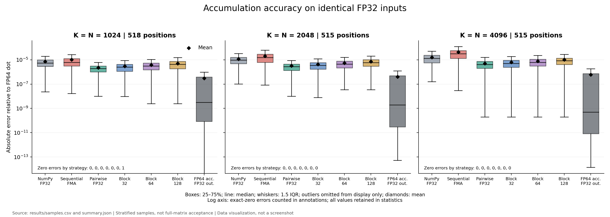
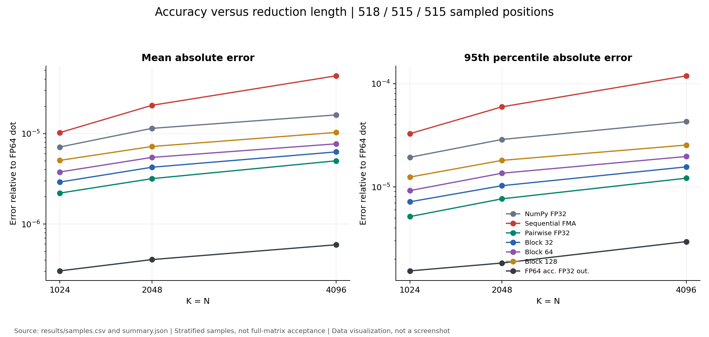
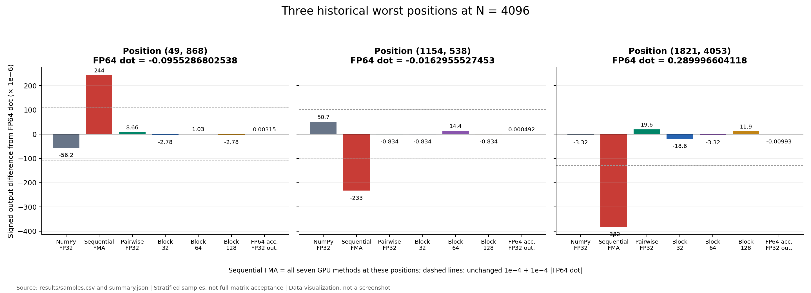
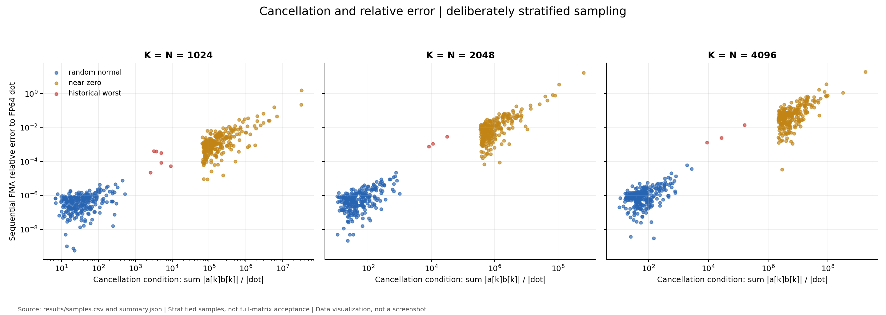

# HyTorch 阶段 3A：GEMM FP32 累加精度诊断

**状态：诊断完成，CPU 与 GPU 对照均已执行。原 N=2048/4096 验收失败仍然保留。** 本轮建立了可复现的精度归因和候选累加策略证据；没有修改生产 CUDA Kernel、benchmark 容差或历史实验报告，没有执行性能优化或其他阶段。

实验日期：2026-10-29 UTC。起点为最新远程 `experiment/a100-gpu-complete` 的 `aad4d0562fd968083a727099e478e7db64d35dd0`；提交分支为 `experiment/gemm-fp32-accuracy`。本目录的 Git 提交即结果版本。完整操作记录见 [commands.md](commands.md)，源码证据见 [source-analysis.md](source-analysis.md)。

## 1. 主要结论

1. **大 K 失败的主要原因是长链 FP32 累加舍入，严重消去使相对误差放大，且 NumPy FP32 参考本身也有舍入误差。** 五个自研实现均为单累加器按 K 递增，已编译代码存在 FP32 FMA；全部 1,548 个抽样位置都精确复现 CPU `libm.fmaf`。N=2048/4096 的 CuPy、PyTorch、自研结果全矩阵数值一致，超差分别为 10 和 2,418 个。
2. **NumPy FP32 不适合作为唯一数值真值。** 在 N=4096 的 515 个样本中，以原参数分别对 NumPy FP32 和 FP64 dot 判定，10 个顺序 FMA 结果改变结论：4 个 NumPy 通过但 FP64 不通过，6 个反过来。完整位置、输出、参考和误差见 [reference-decision-disagreements.csv](results/reference-decision-disagreements.csv)。
3. **FMA 改善每一步舍入，但不能消除 K 次依赖累加的误差。** 多个大幅度正负项抵消后，结果可能很小，途中积累的绝对误差就会成为较大的相对误差。不是“FMA 导致错误”或“所有 GPU 算法都有同一个索引 bug”。
4. **Pairwise 在本轮三个规模均改善平均精度**，相对 FP64 的平均绝对误差比顺序 FMA 低 4.66、6.46、8.69 倍。但逐点仍有 89/518、48/515、47/515 个样本变差，不能保证任意输入都优于 FMA。
5. **三个分块方案均改善平均精度，块长 32 最好**，平均绝对误差降低 3.52、4.83、6.93 倍。它不是每个位置的最优块长：例如 N=4096 的历史异常位置 (1821,4053)，block64 比 block32 更准确。
6. **FP64 累加再输出 FP32 将平均绝对误差降低 33.73、50.70、73.66 倍**，剩余误差主要受到 FP32 输出量化约束。这是高精度对照，不作为默认部署实现。
7. **框架差异依赖规模。** N=2048/4096，七个 GPU 方法两两全矩阵差异均为零。N=1024，CuPy=PyTorch，自研五个变体相等，但两组间有 996,036 个元素数值不同，最大绝对差 `2.0599365234375e-4`，仍全矩阵满足原容差。
8. **本轮没有发现自研 GEMM 独立于 CuPy 的数值错误证据。** 这是对这些固定输入和抽样 FP64 参考的结论，不是对任意矩阵的无条件正确性证明。
9. **建议优先研究 block32 局部 FMA + 平衡树 FP32 合并**，同时以纯 Pairwise 作为另一条精度改进路线。纯 Pairwise 在本轮 FP32 候选中平均误差最小；分块方案保留局部 FMA、部分和更少，可能更便于嵌入现有结构。成本与可行性分析见源码报告，本轮没有测速度或替换 Kernel。
10. **建议下一次评审调整参考方法，暂不修改正式标准。** 保留 NumPy FP32 作为框架一致性对照，增加 FP64 dot/补偿求和参考；分别报告绝对、相对、ULP 与消去条件，并研究以 `sum(abs(a*b))` 为尺度的误差指标。容差是否调整，应依据误差模型、任务需求和额外输入验证决定，不能仅为使当前结果通过而放宽。

## 2. 环境与设备

| 项目 | 实测记录 |
|---|---|
| OS / CPU | Ubuntu 20.04.6，2 × AMD EPYC 7763，256 logical CPUs |
| Python 环境 | 项目已有独立 `.venv`，Python 3.8.10；本轮未安装软件 |
| NumPy / BLAS | NumPy 1.24.4，OpenBLAS 0.3.21，Zen core，4 threads |
| GPU | 物理 GPU **2**，A100-PCIE-40GB，40960 MiB |
| GPU UUID → 逻辑编号 | `GPU-158426a4-6684-7863-8cbe-ed6595f97683` → `cuda:0` |
| 驱动 / Toolkit / nvcc | 535.247.01 / CUDA 12.2 / V12.2.140 |
| CuPy | 12.3.0，实测 runtime 12020（12.2），FP32 compute type 1 |
| PyTorch | 2.4.1+cu121，wheel build CUDA 12.1 |
| TF32 | `CUPY_TF32=0`、`NVIDIA_TF32_OVERRIDE=0`，Torch matmul/cuDNN 均 false；cuBLAS math mode 前后均 0 |
| 编译器 / 动态库 | GCC 9.4.0；读取已有 sm_80 动态库，无重新编译 |

CPU 阶段先完成，且 `CUDA_VISIBLE_DEVICES` 为空。之后连续两次 GPU 检查确认 GPU 2 显存 0、利用率 0、计算进程 0；启动器再次检查空闲，再只暴露这一张卡。GPU 对照从 07:07:02 到 07:07:15 UTC 完成，返回码 0。11 次监控采样最多观察到本实验 1 个进程，最大显存 959 MiB、利用率 24%；这些是运行占用记录，**不能用于 GEMM 性能排名**。结束后的设备记录为显存 0 MiB、利用率 0%。

证据：[CPU 环境](environment.txt)、[空闲检查](evidence/gpu-availability.json)、[GPU 启动与监控](evidence/gpu-monitor-01/)、[GPU 元数据](results/gpu-01/gpu-summary.json)、[结束后的设备环境](evidence/gpu-environment-after.txt)。没有使用 sudo、修改系统配置或使用其他 GPU。

## 3. 输入、抽样和参考方法

所有策略使用相同 FP32 输入：`rng=np.random.default_rng(42+N)`，依次 `standard_normal((N,N), dtype=np.float32)` 生成 A、B。与旧数据中的 NumPy FP32 输出逐点精确复现。

每个规模选取所有历史最差唯一位置、NumPy 输出绝对值最小的 256 个位置、以及 256 个随机正常位置（`abs(NumPy)>1`，样本 RNG 为 `1000000+42+N`，位置不重复）。历史位置源于原诊断各方法的最大“误差/容差”位置，**不一定是最大绝对误差位置**。

| N=K | 历史最差 | 接近零 | 随机正常 | 合计 |
|---|---:|---:|---:|---:|
| 1024 | 6 | 256 | 256 | 518 |
| 2048 | 3 | 256 | 256 | 515 |
| 4096 | 3 | 256 | 256 | 515 |

共 1,548 个位置、7 种 CPU 策略，保存 10,836 行结果；相同位置的 7 种 GPU 方法另保存 10,836 行。样本有意偏重近零和历史异常，不是均匀随机总体估计。三个规模使用各自原 benchmark 种子，覆盖不同输入点积，但每个规模只有一组矩阵；没有完成多随机矩阵、病态分布、非方阵或更大 K 的推广验证。

独立参考是将原 FP32 行列精确转为 FP64 后 `np.dot`。逐点以 `math.fsum` 对 FP64 乘积交叉核查，最大差 `8.526512829121202e-14`，转换 FP32 后 **0 个不一致**。未计算整个 4096×4096 FP64 矩阵乘法。

CSV 保留每种算法输出、FP64 dot、fsum、顺序 FP64 转换前结果、绝对误差、相对误差、与 NumPy 的误差、ULP、两种参考下的原容差判断及 `sum_abs_products`。`near_zero_fp64` 定义为 `abs(FP64 dot)<=0.01`；近零相对误差单独标识，不以其大数值单独判断实现错误。ULP 为相对于 `round32(FP64 dot)` 的有序 binary32 表示距离，统一正负零；跨零时可很大，不能脱离绝对误差解读。

## 4. 候选策略的真实误差

以下是**抽样相对 FP64 dot 的平均绝对误差**，不是全矩阵统计；所有中间 FP32 运算均显式指定精度。

| 策略 | K=1024 | K=2048 | K=4096 |
|---|---:|---:|---:|
| NumPy FP32 | 7.09918e-6 | 1.14193e-5 | 1.60683e-5 |
| 顺序 FP32 FMA | 1.02414e-5 | 2.05201e-5 | 4.34819e-5 |
| FP32 Pairwise | **2.19843e-6** | **3.17480e-6** | **5.00128e-6** |
| 块内 FMA + 树归约，32 | 2.91088e-6 | 4.24419e-6 | 6.27354e-6 |
| 块内 FMA + 树归约，64 | 3.76062e-6 | 5.45423e-6 | 7.70548e-6 |
| 块内 FMA + 树归约，128 | 5.05457e-6 | 7.19813e-6 | 1.03022e-5 |
| FP64 累加 → FP32 输出 | 3.03616e-7 | 4.04747e-7 | 5.90328e-7 |

改善也出现在各抽样类别，而非只靠少量异常位置拉低总体均值。例如 Pairwise 对近零位置的平均误差改善为 3.35/5.81/6.81 倍，对随机正常位置为 5.63/6.70/10.03 倍；block32 分别为 2.52/4.12/5.61 和 4.23/5.22/7.70 倍。历史最差点数量少，单列保留，不据此推广总体。

Pairwise 逐点更好/相等/更差的数量分别为 `412/17/89`、`451/16/48`、`461/7/47`。其中“比顺序 FMA 更接近 NumPy，但反而离 FP64 更远”的位置分别有 36、16、15 个，直接表明优化 NumPy 一致性不等于优化真实精度。分块 32 也有此现象，分别为 37、36、28 个。

FP64 累加转 FP32 后，相对舍入后的参考最大 ULP 为 0/0/1。4096 存在 1 ULP 差，说明独立顺序 FP64 累加本身仍可能有舍入效应；不把它称为精确算术。

| 顺序 FMA 抽样验收 | K=1024 | K=2048 | K=4096 |
|---|---:|---:|---:|
| 超出原 NumPy FP32 容差 | 0/518 | 3/515 | 14/515 |
| 相同参数、以 FP64 dot 为参考 | 0/518 | 3/515 | 12/515 |
| Pairwise / 各分块 / FP64 输出：两种参考下超差数 | 各 0/518 | 各 0/515 | 各 0/515 |

最后一行仅是候选策略的样本结果，**不能描述为候选 Kernel 全矩阵通过**。原正式容差仍为 `abs(actual-reference)<=1e-4+1e-4*abs(reference)`，诊断用 FP64 计算差值与阈值，未改动生产验收。

消去条件定义为 `sum(abs(a[k]*b[k]))/abs(FP64 dot)`。近零类别的条件中位数约为 `1.42e5 / 6.75e5 / 4.82e6`，随机正常类别为 `29.70 / 41.61 / 59.69`。顺序 FMA 对原 NumPy 参考的抽样失败均落在历史最差或近零类别，随机正常类别每个规模均 0/256 失败。这支持消去解释，但选样本身偏向这些位置，因此不是全矩阵失败分布的无偏统计。

## 5. GPU 全矩阵对照与抽样精度

7 个 GPU 方法为 CuPy、PyTorch、Basic、Blocked16/32、Shared16/32。对每个 N，保存它们与 NumPy 的 7 条比较以及 GPU 方法两两的 21 条比较，共 84 条全矩阵记录。

| N | 每个矩阵元素数 | 各 GPU 方法相对 NumPy 的超差数 | CuPy vs PyTorch | CuPy vs 任一自研：不等元素 / 最大绝对差 |
|---|---:|---:|---|---|
| 1024 | 1,048,576 | 均 0 | 全部数值相等 | 996,036 / 2.0599365234375e-4 |
| 2048 | 4,194,304 | 均 10 | 全部数值相等 | 0 / 0 |
| 4096 | 16,777,216 | 均 2,418 | 全部数值相等 | 0 / 0 |

五个自研变体在三个 N 均全矩阵数值相等。这里的“相等”是 FP32 数值比较，不是二进制文件校验或哈希验证。N=1024 的组间最大差仍可通过原相对/绝对组合容差，不能单看 `max_abs > 1e-4` 就判失败。

全部自研抽样位置均与 CPU 顺序 FMA 相等。CuPy/PyTorch 的 N=1024 抽样中 498/518 个位置与顺序 FMA 不等，最大差 `1.068115234375e-4`；其相对 FP64 的平均绝对误差 `5.992679804219489e-6`，小于自研的 `1.024140550861774e-5`。N=2048/4096 的所有 GPU 抽样输出均与顺序 FMA 相等。

数据：[全矩阵比较](results/gpu-01/full-matrix-comparisons.json)、[逐 GPU 样本](results/gpu-01/gpu-samples.csv)、[各方法完整失败坐标](results/gpu-01/)、[原始终端输出](evidence/gpu-monitor-01/benchmark.log)。所有全矩阵结论只涉及 GPU 之间或与 NumPy 的比较；没有全矩阵 FP64 真值。

## 6. 实验脚本修正、测试与限制

生产 CUDA 没有发现需修复的独立 bug，没有修改生产源码。新诊断脚本开发中出现并保留了三类问题：

| 问题 | 原因与修正 | 修正前记录 | 修正后记录 |
|---|---|---|---|
| 新脚本导入 SyntaxError | `accuracy.py` 汇总表达式缺一个右括号；补齐 | arithmetic-tests.log/xml，diagnosis.log | arithmetic-tests-02.log/xml：**4 passed，0 failed，0 skipped** |
| CPU 汇总 JSON 写出失败 | NumPy 布尔值计数产生 `np.int64`，json 无法序列化；计数前转 Python bool | diagnosis-02.log；cpu-summary.json.partial | diagnosis-03.log，completed-03/：完成；两次 10,836 行数值全部相等 |
| 首次画图拒绝零误差 | 对数图检查发现一个精确零误差；改为标注零误差数量，统计仍保留所有值 | figures.log | figures-02.log：完成四张图 |

语义测试验证 FMA 与先舍入乘积的区别、奇数长度树归约/分块、跨正负值的 ULP 映射，以及 Pairwise 不一定逐点更好的反例。最终 [audit.json](results/audit.json) 检查样本有限值、重复实验一致性、GPU/CPU FMA 一致性及两种参考判定差异，状态 COMPLETED。

GPU 导入日志中的“未找到 scipy，无法加载 SVHN 数据集”是仓库已有可选数据集提示；本任务未加载数据集，计算正常完成，没有增加 fallback 或安装 scipy。所有失败日志均保留；没有把失败尝试或原验收超差写成通过。

仍待人工评审：参考方法的正式设计；多随机种子、其他分布/形状和更长 K 的覆盖；CUDA 候选的实际实现及资源成本；OpenBLAS/cuBLAS 内部确切归约路径。本轮完成后停止，不自动执行这些工作，也不据 CPU 诊断耗时宣称 CUDA 加速收益。

## 7. 图像与全部数据路径

以下四图均由实际 CSV/JSON 生成，图内标注来源，**不是终端截图**：

- [各策略绝对误差分布](figures/absolute-errors.png)
- [误差随 K 变化](figures/error-vs-k.png)
- [4096 历史异常位置与 FP64 的差异](figures/historical-worst.png)
- [消去条件与相对误差](figures/cancellation.png)

服务器项目绝对路径为 `/home/xymo/projects/hytorch`，实际挂载路径为 `/srv/lab-disks/disk2/users/xymo/projects/hytorch`。

| 文件 / 目录（相对本报告） | 内容与状态 |
|---|---|
| [commands.md](commands.md)、[command-records.md](command-records.md) | 执行方法，以及逐条真实命令、时间、退出码、日志链接 |
| [environment.txt](environment.txt)、[evidence/](evidence/) | 环境、GPU 空闲/运行/释放记录、已有编译配置、PTX/SASS；不包含动态库本体 |
| [results/samples.csv](results/samples.csv) | 10,836 行 CPU 数值；来自第 2 次运行已完成的数值部分，与第 3 次完全相等 |
| [results/sample-positions.json](results/sample-positions.json) | 1,548 个位置、参考值、输入重建信息关联 |
| [results/completed-03/](results/completed-03/) | 第 3 次完整成功的 CPU 原始输出、参考及汇总 |
| [results/summary.json](results/summary.json) | 最终合并 CPU/GPU 汇总，gpu_status=EXECUTED |
| [results/cpu-analysis.json](results/cpu-analysis.json) | GPU 执行前的真实阶段性快照，gpu_status=NOT_RUN；不代表最终状态 |
| [results/gpu-01/](results/gpu-01/) | GPU 样本、全矩阵差异、21 份完整失败坐标 CSV（无失败时仅表头） |
| [results/reference-decision-disagreements.csv](results/reference-decision-disagreements.csv) | 10 个 NumPy 与 FP64 参考验收结论相反的位置 |
| [results/](results/) 下所有 .log / .command.json / .xml / .partial | 失败与成功的全部原始日志、命令、测试结果，包括最初 diagnosis.log |
| [scripts/](scripts/) | 独立计算、汇总、GPU 对照、语义测试、数据核查、绘图、证据索引脚本 |
| [figures/](figures/) | 四张 PNG 数据可视化 |
| [file-index.tsv](file-index.tsv) | 本轮文件完整索引与字节数，不含任何哈希 |

全部公开实验文件位于 `/home/xymo/projects/hytorch/docs/experiments/gemm-fp32-accuracy/`，随本分支提交。原始未脱敏 GPU 进程监控还保存在服务器 `/home/xymo/projects/hytorch/runs/gemm_accuracy_gpu_monitor_01/`；Git 中的对应监控副本去除了 PID，但保留进程数量、是否观测到实验进程、所有 GPU 数值和原始终端输出。没有上传权重、数据集、完整矩阵、密钥或二进制构建产物。
